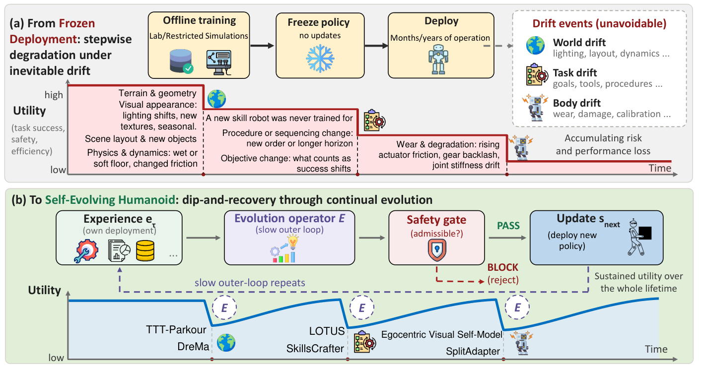

# 具身智能 RSI：值得关注的工作

仅选取本领域最新、与 RSI 关联最紧密的 3 篇工作；编号与「领域内发展状况.md」索引表一致。研究问题与核心方法为英文摘要的中文概括，不对实验数值作任何推断；方法架构图取自 arXiv 官方 HTML 版中的论文原图。

## 1. Self-Evolving AI for Humanoids: Mechanisms, Safety, and Evaluation of Post-Deployment Self-Improvement（2026）

- **研究问题**：人形机器人正成为具身智能的重要载体，强化学习运动控制、世界模型预测与视觉-语言-动作模型推动了通用控制能力的发展。
- **核心方法**：作者主张评价体系应跟踪机器人持续演化的轨迹而非固定检查点，并指出目前缺少面向自进化人形机器人的专用基准。
- **RSI 价值**：改进对象：上下文、提示与记忆结构；反馈闭环：是；多轮迭代：是；分类 L2；定位：直接 RSI（候选）。
- **值得关注的原因**：2026 年工作，在本领域 50 篇收录论文中 RSI 关联度评分位列前段；其主攻方向为上下文与记忆进化，与「系统自主改进自身并参与下一轮改进」这一核心问题直接相关，但摘要层面尚不足以证明稳定的跨代递归闭环，需回到原文实验部分核实。
- **原文与全文**：[官方论文页](https://arxiv.org/abs/2609.13236) ｜ [arXiv:2609.13236](https://arxiv.org/abs/2609.13236) ｜ [本地 PDF](docs/2026_Self_Evolving_AI_for_Humanoids_Mechanisms_Safety.pdf)
- **发表渠道**：arXiv preprint（预印本，未经同行评审）

*图：论文方法 / 框架图（取自 arXiv 官方 HTML 版的原图）。来源：[arXiv 官方 HTML 版原图](https://arxiv.org/html/2609.13236v1/Presentation1.png)*

## 2. MobiAgent: Dual-Loop Recursive Policy Self-Improvement for Long-Horizon Mobile Manipulation（2026）

- **研究问题**：长时程移动操作面临执行误差不断累积、以及移动底盘与机械臂控制之间相互干扰的难题。
- **核心方法**：提出 MobiAgent 双环智能体框架，把稳健的实际部署执行与策略的递归自我改进连接起来。
- **RSI 价值**：改进对象：可复用技能/工具库；反馈闭环：是；多轮迭代：是；分类 L3；定位：直接 RSI（候选）。
- **值得关注的原因**：2026 年工作，在本领域 50 篇收录论文中 RSI 关联度评分位列前段；其主攻方向为技能进化，与「系统自主改进自身并参与下一轮改进」这一核心问题直接相关，但摘要层面尚不足以证明稳定的跨代递归闭环，需回到原文实验部分核实。
- **原文与全文**：[官方论文页](https://arxiv.org/abs/2610.03476) ｜ [arXiv:2610.03476](https://arxiv.org/abs/2610.03476) ｜ [本地 PDF](docs/2026_MobiAgent_Dual_Loop_Recursive_Policy_Self_Improvement.pdf)
- **发表渠道**：CoRL（作者注明：Accepted at the Conference on Robot Learning (CoRL) 2026. Project page）

*图：论文方法 / 框架图（取自 arXiv 官方 HTML 版的原图）。来源：[arXiv 官方 HTML 版原图](https://arxiv.org/html/2610.03476v1/teaser_1.png)*

## 3. A Survey of Self-Evolving Embodied Agents: On the Path to Real-World Physical Intelligence（2026）

- **研究问题**：具身智能正在从静态任务执行，转向能通过与物理世界交互而持续适应、学习与改进的智能体。
- **核心方法**：系统梳理大语言模型、视觉语言模型、机器人基座模型、VLA 与世界模型如何提升感知、推理与行动能力，并归纳自进化机制与安全评估。
- **RSI 价值**：改进对象：Agent 规划、决策与协作机制；反馈闭环：是；多轮迭代：是；分类 L4；定位：直接 RSI（候选）。
- **值得关注的原因**：2026 年工作，在本领域 50 篇收录论文中 RSI 关联度评分位列前段；其主攻方向为Agent 机制进化，与「系统自主改进自身并参与下一轮改进」这一核心问题直接相关，但摘要层面尚不足以证明稳定的跨代递归闭环，需回到原文实验部分核实。
- **原文与全文**：[官方论文页](https://doi.org/10.20944/preprints202611.0739.v1) ｜ 本地 PDF 未获取
- **发表渠道**：Preprints.org（预印本，未经同行评审）
