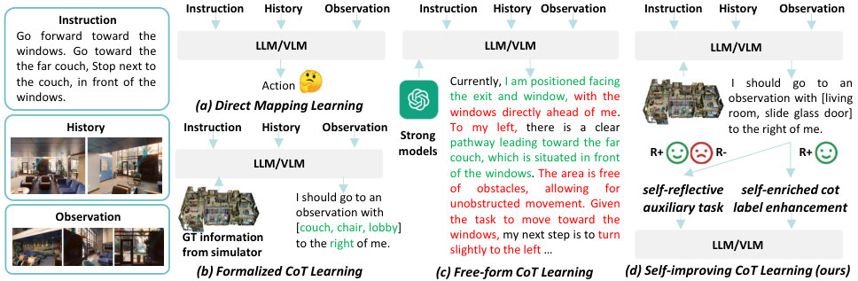
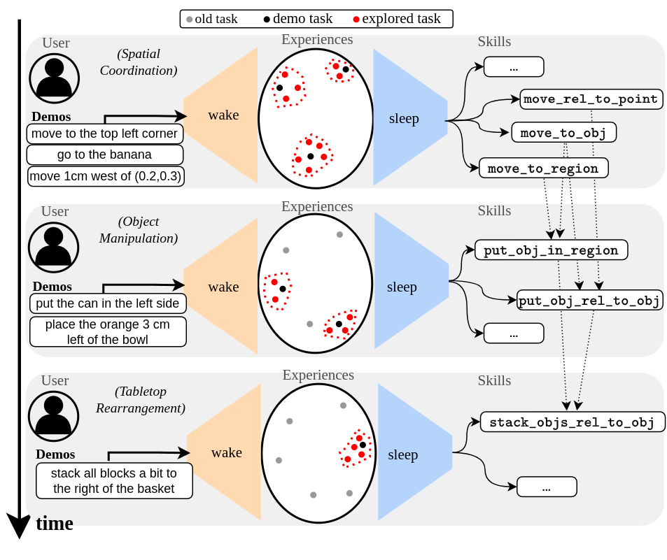

# 具身智能 RSI：值得关注的工作

仅选取 3 篇最新、与 RSI 关联最紧密的工作。研究问题与核心方法为英文摘要的中文概括，不推断实验数值；方法架构图取自 arXiv 官方 HTML 版论文原图。若条目来自补充层，会明确标注其未经同行评审。

## 1. EvolveNav: Empowering LLM-Based Vision-Language Navigation via Self-Improving Embodied Reasoning（2026）

- **研究问题**：已有研究表明，训练开源大语言模型可释放其推理能力、提升视觉-语言导航表现并缓解领域差异，但现有做法在适应性与泛化上仍有不足。
- **核心方法**：提出 EvolveNav，一种自改进的具身推理范式，通过可适配、可泛化的导航推理来提升基于 LLM 的视觉-语言导航。
- **RSI 价值**：改进对象为模型参数与训练机制；反馈闭环：是；多轮迭代：是；分级 L5（置信度 中）；定位：接近 RSI。
- **值得关注的原因**：T1 CCF-A，2026 年。该工作发表于可核查的高水平渠道，且明确描述系统自主修改自身组成；
- **原文与全文**：[官方论文页](https://doi.org/10.1109/tpami.2026.3682514) ｜ [arXiv:2506.01551](https://arxiv.org/abs/2506.01551) ｜ [本地 PDF](docs/2026_EvolveNav_Empowering_LLM_Based_Vision_Language_Navigation.pdf)
- **发表渠道**：IEEE Transactions on Pattern Analysis and Machine Intelligence

*图：论文 Figure 1（方法/框架总览，取自 arXiv 官方 HTML 版）。来源：[arXiv 官方 HTML 版原图](https://arxiv.org/html/2506.01551v3/motivation-test-new.png)*

## 2. MobiAgent: Dual-Loop Recursive Policy Self-Improvement for Long-Horizon Mobile Manipulation（2026）

- **研究问题**：长时程移动操作面临执行误差不断累积，以及移动底盘与机械臂控制之间相互干扰的难题。
- **核心方法**：提出 MobiAgent 双环智能体框架，把稳健的实际部署执行与策略的递归自我改进连接起来。
- **RSI 价值**：改进对象为Agent 规划、决策与协作机制；反馈闭环：未明确；多轮迭代：是；分级 L4（置信度 高（人工复核））；定位：接近 RSI。
- **值得关注的原因**：T3 旗舰会议/领域顶刊，2026 年。该工作发表于可核查的高水平渠道，且明确描述系统自主修改自身组成；
- **原文与全文**：[官方论文页](https://arxiv.org/abs/2610.03476) ｜ [arXiv:2610.03476](https://arxiv.org/abs/2610.03476) ｜ [本地 PDF](docs/2026_MobiAgent_Dual_Loop_Recursive_Policy_Self_Improvement.pdf)
- **发表渠道**：CoRL（作者注明：Accepted at the Conference on Robot Learning (CoRL) 2026. Project page）

*图：论文 Figure 1（方法/框架总览，取自 arXiv 官方 HTML 版）。来源：[arXiv 官方 HTML 版原图](https://arxiv.org/html/2610.03476v1/teaser_1.png)*

## 3. Lifelong Robot Library Learning: Bootstrapping Composable and Generalizable Skills for Embodied Control with Language Models（2024）

- **研究问题**：大语言模型已成为具身推理与控制的新范式，近期做法是生成调用自定义视觉与控制原语技能库的机器人策略代码。
- **核心方法**：提出 LRLL：一个基于 LLM 的终身学习智能体，持续增长机器人技能库，以应对复杂度不断提升的操作任务。
- **RSI 价值**：改进对象为可复用技能/工具库；反馈闭环：未明确；多轮迭代：是；分级 L3（置信度 中）；定位：接近 RSI。
- **值得关注的原因**：T3 旗舰会议/领域顶刊，2024 年。该工作发表于可核查的高水平渠道，且明确描述系统自主修改自身组成；
- **原文与全文**：[官方论文页](https://arxiv.org/abs/2406.18746) ｜ [arXiv:2406.18746](https://arxiv.org/abs/2406.18746) ｜ [本地 PDF](docs/2024_Lifelong_Robot_Library_Learning_Bootstrapping_Composable.pdf)
- **发表渠道**：Proceedings - IEEE International Conference on Robotics and Automation/Proceedings

*图：论文 Figure 1（方法/框架总览，取自 arXiv 官方 HTML 版）。来源：[arXiv 官方 HTML 版原图](https://arxiv.org/html/2406.18746v2/img/fig1.png)*
