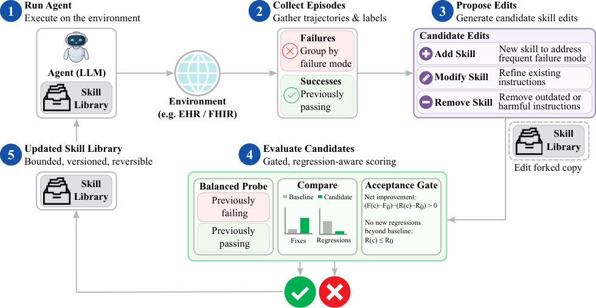
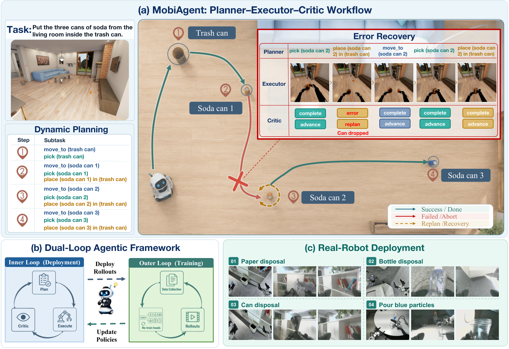

# 具身智能 RSI：值得关注的工作

仅选取 3 篇最新、与 RSI 关联最紧密的工作。研究问题与核心方法为英文摘要的中文概括，不推断实验数值；方法架构图取自 arXiv 官方 HTML 版论文原图。每篇均标注出版层级，若为准入的 2026 年 arXiv 预印本会额外注明未经同行评审。

## 1. EvolveNav: Empowering LLM-Based Vision-Language Navigation via Self-Improving Embodied Reasoning（2026）

- **研究问题**：已有研究表明，训练开源大语言模型可释放其推理能力、提升视觉-语言导航表现并缓解领域差异，但现有做法在适应性与泛化上仍有不足。
- **核心方法**：提出 EvolveNav，一种自改进的具身推理范式，通过可适配、可泛化的导航推理来提升基于 LLM 的视觉-语言导航。
- **RSI 价值**：改进对象为 模型参数与训练机制；反馈闭环：是；多轮迭代：是；分级 L5（置信度 中）；定位：接近 RSI。
- **值得关注的原因**：T1 CCF-A，2026 年。该工作发表于 CCF-A 渠道，属本轮最高出版层级；
- **原文与全文**：[官方论文页](https://doi.org/10.1109/tpami.2026.3682514) ｜ [arXiv:2506.01551](https://arxiv.org/abs/2506.01551) ｜ [本地 PDF](docs/2026_EvolveNav_Empowering_LLM_Based_Vision_Language_Navigation.pdf)
- **发表渠道**：IEEE Transactions on Pattern Analysis and Machine Intelligence

*图：论文 Figure 1（方法/框架总览，取自 arXiv 官方 HTML 版）。来源：[arXiv 官方 HTML 版原图](https://arxiv.org/html/2506.01551v3/motivation-test-new.png)*

## 2. GRASP: Gated Regression-Aware Skill Proposer for Self-Improving LLM Agents（2026）

- **研究问题**：在结构化环境中行动的 LLM 智能体，失败往往发生在操作层面而非对话层面；可靠性依赖对环境的过程性知识，而既有自我改进方法对此处理不足。
- **核心方法**：提出 GRASP：带门控回归感知的技能提议器，为自改进 LLM 智能体生成与筛选可复用技能（摘要未给出更细的机制描述）。
- **RSI 价值**：改进对象为 可复用技能/工具库；反馈闭环：是；多轮迭代：未明确；分级 L3（置信度 中）；定位：接近 RSI。
- **值得关注的原因**：T3 旗舰会议/领域顶刊，2026 年。该工作发表于 CCF-B / SCI 二区 / 领域顶尖会议期刊；
- **原文与全文**：[官方论文页](https://doi.org/10.18653/2026.emnlp-main.452) ｜ [arXiv:2605.29668](https://arxiv.org/abs/2605.29668) ｜ [本地 PDF](docs/2026_GRASP_Gated_Regression_Aware_Skill_Proposer_for.pdf)
- **发表渠道**：Conference on Empirical Methods in Natural Language Processing (EMNLP)

*图：论文 Figure 1（方法/框架总览，取自 arXiv 官方 HTML 版）。来源：[arXiv 官方 HTML 版原图](https://arxiv.org/html/2605.29668v3/illustration_part.png)*

## 3. MobiAgent: Dual-Loop Recursive Policy Self-Improvement for Long-Horizon Mobile Manipulation（2026）

- **研究问题**：长时程移动操作面临执行误差逐步累积、以及移动底盘与机械臂控制之间的能力干扰；现有视觉-语言-动作模型擅长短时程任务，却缺少多阶段目标所需的分层推理，而既有分层智能体又存在子任务映射僵化、重规划不灵活、缺乏持续学习等问题。
- **核心方法**：提出双环智能体框架：内环把高层推理与低层控制解耦为可组合的原子技能，用视觉语言模型做滚动时域规划与视觉反思，动态组合技能以实现错误恢复，技能由共享同一 VLM 骨干的流匹配专家执行；外环负责自动化的策略持续自我改进，把部署执行与递归式策略改进连接起来。
- **RSI 价值**：改进对象为 Agent 规划、决策与协作机制；反馈闭环：未明确；多轮迭代：是；分级 L4（置信度 高（人工复核））；定位：接近 RSI。
- **值得关注的原因**：T3 旗舰会议/领域顶刊，2026 年。该工作发表于 CCF-B / SCI 二区 / 领域顶尖会议期刊；
- **原文与全文**：[官方论文页](https://arxiv.org/abs/2610.03476) ｜ [arXiv:2610.03476](https://arxiv.org/abs/2610.03476) ｜ [本地 PDF](docs/2026_MobiAgent_Dual_Loop_Recursive_Policy_Self_Improvement.pdf)
- **发表渠道**：CoRL（作者注明：Accepted at the Conference on Robot Learning (CoRL) 2026. Project page）

*图：论文 Figure 1（方法/框架总览，取自 arXiv 官方 HTML 版）。来源：[arXiv 官方 HTML 版原图](https://arxiv.org/html/2610.03476v1/teaser_1.png)*
