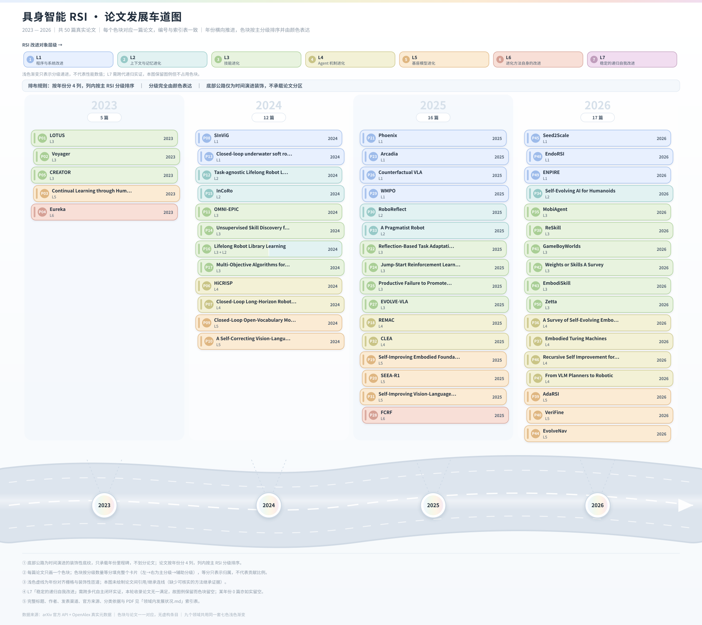

# 具身智能 RSI：领域内发展状况

[PNG 预览图](assets/lane_embodied.png)

> **排布规则**：公路置于底部，仅作时间演进装饰，不划分论文。论文按 2023—2026 四个年份分列，列内按主 RSI 分级排序；分级完全由颜色表达，多分级色块为整块等分填充。本图只绘制**主索引论文**（CCF-A / SCI 一区 / CCF-B / SCI 二区 / 领域顶尖会议期刊，以及 2026 年顶尖团队 arXiv 预印本），补充层条目不计入色块。

## 发展脉络

本领域主索引共 **39 篇**高质量论文：CCF-A 6 篇、旗舰会议/领域顶刊 16 篇、其他正式出版 16 篇、arXiv 预印本 1 篇。分级置信度：高 12 篇、低 8 篇、中 17 篇、高（人工复核） 2 篇。年份分布：2023 年 5 篇、2024 年 6 篇、2025 年 14 篇、2026 年 14 篇。

真 RSI 论文须在标题或摘要明确描述「系统修改自身的某一组成部分」，并以**短语级改进对象证据**判定 L1–L7；仅有 `closed-loop`（控制闭环）、`continual learning`、`feedback` 等泛词的工作不能算 RSI。为达到每领域 20 篇下限而补入的**自主优化 / 反馈驱动改进**工作，已统一标注为「相关探索工作（非 RSI）」；按项目规则跨领域收录的论文在「收录说明」列写明理由。**L7 稳定递归自我改进全程留空**：现有工作均未提供跨多代、可验证的持续提升证据。

## 论文索引（主索引，含逐篇核实信息）

| 编号 | 论文名称 | 年份 | 出版层级 | 发表渠道 | 作者 | RSI 分级 | 置信度 | 定位 | 改进对象 | 反馈闭环 | 多轮迭代 | 判定依据 | 收录说明 | 全文 |
|---|---|---|---|---|---|---|---|---|---|---|---|---|---|---|
| P01 | [AdaptDiffuser: Diffusion Models as Adaptive Self-evolving Planners](https://arxiv.org/abs/2302.01877) | 2023 | T1 CCF-A | ICML（作者注明：Accepted by ICML 2023. Project page: https://adaptdiffuser.github.io） | Zhixuan Liang, Yao Mu, Mingyu Ding et al. | L4 | 高 | 相关基础能力 | Agent 规划、决策与协作机制 | 未明确 | 未明确 | 自我改进证据：self-evolv；L4 改进对象：planner | — | [PDF](docs/2023_AdaptDiffuser_Diffusion_Models_as_Adaptive_Self.pdf) |
| P02 | [LOTUS: Continual Imitation Learning for Robot Manipulation Through Unsupervised Skill Discovery](https://arxiv.org/abs/2311.02058) | 2023 | T3 旗舰会议/领域顶刊 | Proceedings - IEEE International Conference on Robotics and Automation/Proceedings | Weikang Wan, Yifeng Zhu, Rutav Shah et al. | L3 | 高 | 接近 RSI | 可复用技能/工具库 | 未明确 | 是 | 自我改进证据：skill discovery、skill library；L3 改进对象：skill library、skill discovery | — | [PDF](docs/2023_LOTUS_Continual_Imitation_Learning_for_Robot_Manipulation.pdf) |
| P03 | [RoboCat: A Self-Improving Generalist Agent for Robotic Manipulation](https://doi.org/10.48550/arxiv.2306.11706) | 2023 | T4 其他正式出版 | arXiv (Cornell University)（预印本，未经同行评审） | Konstantinos Bousmalis, Giulia Vezzani, Dushyant Rao et al. | L5 | 低 | 接近 RSI | 模型参数与训练机制 | 是 | 是 | 自我改进证据：self-improv、self-improving；反馈/验证信号：摘要含执行反馈、评估或迭代验证线索；L5 改进对象：training data | — | [PDF](docs/2023_RoboCat_A_Self_Improving_Generalist_Agent_for.pdf) |
| P04 | [Voyager: An Open-Ended Embodied Agent with Large Language Models](https://arxiv.org/abs/2305.16291) | 2023 | T4 其他正式出版 | arXiv preprint（预印本，未经同行评审） | Guanzhi Wang, Yuqi Xie, Yunfan Jiang et al. | L3 | 中 | 接近 RSI | 可复用技能/工具库 | 是 | 是 | 自我改进证据：skill library、automatic curriculum；反馈/验证信号：摘要含执行反馈、评估或迭代验证线索；L3 改进对象：skill library、automatic curriculum | — | [PDF](docs/2023_Voyager_An_Open_Ended_Embodied_Agent_with.pdf) |
| P05 | [XSkill: Cross Embodiment Skill Discovery](https://doi.org/10.48550/arxiv.2307.09955) | 2023 | T4 其他正式出版 | arXiv (Cornell University)（预印本，未经同行评审） | Mengda Xu, Zhenjia Xu, Cheng Chi et al. | L3 | 高 | 相关基础能力 | 可复用技能/工具库 | 未明确 | 未明确 | 自我改进证据：skill discovery；L3 改进对象：skill discovery | — | [PDF](docs/2023_XSkill_Cross_Embodiment_Skill_Discovery.pdf) |
| P06 | [Unsupervised Skill Discovery for Robotic Manipulation through Automatic Task Generation](https://arxiv.org/abs/2410.04855) | 2024 | T3 旗舰会议/领域顶刊 | IEEE-RAS International Conference on Humanoid Robots (Humanoids) | Paul Jansonnie, Bingbing Wu, Julien Perez et al. | L3 | 高 | 相关基础能力 | 可复用技能/工具库 | 未明确 | 未明确 | 自我改进证据：skill discovery、self-play；L3 改进对象：skill discovery | — | [PDF](docs/2024_Unsupervised_Skill_Discovery_for_Robotic_Manipulation.pdf) |
| P07 | [Rethinking Mutual Information for Language Conditioned Skill Discovery on Imitation Learning](https://doi.org/10.1609/icaps.v34i1.31488) | 2024 | T3 旗舰会议/领域顶刊 | Proceedings of the International Conference on Automated Planning and Scheduling | Zhaoxun Ju, Chao Yang, Fuchun Sun et al. | L3 | 高 | 相关基础能力 | 可复用技能/工具库 | 未明确 | 未明确 | 自我改进证据：skill discovery；L3 改进对象：skill discovery、primitive skill | — | [PDF](docs/2024_Rethinking_Mutual_Information_for_Language_Conditioned.pdf) |
| P08 | [Lifelong Robot Library Learning: Bootstrapping Composable and Generalizable Skills for Embodied Control with Language Models](https://arxiv.org/abs/2406.18746) | 2024 | T3 旗舰会议/领域顶刊 | Proceedings - IEEE International Conference on Robotics and Automation/Proceedings | Georgios Tziafas, Hamidreza Kasaei | L3 | 中 | 接近 RSI | 可复用技能/工具库 | 未明确 | 是 | 自我改进证据：skill library、self-guided；L3 改进对象：skill library、primitive skill | — | [PDF](docs/2024_Lifelong_Robot_Library_Learning_Bootstrapping_Composable.pdf) |
| P09 | [A Self-Correcting Vision-Language-Action Model for Fast and Slow System Manipulation](https://arxiv.org/abs/2405.17418) | 2024 | T4 其他正式出版 | arXiv preprint（预印本，未经同行评审） | Chenxuan Li, Jiaming Liu, Guanqun Wang et al. | L5 | 低 | 接近 RSI | 模型参数与训练机制 | 是 | 是 | 自我改进证据：self-correct；反馈/验证信号：摘要含执行反馈、评估或迭代验证线索；L5 改进对象：fine-tuning | — | [PDF](docs/2024_A_Self_Correcting_Vision_Language_Action_Model.pdf) |
| P10 | [Closed-Loop Long-Horizon Robotic Planning via Equilibrium Sequence Modeling](https://doi.org/10.48550/arxiv.2410.01440) | 2024 | T4 其他正式出版 | arXiv (Cornell University)（预印本，未经同行评审） | Li, Jinghan, Zhicheng Sun, Yadong Mu | L5 | 中 | 接近 RSI | 模型参数与训练机制 | 是 | 是 | 自我改进证据：self-refin、iteratively refine；反馈/验证信号：摘要含执行反馈、评估或迭代验证线索；L5 改进对象：reward model | — | [PDF](docs/2024_Closed_Loop_Long_Horizon_Robotic_Planning_via.pdf) |
| P11 | [Multi-Objective Algorithms for Learning Open-Ended Robotic Problems](https://arxiv.org/abs/2411.08070) | 2024 | T4 其他正式出版 | IEEE 10th World Forum on Internet of Things, 2024 | Martin Robert, Simon Brodeur, Francois Ferland | L3 | 中 | 相关基础能力 | 可复用技能/工具库 | 未明确 | 未明确 | 自我改进证据：automatic curriculum；L3 改进对象：automatic curriculum | — | [PDF](docs/2024_Multi_Objective_Algorithms_for_Learning_Open_Ended.pdf) |
| P12 | [Self-Improving Embodied Foundation Models](https://arxiv.org/abs/2509.15155) | 2025 | T1 CCF-A | neural information processing systems | Seyed Kamyar Seyed Ghasemipour, Ayzaan Wahid, Jonathan Tompson et al. | L5 | 中 | 相关基础能力 | 模型参数与训练机制 | 未明确 | 未明确 | 自我改进证据：self-improv、self-improvement、self-improving；L5 改进对象：fine-tuning、supervised fine-tuning | — | [PDF](docs/2025_Self_Improving_Embodied_Foundation_Models.pdf) |
| P13 | [SEEA-R1: Tree-Structured Reinforcement Fine-Tuning for Self-Evolving Embodied Agents](https://doi.org/10.52202/085713-2628) | 2025 | T1 CCF-A | neural information processing systems | Wanxin Tian, Shijie Zhang, Kevin Zhang et al. | L5 | 高（人工复核） | 相关基础能力 | 模型参数与训练机制 | 未明确 | 未明确 | 自我改进证据：self-evolv、self-evolution、autonomously improve；L5 改进对象：fine-tuning、reward model；人工复核：通过强化微调改进模型参数，主对象为基座模型（L5）；'自我进化' 未体现对 Agent 架构的修改 | — | [PDF](docs/2025_SEEA_R1_Tree_Structured_Reinforcement_Fine_Tuning.pdf) |
| P14 | [REMAC: Self-Reflective and Self-Evolving Multi-Agent Collaboration for Long-Horizon Robot Manipulation](https://arxiv.org/abs/2503.22122) | 2025 | T3 旗舰会议/领域顶刊 | Pattern Recognition | Puzhen Yuan, Angyuan Ma, Yunchao Yao et al. | L4 | 高 | 接近 RSI | Agent 规划、决策与协作机制 | 是 | 是 | 自我改进证据：self-evolv、self-reflect、self-evolution；反馈/验证信号：摘要含执行反馈、评估或迭代验证线索；L4 改进对象：multi-agent | — | [PDF](docs/2025_REMAC_Self_Reflective_and_Self_Evolving_Multi.pdf) |
| P15 | [Goal-Oriented Skill Abstraction for Offline Multi-Task Reinforcement Learning](https://arxiv.org/abs/2507.06628) | 2025 | T1 CCF-A | Proceedings of the 42nd International Conference on Machine Learning, Vancouver, Canada. PMLR 267, 2025 | Jinmin He, Kai Li, Yifan Zang et al. | L3 | 中 | 相关基础能力 | 可复用技能/工具库 | 未明确 | 未明确 | 自我改进证据：reusable skill、skill library；L3 改进对象：skill library、reusable skill | — | [PDF](docs/2025_Goal_Oriented_Skill_Abstraction_for_Offline_Multi.pdf) |
| P16 | [VLM Can Be a Good Assistant: Enhancing Embodied Visual Tracking with Self-Improving Vision-Language Models](https://doi.org/10.1109/iros60139.2025.11246600) | 2025 | T3 旗舰会议/领域顶刊 | IEEE/RSJ International Conference on Intelligent Robots and Systems (IROS) | Kui Wu, Shuxiang Xu, Hao Chen et al. | L6 | 中 | 接近 RSI | 改进方法/评价与搜索策略 | 是 | 是 | 自我改进证据：self-improv、self-improving、self-reflect；反馈/验证信号：摘要含执行反馈、评估或迭代验证线索；L6 改进对象：reflection mechanism | — | [PDF](docs/2025_VLM_Can_Be_a_Good_Assistant_Enhancing.pdf) |
| P17 | [Making VLMs More Robot-Friendly: Self-Critical Distillation of Low-Level Procedural Reasoning](https://doi.org/10.18653/v1/2025.emnlp-main.1658) | 2025 | T3 旗舰会议/领域顶刊 | Conference on Empirical Methods in Natural Language Processing (EMNLP) | Chan Young Park, Jillian Fisher, Marius Memmel et al. | L5 | 高 | 接近 RSI | 模型参数与训练机制 | 是 | 是 | 自我改进证据：self-critic、self-improv、self-improvement；反馈/验证信号：摘要含执行反馈、评估或迭代验证线索；L5 改进对象：fine-tuning、distillation | — | [PDF](docs/2025_Making_VLMs_More_Robot_Friendly_Self_Critical.pdf) |
| P18 | [A Pragmatist Robot: Learning to Plan Tasks by Experiencing the Real World](https://arxiv.org/abs/2507.16713) | 2025 | T3 旗舰会议/领域顶刊 | IEEE Robotics and Automation Letters | Kaixian Qu, Guowei Lan, René Zurbrügg et al. | L2 | 中 | 相关基础能力 | 上下文、提示与记忆结构 | 未明确 | 未明确 | 自我改进证据：self-reflect；L2 改进对象：long-term memory、retrieval-augmented | — | [PDF](docs/2025_A_Pragmatist_Robot_Learning_to_Plan_Tasks.pdf) |
| P19 | [M2Distill: Multi-Modal Distillation for Lifelong Imitation Learning](https://doi.org/10.1109/icra55743.2025.11128857) | 2025 | T3 旗舰会议/领域顶刊 | Proceedings - IEEE International Conference on Robotics and Automation/Proceedings | Kaushik Roy, Akila Dissanayakc, Brendan Tidd et al. | L3 | 中 | 接近 RSI | 可复用技能/工具库 | 未明确 | 是 | 自我改进证据：skill library、skill discovery；L3 改进对象：skill library、skill discovery | — | [PDF](docs/2025_M2Distill_Multi_Modal_Distillation_for_Lifelong.pdf) |
| P20 | [Self-Improving Vision-Language-Action Models with Data Generation via Residual RL](https://doi.org/10.48550/arxiv.2511.00091) | 2025 | T4 其他正式出版 | arXiv (Cornell University)（预印本，未经同行评审） | Wenli Xiao, Haotian Lin, Peng, Andy et al. | L5 | 中 | 相关基础能力 | 模型参数与训练机制 | 未明确 | 未明确 | 自我改进证据：self-improv、self-improving；L5 改进对象：fine-tuning、supervised fine-tuning | — | [PDF](docs/2025_Self_Improving_Vision_Language_Action_Models_with.pdf) |
| P21 | [EvolvingAgent: Curriculum Self-evolving Agent with Continual World Model for Long-Horizon Tasks](https://doi.org/10.48550/arxiv.2502.05907) | 2025 | T4 其他正式出版 | arXiv (Cornell University)（预印本，未经同行评审） | Tongtong Feng, Xin Wang, Zhou, Zekai et al. | L4 | 低 | 接近 RSI | Agent 规划、决策与协作机制 | 是 | 是 | 自我改进证据：self-evolv、evolving agent、self-reflect；反馈/验证信号：摘要含执行反馈、评估或迭代验证线索；L4 改进对象：planner | — | [PDF](docs/2025_EvolvingAgent_Curriculum_Self_evolving_Agent_with.pdf) |
| P22 | [RoboOS: A Hierarchical Embodied Framework for Cross-Embodiment and Multi-Agent Collaboration](https://arxiv.org/abs/2505.03673) | 2025 | T4 其他正式出版 | arXiv preprint（预印本，未经同行评审） | Huajie Tan, Xiaoshuai Hao, Cheng Chi et al. | L4 | 高 | 相关基础能力 | Agent 规划、决策与协作机制 | 未明确 | 未明确 | 自我改进证据：skill library；L4 改进对象：multi-agent | — | [PDF](docs/2025_RoboOS_A_Hierarchical_Embodied_Framework_for_Cross.pdf) |
| P23 | [Self-Improving Loops for Visual Robotic Planning](https://doi.org/10.48550/arxiv.2506.06658) | 2025 | T4 其他正式出版 | arXiv (Cornell University)（预印本，未经同行评审） | Luo, Calvin, Zilai Zeng, Mingxi Jia et al. | L4 | 低 | 接近 RSI | Agent 规划、决策与协作机制 | 是 | 是 | 自我改进证据：self-improv、self-improving；反馈/验证信号：摘要含执行反馈、评估或迭代验证线索；L4 改进对象：planner | — | [PDF](docs/2025_Self_Improving_Loops_for_Visual_Robotic_Planning.pdf) |
| P24 | [OmniVIC: A Self-Improving Variable Impedance Controller with Vision-Language In-Context Learning for Safe Robotic Manipulation](https://doi.org/10.48550/arxiv.2510.17150) | 2025 | T4 其他正式出版 | arXiv (Cornell University)（预印本，未经同行评审） | Heng Zhang, Wei-Hsing Huang, Gökhan Solak et al. | L2 | 低 | 接近 RSI | 上下文、提示与记忆结构 | 是 | 未明确 | 自我改进证据：self-improv、self-improving；反馈/验证信号：摘要含执行反馈、评估或迭代验证线索；L2 改进对象：retrieval-augmented | — | [PDF](docs/2025_OmniVIC_A_Self_Improving_Variable_Impedance_Controller.pdf) |
| P25 | [Robo-Dopamine: General Process Reward Modeling for High-Precision Robotic Manipulation](https://doi.org/10.48550/arxiv.2512.23703) | 2025 | T4 其他正式出版 | arXiv (Cornell University)（预印本，未经同行评审） | Huajie Tan, Sixiang Chen, Yijie Xu et al. | L5 | 高 | 相关基础能力 | 模型参数与训练机制 | 未明确 | 未明确 | 自我改进证据：self-improv、self-improvement；L5 改进对象：reward model | — | [PDF](docs/2025_Robo_Dopamine_General_Process_Reward_Modeling_for.pdf) |
| P26 | [EvolveNav: Empowering LLM-Based Vision-Language Navigation via Self-Improving Embodied Reasoning](https://doi.org/10.1109/tpami.2026.3682514) | 2026 | T1 CCF-A | IEEE Transactions on Pattern Analysis and Machine Intelligence | Bingqian Lin, Yunshuang Nie, Khun Loun Zai et al. | L5 | 中 | 接近 RSI | 模型参数与训练机制 | 是 | 是 | 自我改进证据：self-improv、self-improving、self-reflect；反馈/验证信号：摘要含执行反馈、评估或迭代验证线索；L5 改进对象：fine-tuning、supervised fine-tuning | — | [PDF](docs/2026_EvolveNav_Empowering_LLM_Based_Vision_Language_Navigation.pdf) |
| P27 | [GRASP: Gated Regression-Aware Skill Proposer for Self-Improving LLM Agents](https://doi.org/10.18653/2026.emnlp-main.452) | 2026 | T3 旗舰会议/领域顶刊 | Conference on Empirical Methods in Natural Language Processing (EMNLP) | J Moll, Jean-Philippe Corbeil, Jiazhen Pan et al. | L3 | 中 | 接近 RSI | 可复用技能/工具库 | 是 | 未明确 | 自我改进证据：self-improv、self-improving、self-improvement；反馈/验证信号：摘要含执行反馈、评估或迭代验证线索；L3 改进对象：skill library | — | [PDF](docs/2026_GRASP_Gated_Regression_Aware_Skill_Proposer_for.pdf) |
| P28 | [MobiAgent: Dual-Loop Recursive Policy Self-Improvement for Long-Horizon Mobile Manipulation](https://arxiv.org/abs/2610.03476) | 2026 | T3 旗舰会议/领域顶刊 | CoRL（作者注明：Accepted at the Conference on Robot Learning (CoRL) 2026. Project page） | Chenzhi Liu, Yue Zhang, Jiehong Lin et al. | L4 | 高（人工复核） | 接近 RSI | Agent 规划、决策与协作机制 | 未明确 | 是 | 自我改进证据：self-improv、self-improvement、skill library；L3 改进对象：skill library；人工复核：递归策略自我改进作用于闭环控制器与决策机制，属 L4 Agent 机制进化 | — | [PDF](docs/2026_MobiAgent_Dual_Loop_Recursive_Policy_Self_Improvement.pdf) |
| P29 | [TabClaw: An Interactive and Self-Evolving Agent for Spreadsheet Manipulation and Table Reasoning](https://doi.org/10.1145/3799682.3840274) | 2026 | T3 旗舰会议/领域顶刊 | ACM International Conference on Information and Knowledge Management (CIKM) | Mingyue Cheng, Shuo Yu, Daoyu Wang et al. | L3 | 中 | 接近 RSI | 可复用技能/工具库 | 未明确 | 是 | 自我改进证据：self-evolv、evolving agent、reusable skill；L3 改进对象：reusable skill | — | [PDF](docs/2026_TabClaw_An_Interactive_and_Self_Evolving_Agent.pdf) |
| P30 | [Uni-Skill: Building Self-Evolving Skill Repository for Generalizable Robotic Manipulation](https://arxiv.org/abs/2603.02623) | 2026 | T3 旗舰会议/领域顶刊 | Proceedings - IEEE International Conference on Robotics and Automation/Proceedings | Senwei Xie, Yuntian Zhang, Ruiping Wang et al. | L3 | 中 | 相关基础能力 | 可复用技能/工具库 | 未明确 | 未明确 | 自我改进证据：self-evolv、skill library；L3 改进对象：skill library | — | [PDF](docs/2026_Uni_Skill_Building_Self_Evolving_Skill_Repository.pdf) |
| P31 | [What Stops Recursive Self-Improvement in Robotics? Lessons from 123 Rounds of Agentic Skill Discovery](https://doi.org/10.48550/arxiv.2609.31760) | 2026 | T4 其他正式出版 | arXiv (Cornell University)（预印本，未经同行评审） | Jiaming Wang | L3 | 高 | 接近 RSI | 可复用技能/工具库 | 未明确 | 是 | 自我改进证据：recursive self、self-improv、self-improvement；L3 改进对象：skill discovery | — | [PDF](docs/2026_What_Stops_Recursive_Self_Improvement_in_Robotics.pdf) |
| P32 | [RegenHarness: A Robot Agent Harness with Evidence-Gated Recursive Self-Improvement](https://arxiv.org/abs/2609.27612) | 2026 | T5 arXiv 预印本（顶尖团队准入：高影响代理（OpenAlex 引用 9 次，非机构直接证据）） | arXiv (Cornell University)（预印本，未经同行评审） | Kailin Wang, Haoxiang Jie, Yan Yaoyuan et al. | L4 | 高 | 接近 RSI | Agent 规划、决策与协作机制 | 是 | 是 | 自我改进证据：recursive self、self-improv、self-improvement；反馈/验证信号：摘要含执行反馈、评估或迭代验证线索；L4 改进对象：agent harness | — | [PDF](docs/2026_RegenHarness_A_Robot_Agent_Harness_with_Evidence.pdf) |
| P33 | [When Search Becomes Memory: Accelerating Robot Design Discovery with Self-Evolving Skills](https://arxiv.org/abs/2605.25832) | 2026 | T3 旗舰会议/领域顶刊 | Conference on Empirical Methods in Natural Language Processing (EMNLP) | Yunfei Wang, Xiaohao Xu, Yang Li et al. | L3 | 中 | 相关基础能力 | 可复用技能/工具库 | 未明确 | 未明确 | 自我改进证据：self-evolv、skill library；L3 改进对象：skill library | — | [PDF](docs/2026_When_Search_Becomes_Memory_Accelerating_Robot_Design.pdf) |
| P34 | [SHRIMP: Iterative Refinement of Robot Task Plans](https://doi.org/10.1145/3830398.3830644) | 2026 | T1 CCF-A | ACM Symposium on User Interface Software and Technology (UIST) | Mya Schroder, Yuna Hwang, Callie Y. Kim et al. | L1 | 低 | 接近 RSI | 程序/系统实现与算法流程 | 是 | 是 | 自我改进证据：iterative refinement；反馈/验证信号：摘要含执行反馈、评估或迭代验证线索；L1 改进对象：source code | — | [PDF](docs/2026_SHRIMP_Iterative_Refinement_of_Robot_Task_Plans.pdf) |
| P35 | [Evading Fake News Detection: Self-evolving Social Manipulation via LLM-driven Agent Orchestration](https://doi.org/10.18653/2026.emnlp-main.1083) | 2026 | T3 旗舰会议/领域顶刊 | Conference on Empirical Methods in Natural Language Processing (EMNLP) | Mengyang Chen, Lingwei Wei, Wei Zhou et al. | L4 | 高 | 相关基础能力 | Agent 规划、决策与协作机制 | 未明确 | 未明确 | 自我改进证据：self-evolv；L4 改进对象：orchestration | — | [PDF](docs/2026_Evading_Fake_News_Detection_Self_evolving_Social.pdf) |
| P36 | [AdaRSI: On-Demand Recursive Self-Improvement for Embodied Agents](https://arxiv.org/abs/2610.20474) | 2026 | T4 其他正式出版 | arXiv preprint（预印本，未经同行评审） | Peidong Wang, Ying Chang, Zhiming Ma et al. | L5 | 低 | 接近 RSI | 模型参数与训练机制 | 未明确 | 是 | 自我改进证据：recursive self、self-improv、self-improvement；L5 改进对象：fine-tuning | — | [PDF](docs/2026_AdaRSI_On_Demand_Recursive_Self_Improvement_for.pdf) |
| P37 | [Embodied Turing Machines: Stateful Code for Robot Recursive Self-Improvement](https://arxiv.org/abs/2610.12369) | 2026 | T4 其他正式出版 | arXiv preprint（预印本，未经同行评审） | Kairui Hu, Siyuan Hu, Fangzhou Hong et al. | L4 | 中 | 接近 RSI | Agent 规划、决策与协作机制 | 未明确 | 是 | 自我改进证据：recursive self、self-improv、self-improvement；L4 改进对象：agent harness | — | [PDF](docs/2026_Embodied_Turing_Machines_Stateful_Code_for_Robot.pdf) |
| P38 | [SkillPlug: Unsupervised Skill Mining for Few-Shot Adaptation in Robotic Manipulation](https://arxiv.org/abs/2607.08354) | 2026 | T3 旗舰会议/领域顶刊 | IEEE Robotics and Automation Letters, vol. 11, no. 8, pp. 9511-9518, Aug. 2026 | Zi-han Ding, Ziwei Wang | L3 | 中 | 相关基础能力 | 可复用技能/工具库 | 未明确 | 未明确 | 自我改进证据：skill library、reusable skill；L3 改进对象：skill library、reusable skill | — | [PDF](docs/2026_SkillPlug_Unsupervised_Skill_Mining_for_Few_Shot.pdf) |
| P39 | [ELITE: Experiential Learning and Intent-Aware Transfer for Self-improving Embodied Agents](https://doi.org/10.48550/arxiv.2603.24018) | 2026 | T4 其他正式出版 | arXiv (Cornell University)（预印本，未经同行评审） | Bingqing Wei, Zhongyu Xia, Dingai Liu et al. | L5 | 低 | 相关基础能力 | 模型参数与训练机制 | 未明确 | 未明确 | 自我改进证据：self-improv、self-improving、self-reflect；L5 改进对象：training data | — | [PDF](docs/2026_ELITE_Experiential_Learning_and_Intent_Aware_Transfer.pdf) |

> 「出版层级」依据 CCF 第七版（2026）官方目录与项目内可核查的期刊/会议别名词表；标注「作者自述接收」的记录来自 arXiv comment，尚待正式出版页面核实。「置信度」为 L1–L7 判定依据强度：高＝标题含明确改进对象短语，中＝摘要含强短语，人工复核＝已按编辑判断修正。完整标准见顶层《分类与质量核查报告.md》。

## 补充层：其他正式出版 / 未准入 arXiv（不计入高质量论文）

以下 10 篇与本领域自主改进主题相关，但属于**非顶级正式出版渠道**，或为**非 2026 年 / 未匹配顶尖团队证据的 arXiv 预印本**，按新标准不进入上方主索引与车道图，仅作后续跟踪；不得视为已证实的高水平成果。

| 编号 | 论文名称 | 年份 | 出版层级 | 分级 | 定位 | 来源 |
|---|---|---|---|---|---|---|
| S01 | [GameBoyWorlds: A Testbed for Self-Improvement in Embodied Video Games](https://arxiv.org/abs/2609.32093) | 2026 | T5 arXiv 预印本（顶尖团队准入：未匹配顶尖团队证据） | L3 | 相关基础能力 | [官方页](https://arxiv.org/abs/2609.32093) |
| S02 | [ReSkill: Selective Self-Improvement for Robot Manipulation](https://arxiv.org/abs/2611.10510) | 2026 | T5 arXiv 预印本（顶尖团队准入：未匹配顶尖团队证据） | L3 | 接近 RSI | [官方页](https://arxiv.org/abs/2611.10510) |
| S03 | [Practice Makes Policies: Bootstrapping and Consolidating Robotic Capabilities from Zero Human Demonstrations](https://arxiv.org/abs/2607.26809) | 2026 | T5 arXiv 预印本（顶尖团队准入：未匹配顶尖团队证据） | L2 | 接近 RSI | [官方页](https://arxiv.org/abs/2607.26809) |
| S04 | [SeedPolicy: Horizon Scaling via Self-Evolving Diffusion Policy for Robot Manipulation](https://arxiv.org/abs/2603.05117) | 2026 | T5 arXiv 预印本（顶尖团队准入：未匹配顶尖团队证据） | L5 | 相关基础能力 | [官方页](https://arxiv.org/abs/2603.05117) |
| S05 | [Diagnosing Semantic Handoff Failures in Agent-Orchestrated Vision-Language-Action Skill Composition](https://arxiv.org/abs/2607.06256) | 2026 | T5 arXiv 预印本（顶尖团队准入：未匹配顶尖团队证据） | L3 | 接近 RSI | [官方页](https://arxiv.org/abs/2607.06256) |
| S06 | [EvoHIL: Self-Evolving Reward and Flow-Matched Policy Optimization for Robust Human-in-the-Loop Reinforcement Learning](https://arxiv.org/abs/2608.03872) | 2026 | T5 arXiv 预印本（顶尖团队准入：未匹配顶尖团队证据） | L5 | 相关基础能力 | [官方页](https://arxiv.org/abs/2608.03872) |
| S07 | [A Few Words Go a Long Way: Language Guided Robot Policy Synthesis](https://arxiv.org/abs/2607.23784) | 2026 | T5 arXiv 预印本（顶尖团队准入：未匹配顶尖团队证据） | L3 | 接近 RSI | [官方页](https://arxiv.org/abs/2607.23784) |
| S08 | [Agentic World Action Models](https://arxiv.org/abs/2610.30136) | 2026 | T5 arXiv 预印本（顶尖团队准入：未匹配顶尖团队证据） | L3 | 相关基础能力 | [官方页](https://arxiv.org/abs/2610.30136) |
| S09 | [Scaling Rough Terrain Locomotion with Automatic Curriculum Reinforcement Learning](https://arxiv.org/abs/2601.17428) | 2026 | T5 arXiv 预印本（顶尖团队准入：未匹配顶尖团队证据） | L3 | 相关基础能力 | [官方页](https://arxiv.org/abs/2601.17428) |
| S10 | [Trajectory-Level Automatic Curriculum Learning for Legged Locomotion on Unstructured Terrain](https://arxiv.org/abs/2608.16164) | 2026 | T5 arXiv 预印本（顶尖团队准入：未匹配顶尖团队证据） | L3 | 接近 RSI | [官方页](https://arxiv.org/abs/2608.16164) |

## 目前的主要技术路线及发展趋势

主索引中占比最高的改进对象为：L3 技能进化（15 篇）、L5 基座模型进化（11 篇）、L4 Agent 机制进化（9 篇）。这反映本领域目前的研究集中在**组件级 / 技能级的自主改进**，而非基座模型或进化方法自身的递归改进。

跨领域共通的基础方法（Self-Refine、STOP、Darwin Gödel Machine、AlphaEvolve、FunSearch、MemGPT 等）不归属任何应用领域，统一收录于顶层《跨领域 RSI 基础方法.md》。

## 尚未解决的关键问题

1. **稳定多轮递归闭环缺失**：L1–L6 均有零散工作，但没有一篇提供跨多代、由改进后系统继续推动下一代改进的实证，L7 因此留空。
2. **发表层级与前沿性矛盾**：RSI 最新工作大量停留在 arXiv，严格按 CCF-A / 顶刊筛选会显著减少可用文献；补充层与主索引的分离是必要的折中。
3. **作者自述接收待核实**：部分 2026 年顶会记录仅来自 arXiv comment，需以会议官方论文集复核。
4. **分级依赖摘要措辞**：本索引的 L1–L7 判定基于标题/摘要的改进对象短语，尚需回到原文方法部分与实验部分做最终确认。
