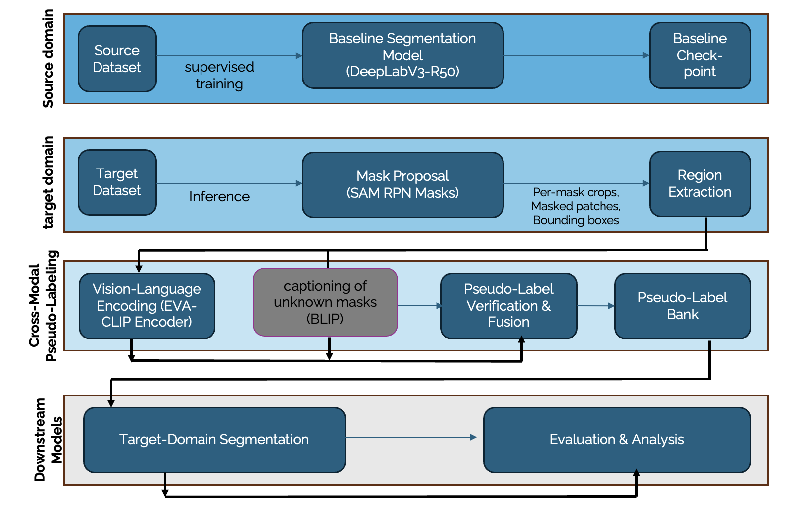

# 自动驾驶 RSI：值得关注的工作

仅选取 3 篇最新、与 RSI 关联最紧密的工作。研究问题与核心方法为英文摘要的中文概括，不推断实验数值；方法架构图取自 arXiv 官方 HTML 版论文原图。每篇均标注出版层级，若为准入的 2026 年 arXiv 预印本会额外注明未经同行评审。

## 1. REINS: A Self-Evolving Agent Harness for Real-Time Trajectory Planning（2026）

- **研究问题**：Agent harness（包裹 LLM 推理循环、提供工具调度、验证与持久记忆的运行时脚手架）已成为把 LLM 部署为自主智能体的标准底座。
- **核心方法**：提出 REINS，建立在三组 LLM—规划器耦合之上：把 LLM 输出锚定到学习到的变量级动力学模型、用校准谓词与前向推演加以验证、并整合进持久记忆。
- **RSI 价值**：改进对象为 Agent 规划、决策与协作机制；反馈闭环：是；多轮迭代：未明确；分级 L4（置信度 高）；定位：接近 RSI。
- **值得关注的原因**：T1 CCF-A，2026 年。该工作发表于 CCF-A 渠道，属本轮最高出版层级；
- **原文与全文**：[官方论文页](https://arxiv.org/abs/2611.10748) ｜ [arXiv:2611.10748](https://arxiv.org/abs/2611.10748) ｜ [本地 PDF](docs/2026_REINS_A_Self_Evolving_Agent_Harness_for.pdf)
- **发表渠道**：NeurIPS（作者注明：Accepted at NeurIPS 2026 (Main Track). 36 pages, 7 figures, 20 tables.）

*图：论文 Figure 1（方法/框架总览，取自 arXiv 官方 HTML 版）。来源：[arXiv 官方 HTML 版原图](https://arxiv.org/html/2611.10748v1/figures/intro_gaps-v3.png)*

## 2. SRPO: Self-Reflection Policy Optimization for Stable and Robust Autonomous Driving（2026）

- **研究问题**：自动驾驶要求强化学习智能体不仅性能好，还要稳定、样本高效且对不确定性鲁棒。
- **核心方法**：提出 SRPO（自反思策略优化），在策略层面引入自我评价：把每次策略迭代与其自身历史表现对照，据此稳定训练。
- **RSI 价值**：改进对象为 程序/系统实现与算法流程；反馈闭环：是；多轮迭代：是；分级 L1（置信度 低）；定位：接近 RSI。
- **值得关注的原因**：T3 旗舰会议/领域顶刊，2026 年。该工作发表于 CCF-B / SCI 二区 / 领域顶尖会议期刊；
- **原文与全文**：[官方论文页](https://doi.org/10.1109/icra57385.2026.11697044) ｜ 本地 PDF 未获取
- **发表渠道**：Proceedings - IEEE International Conference on Robotics and Automation/Proceedings

*该论文未检索到 arXiv 官方 HTML 版插图，故不插入架构图（不伪造图片）。*

## 3. Vision-Language-Guided Pseudo-Labels for Unsupervised Domain Adaptation in Semantic Segmentation for Waste Sorting（2026）

- **研究问题**：在自动驾驶、工业废料分选等应用场景中，为语义分割获取标注数据成本高、且难以规模化。
- **核心方法**：提出跨模态伪标签流程，在完全不使用目标域标注的条件下完成无监督域适应；该工作属相关探索，未描述系统修改自身的闭环。
- **RSI 价值**：改进对象为 模型参数与训练机制；反馈闭环：是；多轮迭代：未明确；分级 L5（置信度 中）；定位：接近 RSI。
- **值得关注的原因**：T3 旗舰会议/领域顶刊（作者自述接收，待核实），2026 年。该工作发表于 CCF-B / SCI 二区 / 领域顶尖会议期刊；
- **原文与全文**：[官方论文页](https://arxiv.org/abs/2609.00898) ｜ [arXiv:2609.00898](https://arxiv.org/abs/2609.00898) ｜ [本地 PDF](docs/2026_Vision_Language_Guided_Pseudo_Labels_for_Unsupervised.pdf)
- **发表渠道**：arXiv preprint（预印本，未经同行评审）

*图：论文 Figure 1（方法/框架总览，取自 arXiv 官方 HTML 版）。来源：[arXiv 官方 HTML 版原图](https://arxiv.org/html/2609.00898v1/figures/pipeline.png)*
