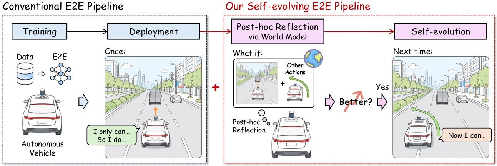
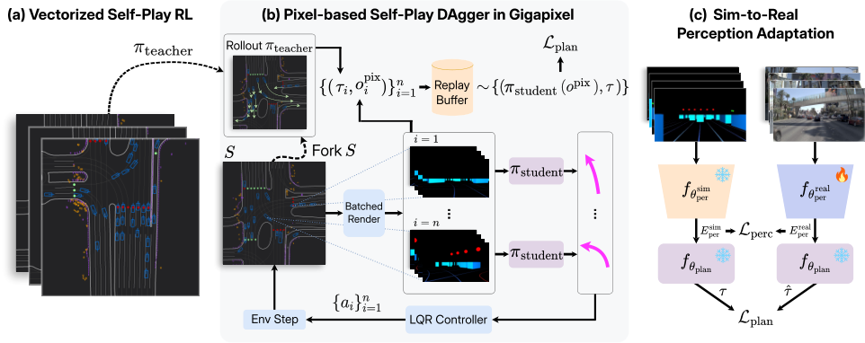
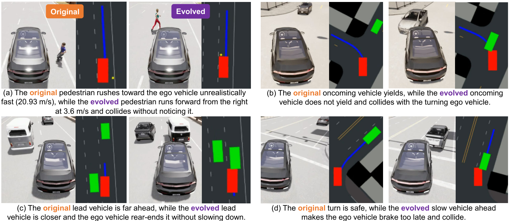

# 自动驾驶 RSI：值得关注的工作

仅选取本领域最新、与 RSI 关联最紧密的 3 篇工作；编号与「领域内发展状况.md」索引表一致。研究问题与核心方法为英文摘要的中文概括，不对实验数值作任何推断；方法架构图取自 arXiv 官方 HTML 版中的论文原图。

## 1. EvoAD: Self-Evolving Autonomous Driving via Latent World-Model Guided Post-hoc Reflection（2026）

- **研究问题**：端到端自动驾驶通过学习「传感器观测→行驶轨迹」的统一策略取得了快速进展。
- **核心方法**：提出 EvoAD：以潜在世界模型引导的事后反思，实现自动驾驶框架的自进化。
- **RSI 价值**：改进对象：上下文、提示与记忆结构；反馈闭环：未明确；多轮迭代：是；分类 L2；定位：直接 RSI（候选）。
- **值得关注的原因**：2026 年工作，在本领域 50 篇收录论文中 RSI 关联度评分位列前段；其主攻方向为上下文与记忆进化，与「系统自主改进自身并参与下一轮改进」这一核心问题直接相关，但摘要层面尚不足以证明稳定的跨代递归闭环，需回到原文实验部分核实。
- **原文与全文**：[官方论文页](https://arxiv.org/abs/2610.23886) ｜ [arXiv:2610.23886](https://arxiv.org/abs/2610.23886) ｜ [本地 PDF](docs/2026_EvoAD_Self_Evolving_Autonomous_Driving_via_Latent.pdf)
- **发表渠道**：arXiv preprint（预印本，未经同行评审）

*图：论文方法 / 框架图（取自 arXiv 官方 HTML 版的原图）。来源：[arXiv 官方 HTML 版原图](https://arxiv.org/html/2610.23886v1/teaser.png)*

## 2. Scaling Self-Play for End-to-End Driving（2026）

- **研究问题**：端到端驾驶模型通常基于离线人类示范数据训练，状态覆盖有限且缺少闭环反馈，部署后容易产生误差累积。
- **核心方法**：提出另一种训练思路：在仿真环境中直接从像素进行大规模自博弈。
- **RSI 价值**：改进对象：模型参数与训练机制；反馈闭环：是；多轮迭代：未明确；分类 L5；定位：直接 RSI（候选）。
- **值得关注的原因**：2026 年工作，在本领域 50 篇收录论文中 RSI 关联度评分位列前段；其主攻方向为基座模型进化，与「系统自主改进自身并参与下一轮改进」这一核心问题直接相关，但摘要层面尚不足以证明稳定的跨代递归闭环，需回到原文实验部分核实。
- **原文与全文**：[官方论文页](https://arxiv.org/abs/2606.19641) ｜ [arXiv:2606.19641](https://arxiv.org/abs/2606.19641) ｜ [本地 PDF](docs/2026_Scaling_Self_Play_for_End_to_End.pdf)
- **发表渠道**：arXiv preprint（预印本，未经同行评审）

*图：论文方法 / 框架图（取自 arXiv 官方 HTML 版的原图）。来源：[arXiv 官方 HTML 版原图](https://arxiv.org/html/2606.19641v2/gigapixel_system_felix_upgrades_v16.png)*

## 3. EvoDrive: Pareto Evolution for Safety-Critical Autonomous Driving via Self-Improving LLM Agents（2026）

- **研究问题**：生成安全关键场景对验证与改进自动驾驶系统至关重要，但既要最大化对抗性以暴露失效，又必须保持场景真实性。
- **核心方法**：提出 EvoDrive，首个基于大语言模型的自动化多目标场景生成智能体进化框架。
- **RSI 价值**：改进对象：改进方法/评价与搜索策略；反馈闭环：是；多轮迭代：是；分类 L6；定位：直接 RSI（候选）。
- **值得关注的原因**：2026 年工作，在本领域 50 篇收录论文中 RSI 关联度评分位列前段；其主攻方向为进化方法自身的改进，与「系统自主改进自身并参与下一轮改进」这一核心问题直接相关，但摘要层面尚不足以证明稳定的跨代递归闭环，需回到原文实验部分核实。
- **原文与全文**：[官方论文页](https://arxiv.org/abs/2606.03678) ｜ [arXiv:2606.03678](https://arxiv.org/abs/2606.03678) ｜ [本地 PDF](docs/2026_EvoDrive_Pareto_Evolution_for_Safety_Critical_Autonomous.pdf)
- **发表渠道**：CoRL（作者注明：Accepted at the 10th Conference on Robot Learning (CoRL 2026)）

*图：论文方法 / 框架图（取自 arXiv 官方 HTML 版的原图）。来源：[arXiv 官方 HTML 版原图](https://arxiv.org/html/2606.03678v2/fig_carla_cases.png)*
