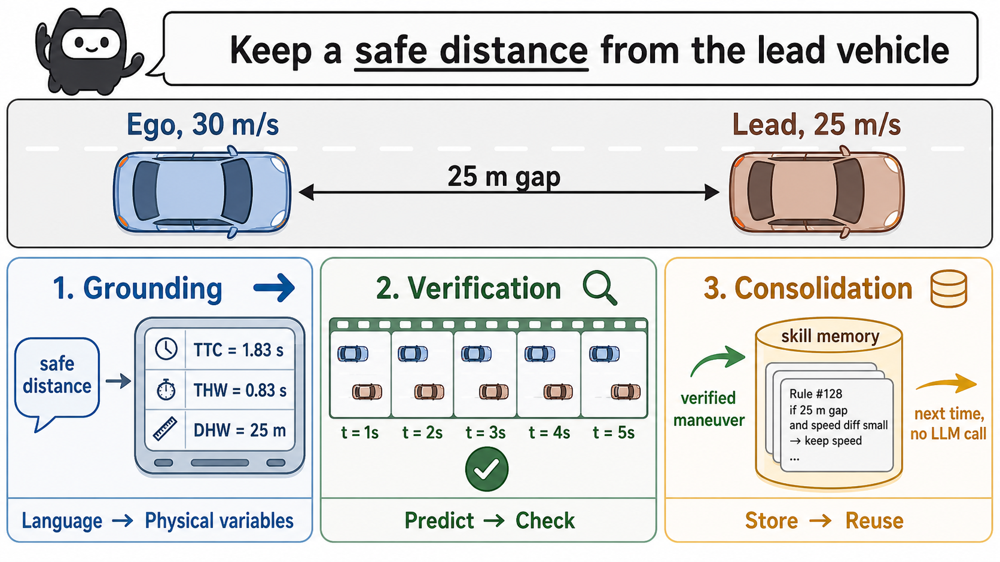
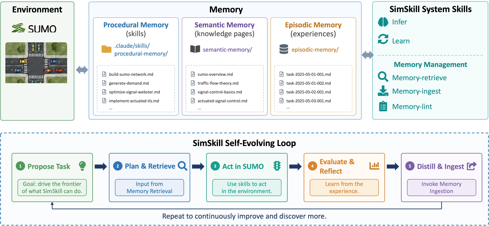
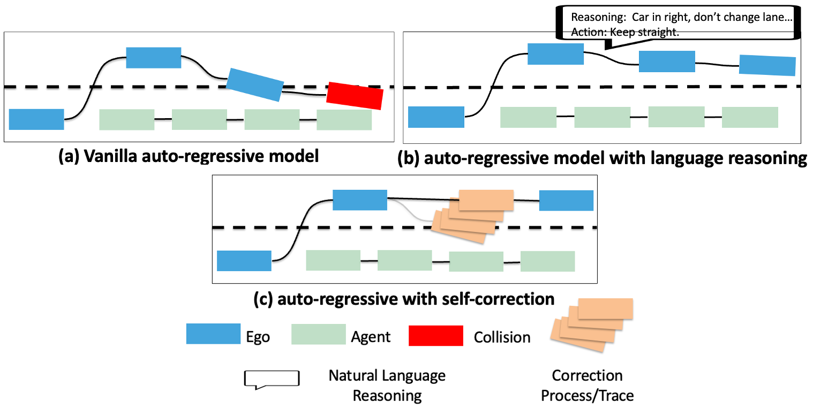

# 自动驾驶 RSI：值得关注的工作

仅选取 3 篇最新、与 RSI 关联最紧密的工作。研究问题与核心方法为英文摘要的中文概括，不推断实验数值；方法架构图取自 arXiv 官方 HTML 版论文原图。若条目来自补充层，会明确标注其未经同行评审。

## 1. REINS: A Self-Evolving Agent Harness for Real-Time Trajectory Planning（2026）

- **研究问题**：Agent harness（包裹 LLM 推理循环、提供工具调度、验证与持久记忆的运行时脚手架）已成为把 LLM 部署为自主智能体的标准底座。
- **核心方法**：提出 REINS，建立在三组 LLM—规划器耦合之上：把 LLM 输出锚定到学习到的变量级动力学模型、用校准谓词与前向推演加以验证、并整合进持久记忆。
- **RSI 价值**：改进对象为Agent 规划、决策与协作机制；反馈闭环：是；多轮迭代：未明确；分级 L4（置信度 高）；定位：接近 RSI。
- **值得关注的原因**：T1 CCF-A，2026 年。该工作发表于可核查的高水平渠道，且明确描述系统自主修改自身组成；
- **原文与全文**：[官方论文页](https://arxiv.org/abs/2611.10748) ｜ [arXiv:2611.10748](https://arxiv.org/abs/2611.10748) ｜ [本地 PDF](docs/2026_REINS_A_Self_Evolving_Agent_Harness_for.pdf)
- **发表渠道**：NeurIPS（作者注明：Accepted at NeurIPS 2026 (Main Track). 36 pages, 7 figures, 20 tables.）

*图：论文 Figure 1（方法/框架总览，取自 arXiv 官方 HTML 版）。来源：[arXiv 官方 HTML 版原图](https://arxiv.org/html/2611.10748v1/figures/intro_gaps-v3.png)*

## 2. SimSkill: A Self-Evolving LLM Agent for Skill and Knowledge Accumulation in Traffic Simulation（2026）

- **研究问题**：累积文化使人类能够跨经验与代际保存、复用并扩展知识与技能。
- **核心方法**：受该原理启发，提出 SimSkill：围绕 SUMO 城市交通仿真器构建的自进化智能体，用于技能与知识的持续积累。
- **RSI 价值**：改进对象为可复用技能/工具库；反馈闭环：未明确；多轮迭代：是；分级 L3（置信度 中）；定位：接近 RSI。
- **值得关注的原因**：T5 arXiv 预印本，2026 年。**该条目来自补充层，仅 arXiv / 非顶级渠道，未经同行评审，供跟踪而非定论。**
- **原文与全文**：[官方论文页](https://arxiv.org/abs/2609.03753) ｜ [arXiv:2609.03753](https://arxiv.org/abs/2609.03753) ｜ 本地 PDF 未获取
- **发表渠道**：arXiv preprint（预印本，未经同行评审）

*图：论文 Figure 1（方法/框架总览，取自 arXiv 官方 HTML 版）。来源：[arXiv 官方 HTML 版原图](https://arxiv.org/html/2609.03753v3/framework_simplified.png)*

## 3. CorrectionPlanner: Self-Correction Planner with Reinforcement Learning in Autonomous Driving（2026）

- **研究问题**：自动驾驶要求安全规划，但多数基于学习的规划器缺少显式自我纠正能力：一旦提出不安全动作，没有机制加以修正。
- **核心方法**：提出 CorrectionPlanner，一个带自纠正的自回归规划器，把规划建模为「提出—评估—纠正」循环中的运动 token 生成。
- **RSI 价值**：改进对象为Agent 规划、决策与协作机制；反馈闭环：未明确；多轮迭代：未明确；分级 L4（置信度 高）；定位：相关基础能力。
- **值得关注的原因**：T5 arXiv 预印本，2026 年。**该条目来自补充层，仅 arXiv / 非顶级渠道，未经同行评审，供跟踪而非定论。**
- **原文与全文**：[官方论文页](https://arxiv.org/abs/2603.15771) ｜ [arXiv:2603.15771](https://arxiv.org/abs/2603.15771) ｜ 本地 PDF 未获取
- **发表渠道**：arXiv preprint（预印本，未经同行评审）

*图：论文 Figure 1（方法/框架总览，取自 arXiv 官方 HTML 版）。来源：[arXiv 官方 HTML 版原图](https://arxiv.org/html/2603.15771v1/figure/autoregressive.png)*
