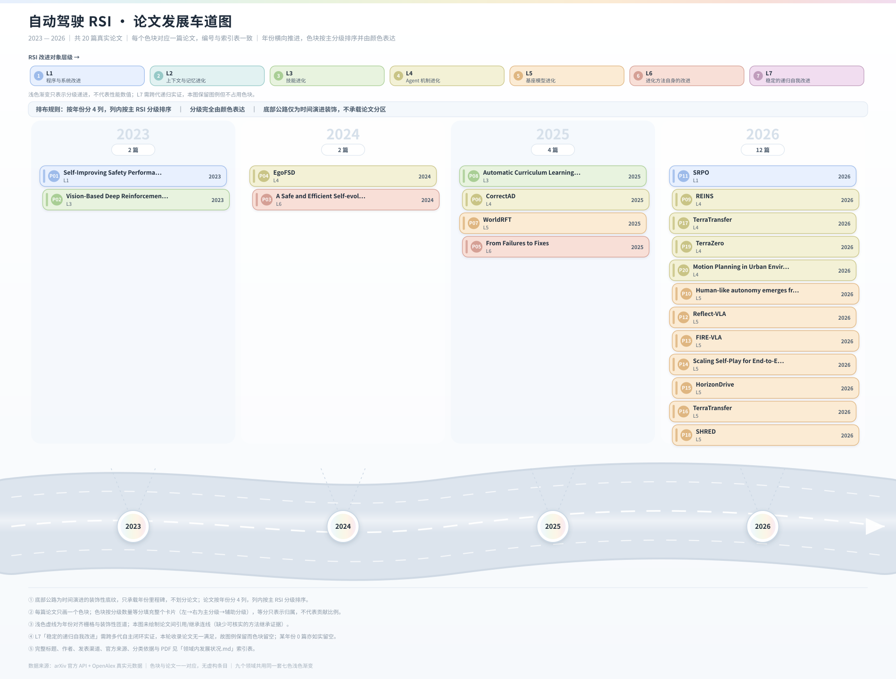

# 自动驾驶 RSI：领域内发展状况

[PNG 预览图](assets/lane_driving.png)

> **排布规则**：公路置于底部，仅作时间演进装饰，不划分论文。论文按 2023—2026 四个年份分列，列内按主 RSI 分级排序；分级完全由颜色表达，多分级色块为整块等分填充。本图**只绘制主索引论文**（CCF-A / SCI 一区 / 旗舰会议·顶刊 + 严格 RSI 分级），补充层预印本不计入色块。

## 发展脉络

本领域主索引共 **2 篇**高质量论文：CCF-A 1 篇、旗舰会议/领域顶刊 1 篇。分级置信度：高（人工复核） 1 篇、高 1 篇。年份分布：2025 年 1 篇、2026 年 1 篇。

所有论文均要求标题或摘要明确描述「系统修改自身的某一组成部分」，并以**短语级改进对象证据**判定 L1–L7；仅有 `closed-loop`（控制闭环）、`continual learning`、`feedback` 等泛词的工作一律不计入。**L7 稳定递归自我改进全程留空**：现有工作均未提供跨多代、可验证的持续提升证据。

## 论文索引（主索引，含逐篇核实信息）

| 编号 | 论文名称 | 年份 | 出版层级 | 发表渠道 | 作者 | RSI 分级 | 置信度 | 定位 | 改进对象 | 反馈闭环 | 多轮迭代 | 判定依据 | 全文 |
|---|---|---|---|---|---|---|---|---|---|---|---|---|---|
| P01 | [Automatic Curriculum Learning for Driving Scenarios: Towards Robust and Efficient Reinforcement Learning](https://arxiv.org/abs/2505.08264) | 2025 | T3 旗舰会议/领域顶刊 | IEEE（作者注明：Accepted in the 36th IEEE Intelligent Vehicles Symposium (IV 2025)） | Ahmed Abouelazm, Tim Weinstein, Tim Joseph et al. | L3 | 高（人工复核） | 相关基础能力 | 可复用技能/工具库 | 未明确 | 未明确 | 自我改进证据：automatic curriculum；L3 改进对象：automatic curriculum；人工复核：自动课程学习仅调整训练样本分布，未证明改进后的系统参与下一轮自我改进 | [PDF](docs/2025_Automatic_Curriculum_Learning_for_Driving_Scenarios.pdf) |
| P02 | [REINS: A Self-Evolving Agent Harness for Real-Time Trajectory Planning](https://arxiv.org/abs/2611.10748) | 2026 | T1 CCF-A | NeurIPS（作者注明：Accepted at NeurIPS 2026 (Main Track). 36 pages, 7 figures, 20 tables.） | Zhihong Cui, Hengyu Liu, Haoran Tang et al. | L4 | 高 | 接近 RSI | Agent 规划、决策与协作机制 | 是 | 未明确 | 自我改进证据：self-evolv、evolving agent、self-evolution；反馈/验证信号：摘要含执行反馈、评估或迭代验证线索；L4 改进对象：agent harness、planner | [PDF](docs/2026_REINS_A_Self_Evolving_Agent_Harness_for.pdf) |

> 「出版层级」依据 CCF 第七版（2026）官方目录与项目内可核查的期刊/会议别名词表；标注「作者自述接收」的记录来自 arXiv comment，尚待正式出版页面核实。「置信度」为 L1–L7 判定依据强度：高＝标题含明确改进对象短语，中＝摘要含强短语，人工复核＝已按编辑判断修正。完整标准见顶层《分类与质量核查报告.md》。

## 补充层：预印本与非顶级正式出版（不计入高质量论文）

以下 5 篇与本领域自主改进主题相关，但**仅发表于 arXiv 或非顶级渠道**，按「宁缺毋滥」原则不进入上方主索引与车道图，仅作后续跟踪；不得视为已证实的高水平成果。

| 编号 | 论文名称 | 年份 | 出版层级 | 分级 | 定位 | 来源 |
|---|---|---|---|---|---|---|
| S01 | [Vision-Based Deep Reinforcement Learning of UAV-UGV Collaborative Landing Policy Using Automatic Curriculum](https://doi.org/10.3390/drones7110676) | 2023 | T4 其他正式出版 | L3 | 相关基础能力 | [官方页](https://doi.org/10.3390/drones7110676) |
| S02 | [SimSkill: A Self-Evolving LLM Agent for Skill and Knowledge Accumulation in Traffic Simulation](https://arxiv.org/abs/2609.03753) | 2026 | T5 arXiv 预印本 | L3 | 接近 RSI | [官方页](https://arxiv.org/abs/2609.03753) |
| S03 | [From Failures to Fixes: LLM-Driven Scenario Repair for Self-Evolving Autonomous Driving](https://arxiv.org/abs/2505.22067) | 2025 | T5 arXiv 预印本 | L6 | 相关基础能力 | [官方页](https://arxiv.org/abs/2505.22067) |
| S04 | [CorrectionPlanner: Self-Correction Planner with Reinforcement Learning in Autonomous Driving](https://arxiv.org/abs/2603.15771) | 2026 | T5 arXiv 预印本 | L4 | 相关基础能力 | [官方页](https://arxiv.org/abs/2603.15771) |
| S05 | [AutoDrive-R$^2$: Incentivizing Reasoning and Self-Reflection Capacity for VLA Model in Autonomous Driving](https://arxiv.org/abs/2509.01944) | 2025 | T5 arXiv 预印本 | L5 | 接近 RSI | [官方页](https://arxiv.org/abs/2509.01944) |

## 目前的主要技术路线及发展趋势

主索引中占比最高的改进对象为：L3 技能进化（1 篇）、L4 Agent 机制进化（1 篇）。这反映本领域目前的研究集中在**组件级 / 技能级的自主改进**，而非基座模型或进化方法自身的递归改进。

跨领域共通的基础方法（Self-Refine、STOP、Darwin Gödel Machine、AlphaEvolve、FunSearch、MemGPT 等）不归属任何应用领域，统一收录于顶层《跨领域 RSI 基础方法.md》。

## 尚未解决的关键问题

1. **稳定多轮递归闭环缺失**：L1–L6 均有零散工作，但没有一篇提供跨多代、由改进后系统继续推动下一代改进的实证，L7 因此留空。
2. **发表层级与前沿性矛盾**：RSI 最新工作大量停留在 arXiv，严格按 CCF-A / 顶刊筛选会显著减少可用文献；补充层与主索引的分离是必要的折中。
3. **作者自述接收待核实**：部分 2026 年顶会记录仅来自 arXiv comment，需以会议官方论文集复核。
4. **分级依赖摘要措辞**：本索引的 L1–L7 判定基于标题/摘要的改进对象短语，尚需回到原文方法部分与实验部分做最终确认。
