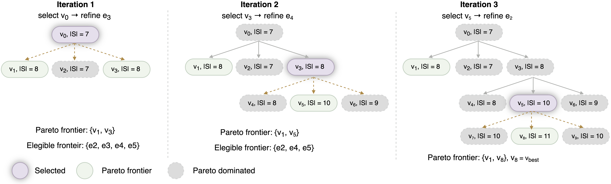
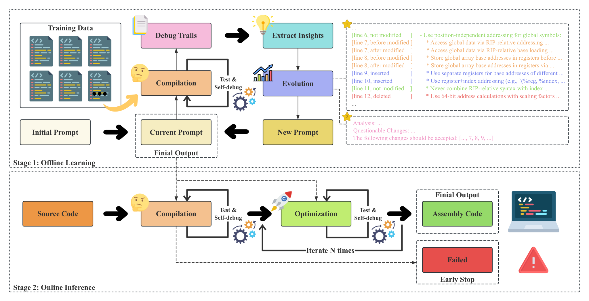

# 软件工程 RSI：值得关注的工作

仅选取 3 篇最新、与 RSI 关联最紧密的工作。研究问题与核心方法为英文摘要的中文概括，不推断实验数值；方法架构图取自 arXiv 官方 HTML 版论文原图。若条目来自补充层，会明确标注其未经同行评审。

## 1. SpecForge: Recursive Self-Improvement for Coding Agents via Behavioral Specifications（2026）

- **研究问题**：基于冻结语言模型的编码智能体，可在不更新模型权重的前提下，通过优化其依赖的外部上下文提升表现。
- **核心方法**：构建自我改进闭环：智能体依据当前行为规格生成代码，用执行验证过的测试加以评估，再根据观察到的失败修订规格。
- **RSI 价值**：改进对象为上下文、提示与记忆结构；反馈闭环：是；多轮迭代：是；分级 L2（置信度 高（人工复核））；定位：直接 RSI（候选）。
- **值得关注的原因**：T1 CCF-A，2026 年。该工作发表于可核查的高水平渠道，且明确描述系统自主修改自身组成；
- **原文与全文**：[官方论文页](https://arxiv.org/abs/2610.15708) ｜ [arXiv:2610.15708](https://arxiv.org/abs/2610.15708) ｜ [本地 PDF](docs/2026_SpecForge_Recursive_Self_Improvement_for_Coding.pdf)
- **发表渠道**：NeurIPS（作者注明：Accepted to NeurIPS 2026 (Main Track)）

*图：论文 Figure 1（方法/框架总览，取自 arXiv 官方 HTML 版）。来源：[arXiv 官方 HTML 版原图](https://arxiv.org/html/2610.15708v1/figures/tree.png)*

## 2. QiMeng-NeuComBack: Self-Evolving Translation from IR to Assembly Code（2025）

- **研究问题**：编译器极其复杂，开发和维护需要昂贵的人工专业知识；大语言模型带来的「神经编译」为新架构的编译器开发与优化技术发现提供了新范式，但仍有关键障碍。
- **核心方法**：提出从中间表示（IR）到汇编代码的自进化翻译方法；摘要报告其显著改善了 LLM 生成汇编代码的功能正确性与性能（具体机制需回原文方法部分核实）。
- **RSI 价值**：改进对象为程序/系统实现与算法流程；反馈闭环：是；多轮迭代：是；分级 L1（置信度 高（人工复核））；定位：接近 RSI。
- **值得关注的原因**：T1 CCF-A，2025 年。该工作发表于可核查的高水平渠道，且明确描述系统自主修改自身组成；
- **原文与全文**：[官方论文页](https://arxiv.org/abs/2511.01183) ｜ [arXiv:2511.01183](https://arxiv.org/abs/2511.01183) ｜ [本地 PDF](docs/2025_QiMeng_NeuComBack_Self_Evolving_Translation_from.pdf)
- **发表渠道**：NeurIPS（作者注明：Accepted at NeurIPS 2025）

*图：论文 Figure 1（方法/框架总览，取自 arXiv 官方 HTML 版）。来源：[arXiv 官方 HTML 版原图](https://arxiv.org/html/2511.01183v1/Neural_Compilation.png)*

## 3. Toward Training Superintelligent Software Agents through Self-Play SWE-RL（2025）

- **研究问题**：当前由 LLM 与智能体强化学习驱动的软件开发智能体能提升程序员效率，但其训练数据（如 GitHub issue、PR）与环境存在局限。
- **核心方法**：提出 Self-play SWE-RL（SSR），作为面向「超级软件智能体」训练范式的第一步，采用自博弈方式组织训练。
- **RSI 价值**：改进对象为模型参数与训练机制；反馈闭环：是；多轮迭代：是；分级 L5（置信度 高）；定位：接近 RSI。
- **值得关注的原因**：T1 CCF-A，2025 年。该工作发表于可核查的高水平渠道，且明确描述系统自主修改自身组成；
- **原文与全文**：[官方论文页](https://arxiv.org/abs/2512.18552) ｜ [arXiv:2512.18552](https://arxiv.org/abs/2512.18552) ｜ [本地 PDF](docs/2025_Toward_Training_Superintelligent_Software_Agents.pdf)
- **发表渠道**：ICML（作者注明：Accepted to ICML 2026）

*该论文未检索到 arXiv 官方 HTML 版插图，故不插入架构图（不伪造图片）。*
