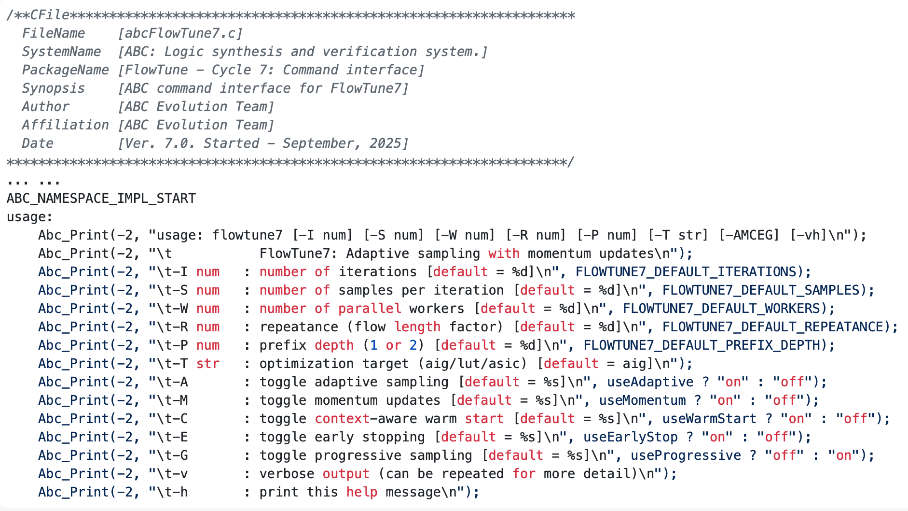

# 软件工程 RSI：值得关注的工作

仅选取 3 篇最新、与 RSI 关联最紧密的工作。研究问题与核心方法为英文摘要的中文概括，不推断实验数值；方法架构图取自 arXiv 官方 HTML 版论文原图。每篇均标注出版层级，若为准入的 2026 年 arXiv 预印本会额外注明未经同行评审。

## 1. Autonomous Evolution of EDA Tools: Multi-Agent Self-Evolved ABC（2026）

- **研究问题**：逻辑综合工具（ABC）的改进长期依赖人工工程经验；论文提出首个自进化逻辑综合框架。
- **核心方法**：用 LLM 智能体自主改进广泛使用的 ABC 源代码，在整个集成代码库上工作，并保持单二进制执行模型与命令接口不变。
- **RSI 价值**：改进对象为 Agent 规划、决策与协作机制；反馈闭环：是；多轮迭代：是；分级 L4（置信度 高）；定位：接近 RSI。
- **值得关注的原因**：T1 CCF-A，2026 年。该工作发表于 CCF-A 渠道，属本轮最高出版层级；
- **原文与全文**：[官方论文页](https://doi.org/10.1145/3770743.3804221) ｜ [arXiv:2604.15082](https://arxiv.org/abs/2604.15082) ｜ [本地 PDF](docs/2026_Autonomous_Evolution_of_EDA_Tools_Multi_Agent.pdf)
- **发表渠道**：ACM/IEEE Design Automation Conference (DAC)

*图：论文 Figure 1（方法/框架总览，取自 arXiv 官方 HTML 版）。来源：[arXiv 官方 HTML 版原图](https://arxiv.org/html/2604.15082v1/figs/flowtune-7-example.png)*

## 2. SpecForge: Recursive Self-Improvement for Coding Agents via Behavioral Specifications（2026）

- **研究问题**：基于冻结语言模型的编码智能体，可在不更新模型权重的前提下，通过优化其依赖的外部上下文提升表现。
- **核心方法**：构建自我改进闭环：智能体依据当前行为规格生成代码，用执行验证过的测试加以评估，再根据观察到的失败修订规格。
- **RSI 价值**：改进对象为 上下文、提示与记忆结构；反馈闭环：是；多轮迭代：是；分级 L2（置信度 高（人工复核））；定位：直接 RSI（候选）。
- **值得关注的原因**：T1 CCF-A，2026 年。该工作发表于 CCF-A 渠道，属本轮最高出版层级；
- **原文与全文**：[官方论文页](https://arxiv.org/abs/2610.15708) ｜ [arXiv:2610.15708](https://arxiv.org/abs/2610.15708) ｜ [本地 PDF](docs/2026_SpecForge_Recursive_Self_Improvement_for_Coding.pdf)
- **发表渠道**：NeurIPS（作者注明：Accepted to NeurIPS 2026 (Main Track)）

*图：论文 Figure 1（方法/框架总览，取自 arXiv 官方 HTML 版）。来源：[arXiv 官方 HTML 版原图](https://arxiv.org/html/2610.15708v1/figures/tree.png)*

## 3. ExeCRE: Execution-Consistency Guided Reliability Estimation for Self-Correcting Code Generation（2026）

- **研究问题**：大语言模型在代码生成上进展显著，但在需要复杂算法与实现的困难任务上仍然吃力。
- **核心方法**：提出 ExeCRE：以执行一致性为导向的代码可靠性估计框架，用于自我纠错式代码生成中的结果筛选。
- **RSI 价值**：改进对象为 程序/系统实现与算法流程；反馈闭环：是；多轮迭代：未明确；分级 L1（置信度 高）；定位：接近 RSI。
- **值得关注的原因**：T1 CCF-A，2026 年。该工作发表于 CCF-A 渠道，属本轮最高出版层级；
- **原文与全文**：[官方论文页](https://doi.org/10.1145/3832783.3837445) ｜ [arXiv:2608.04439](https://arxiv.org/abs/2608.04439) ｜ [本地 PDF](docs/2026_ExeCRE_Execution_Consistency_Guided_Reliability.pdf)
- **发表渠道**：IEEE/ACM International Conference on Automated Software Engineering (ASE)

*图：论文 Figure 1（方法/框架总览，取自 arXiv 官方 HTML 版）。来源：[arXiv 官方 HTML 版原图](https://arxiv.org/html/2608.04439v1/figures/SelfCorrection_0327_4.png)*
