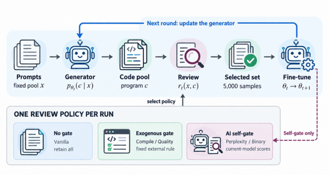

# 软件工程 RSI：值得关注的工作

仅选取本领域最新、与 RSI 关联最紧密的 3 篇工作；编号与「领域内发展状况.md」索引表一致。研究问题与核心方法为英文摘要的中文概括，不对实验数值作任何推断；方法架构图取自 arXiv 官方 HTML 版中的论文原图。

## 1. SpecForge: Recursive Self-Improvement for Coding Agents via Behavioral Specifications（2026）

- **研究问题**：基于冻结语言模型的编码智能体，可以在不更新模型权重的前提下，通过优化其依赖的外部上下文来提升表现。
- **核心方法**：构建自我改进闭环：智能体依据当前行为规格生成代码，用经执行验证的测试评估，再根据观察到的失败修订规格。
- **RSI 价值**：改进对象：模型参数与训练机制；反馈闭环：是；多轮迭代：是；分类 L5；定位：直接 RSI（候选）。
- **值得关注的原因**：2026 年工作，在本领域 50 篇收录论文中 RSI 关联度评分位列前段；其主攻方向为基座模型进化，与「系统自主改进自身并参与下一轮改进」这一核心问题直接相关，但摘要层面尚不足以证明稳定的跨代递归闭环，需回到原文实验部分核实。
- **原文与全文**：[官方论文页](https://arxiv.org/abs/2610.15708) ｜ [arXiv:2610.15708](https://arxiv.org/abs/2610.15708) ｜ [本地 PDF](docs/2026_SpecForge_Recursive_Self_Improvement_for_Coding.pdf)
- **发表渠道**：NeurIPS（作者注明：Accepted to NeurIPS 2026 (Main Track)）

*图：论文方法 / 框架图（取自 arXiv 官方 HTML 版的原图）。来源：[arXiv 官方 HTML 版原图](https://arxiv.org/html/2610.15708v1/figures/tree.png)*

## 2. Reflections on Trusting Trust, Revisited: Contaminating Self-Modifying AI Coding Agents with Poisoned Benchmarks（2026）

- **研究问题**：Thompson 的经典工作表明，编译器可被植入后门并自我复制，即使重新编译干净源码也会重现木马。
- **核心方法**：把这一风险迁移到会生成自身新版本的 AI 编码智能体，考察投毒对自我修改型智能体的威胁。
- **RSI 价值**：改进对象：Agent 规划、决策与协作机制；反馈闭环：未明确；多轮迭代：未明确；分类 L4；定位：接近 RSI。
- **值得关注的原因**：2026 年工作，在本领域 50 篇收录论文中 RSI 关联度评分位列前段；其主攻方向为Agent 机制进化，与「系统自主改进自身并参与下一轮改进」这一核心问题直接相关，但摘要层面尚不足以证明稳定的跨代递归闭环，需回到原文实验部分核实。
- **原文与全文**：[官方论文页](https://arxiv.org/abs/2609.17817) ｜ [arXiv:2609.17817](https://arxiv.org/abs/2609.17817) ｜ [本地 PDF](docs/2026_Reflections_on_Trusting_Trust_Revisited_Contaminating.pdf)
- **发表渠道**：arXiv preprint（预印本，未经同行评审）

## 3. When AI Reviews Its Own Code: Recursive Self-Training Collapse in Code LLMs（2026）

- **研究问题**：当生成数据被反复复用、又缺少新的人类数据或外部质量控制时，递归自训练会使生成模型退化。
- **核心方法**：在代码大模型上研究该风险：AI 生成的代码进入真实仓库后又成为训练数据，形成仓库规模的自训练回路。
- **RSI 价值**：改进对象：模型参数与训练机制；反馈闭环：是；多轮迭代：是；分类 L5；定位：直接 RSI（候选）。
- **值得关注的原因**：2026 年工作，在本领域 50 篇收录论文中 RSI 关联度评分位列前段；其主攻方向为基座模型进化，与「系统自主改进自身并参与下一轮改进」这一核心问题直接相关，但摘要层面尚不足以证明稳定的跨代递归闭环，需回到原文实验部分核实。
- **原文与全文**：[官方论文页](https://arxiv.org/abs/2606.28438) ｜ [arXiv:2606.28438](https://arxiv.org/abs/2606.28438) ｜ [本地 PDF](docs/2026_When_AI_Reviews_Its_Own_Code_Recursive.pdf)
- **发表渠道**：arXiv preprint（预印本，未经同行评审）

*图：论文方法 / 框架图（取自 arXiv 官方 HTML 版的原图）。来源：[arXiv 官方 HTML 版原图](https://arxiv.org/html/2606.28438v2/review_coupling_imagegen.png)*
