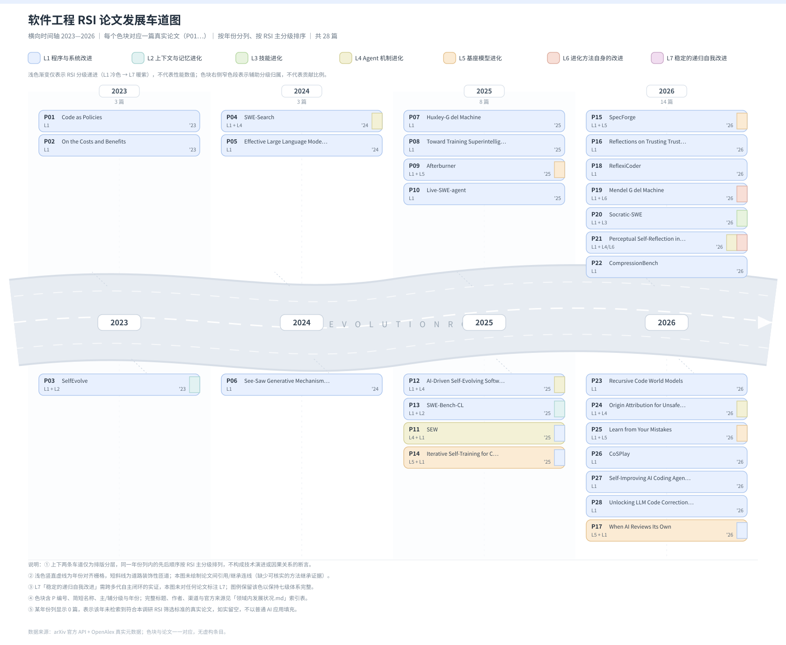

# 软件工程 RSI：领域内发展状况

[PNG 预览图](assets/lane_software.png) ｜ 图中每个色块对应一篇真实论文，编号与下表一致。 ｜ [七级配色规范](../assets/RSI_七级配色图例.svg)

## 发展脉络

本领域共收录 **28 篇** 2023—2026 年的真实论文，按年份分布为 2023 年 3 篇、2024 年 3 篇、2025 年 8 篇、2026 年 14 篇。其中 23 篇为 arXiv 预印本（未经同行评审），28 篇已下载原文 PDF 存档。

按 RSI 主分级统计，L1（程序与系统改进）25 篇、L4（Agent 机制进化）1 篇、L5（基座模型进化）2 篇。定位上：直接 RSI 候选 14 篇、接近 RSI 12 篇、相关基础能力 2 篇。

**成熟度判断**：该领域已有较多以自我改进、迭代反馈与经验积累为核心机制的工作，但「改进后的系统能否稳定推动下一代改进」仍普遍缺少跨多代、可持续提升的实证；第 7 级（稳定的递归自我改进）在本轮收录中一律留空。

## 论文索引

| 编号 | 论文名称 | 年份 | 发表渠道 | RSI 分类 | 定位 | 官方来源 | PDF |
|---|---|---|---|---|---|---|---|
| P01 | Code as Policies: Language Model Programs for Embodied Control | 2023 | Proceedings - IEEE International Conference on Robotics and Automation/Proceedings | L1 | 直接 RSI（候选） | [原文页](https://doi.org/10.1109/icra48891.2023.10160591) | [2023\_Code\_as\_Policies\_Language\_Model\_Programs\_for.pdf](docs/2023_Code_as_Policies_Language_Model_Programs_for.pdf) |
| P02 | On the Costs and Benefits of Adopting Lifelong Learning for Software Analytics -- Empirical Study on Brown Build and Risk Prediction | 2023 | 46th International Conference on Software Engineering: Software Engineering in Practice 2024 | L1 | 相关基础能力 | [原文页](https://arxiv.org/abs/2305.09824) | [2023\_On\_the\_Costs\_and\_Benefits\_of\_Adopting.pdf](docs/2023_On_the_Costs_and_Benefits_of_Adopting.pdf) |
| P03 | SelfEvolve: A Code Evolution Framework via Large Language Models | 2023 | arXiv preprint（预印本，未经同行评审） | L1 + L2 | 相关基础能力 | [原文页](https://arxiv.org/abs/2306.02907) | [2023\_SelfEvolve\_A\_Code\_Evolution\_Framework\_via\_Large.pdf](docs/2023_SelfEvolve_A_Code_Evolution_Framework_via_Large.pdf) |
| P04 | SWE-Search: Enhancing Software Agents with Monte Carlo Tree Search and Iterative Refinement | 2024 | arXiv (Cornell University)（预印本，未经同行评审） | L1 + L4 | 直接 RSI（候选） | [原文页](https://doi.org/10.48550/arxiv.2410.20285) | [2024\_SWE\_Search\_Enhancing\_Software\_Agents\_with\_Monte.pdf](docs/2024_SWE_Search_Enhancing_Software_Agents_with_Monte.pdf) |
| P05 | Effective Large Language Model Debugging with Best-first Tree Search | 2024 | arXiv preprint（预印本，未经同行评审） | L1 | 接近 RSI | [原文页](https://arxiv.org/abs/2407.19055) | [2024\_Effective\_Large\_Language\_Model\_Debugging\_with\_Best.pdf](docs/2024_Effective_Large_Language_Model_Debugging_with_Best.pdf) |
| P06 | See-Saw Generative Mechanism for Scalable Recursive Code Generation with Generative AI | 2024 | arXiv preprint（预印本，未经同行评审） | L1 | 直接 RSI（候选） | [原文页](https://arxiv.org/abs/2411.10861) | [2024\_See\_Saw\_Generative\_Mechanism\_for\_Scalable\_Recursive.pdf](docs/2024_See_Saw_Generative_Mechanism_for_Scalable_Recursive.pdf) |
| P07 | Huxley-Gödel Machine: Human-Level Coding Agent Development by an Approximation of the Optimal Self-Improving Machine | 2025 | arXiv preprint（预印本，未经同行评审） | L1 | 接近 RSI | [原文页](https://arxiv.org/abs/2510.21614) | [2025\_Huxley\_G\_del\_Machine\_Human\_Level\_Coding.pdf](docs/2025_Huxley_G_del_Machine_Human_Level_Coding.pdf) |
| P08 | Toward Training Superintelligent Software Agents through Self-Play SWE-RL | 2025 | ICML（作者注明：Accepted to ICML 2026） | L1 | 直接 RSI（候选） | [原文页](https://arxiv.org/abs/2512.18552) | [2025\_Toward\_Training\_Superintelligent\_Software\_Agents.pdf](docs/2025_Toward_Training_Superintelligent_Software_Agents.pdf) |
| P09 | Afterburner: Reinforcement Learning Facilitates Self-Improving Code Efficiency Optimization | 2025 | arXiv preprint（预印本，未经同行评审） | L1 + L5 | 直接 RSI（候选） | [原文页](https://arxiv.org/abs/2505.23387) | [2025\_Afterburner\_Reinforcement\_Learning\_Facilitates\_Self.pdf](docs/2025_Afterburner_Reinforcement_Learning_Facilitates_Self.pdf) |
| P10 | Live-SWE-agent: Can Software Engineering Agents Self-Evolve on the Fly? | 2025 | arXiv preprint（预印本，未经同行评审） | L1 | 接近 RSI | [原文页](https://arxiv.org/abs/2511.13646) | [2025\_Live\_SWE\_agent\_Can\_Software\_Engineering\_Agents.pdf](docs/2025_Live_SWE_agent_Can_Software_Engineering_Agents.pdf) |
| P11 | SEW: Self-Evolving Agentic Workflows for Automated Code Generation | 2025 | arXiv preprint（预印本，未经同行评审） | L4 + L1 | 接近 RSI | [原文页](https://arxiv.org/abs/2505.18646) | [2025\_SEW\_Self\_Evolving\_Agentic\_Workflows\_for\_Automated.pdf](docs/2025_SEW_Self_Evolving_Agentic_Workflows_for_Automated.pdf) |
| P12 | AI-Driven Self-Evolving Software: A Promising Path Toward Software Automation | 2025 | arXiv preprint（预印本，未经同行评审） | L1 + L4 | 接近 RSI | [原文页](https://arxiv.org/abs/2510.00591) | [2025\_AI\_Driven\_Self\_Evolving\_Software\_A\_Promising.pdf](docs/2025_AI_Driven_Self_Evolving_Software_A_Promising.pdf) |
| P13 | SWE-Bench-CL: Continual Learning for Coding Agents | 2025 | arXiv preprint（预印本，未经同行评审） | L1 + L2 | 接近 RSI | [原文页](https://arxiv.org/abs/2507.00014) | [2025\_SWE\_Bench\_CL\_Continual\_Learning\_for\_Coding.pdf](docs/2025_SWE_Bench_CL_Continual_Learning_for_Coding.pdf) |
| P14 | Iterative Self-Training for Code Generation via Reinforced Re-Ranking | 2025 | arXiv preprint（预印本，未经同行评审） | L5 + L1 | 直接 RSI（候选） | [原文页](https://arxiv.org/abs/2504.09643) | [2025\_Iterative\_Self\_Training\_for\_Code\_Generation\_via.pdf](docs/2025_Iterative_Self_Training_for_Code_Generation_via.pdf) |
| P15 | SpecForge: Recursive Self-Improvement for Coding Agents via Behavioral Specifications | 2026 | NeurIPS（作者注明：Accepted to NeurIPS 2026 (Main Track)） | L1 + L5 | 直接 RSI（候选） | [原文页](https://arxiv.org/abs/2610.15708) | [2026\_SpecForge\_Recursive\_Self\_Improvement\_for\_Coding.pdf](docs/2026_SpecForge_Recursive_Self_Improvement_for_Coding.pdf) |
| P16 | Reflections on Trusting Trust, Revisited: Contaminating Self-Modifying AI Coding Agents with Poisoned Benchmarks | 2026 | arXiv preprint（预印本，未经同行评审） | L1 | 接近 RSI | [原文页](https://arxiv.org/abs/2609.17817) | [2026\_Reflections\_on\_Trusting\_Trust\_Revisited\_Contaminating.pdf](docs/2026_Reflections_on_Trusting_Trust_Revisited_Contaminating.pdf) |
| P17 | When AI Reviews Its Own Code: Recursive Self-Training Collapse in Code LLMs | 2026 | arXiv preprint（预印本，未经同行评审） | L5 + L1 | 直接 RSI（候选） | [原文页](https://arxiv.org/abs/2606.28438) | [2026\_When\_AI\_Reviews\_Its\_Own\_Code\_Recursive.pdf](docs/2026_When_AI_Reviews_Its_Own_Code_Recursive.pdf) |
| P18 | ReflexiCoder: Teaching Large Language Models to Self-Reflect on Generated Code and Self-Correct It via Reinforcement Learning | 2026 | arXiv preprint（预印本，未经同行评审） | L1 | 接近 RSI | [原文页](https://arxiv.org/abs/2603.05863) | [2026\_ReflexiCoder\_Teaching\_Large\_Language\_Models\_to\_Self.pdf](docs/2026_ReflexiCoder_Teaching_Large_Language_Models_to_Self.pdf) |
| P19 | Mendel Gödel Machine: Recursive Self-Improving Coding Agents via Comparative Evolution | 2026 | arXiv preprint（预印本，未经同行评审） | L1 + L6 | 直接 RSI（候选） | [原文页](https://arxiv.org/abs/2608.07645) | [2026\_Mendel\_G\_del\_Machine\_Recursive\_Self\_Improving.pdf](docs/2026_Mendel_G_del_Machine_Recursive_Self_Improving.pdf) |
| P20 | Socratic-SWE: Self-Evolving Coding Agents via Trace-Derived Agent Skills | 2026 | arXiv preprint（预印本，未经同行评审） | L1 + L3 | 直接 RSI（候选） | [原文页](https://arxiv.org/abs/2606.07412) | [2026\_Socratic\_SWE\_Self\_Evolving\_Coding\_Agents\_via.pdf](docs/2026_Socratic_SWE_Self_Evolving_Coding_Agents_via.pdf) |
| P21 | Perceptual Self-Reflection in Agentic Physics Simulation Code Generation | 2026 | arXiv preprint（预印本，未经同行评审） | L1 + L4 + L6 | 接近 RSI | [原文页](https://arxiv.org/abs/2602.12311) | [2026\_Perceptual\_Self\_Reflection\_in\_Agentic\_Physics\_Simulation.pdf](docs/2026_Perceptual_Self_Reflection_in_Agentic_Physics_Simulation.pdf) |
| P22 | CompressionBench: How can your coding agents compress LLMs? | 2026 | arXiv preprint（预印本，未经同行评审） | L1 | 直接 RSI（候选） | [原文页](https://arxiv.org/abs/2611.06858) | [2026\_CompressionBench\_How\_can\_your\_coding\_agents\_compress.pdf](docs/2026_CompressionBench_How_can_your_coding_agents_compress.pdf) |
| P23 | Recursive Code World Models: Building Complex Worlds through Recursive Scene Programs | 2026 | arXiv preprint（预印本，未经同行评审） | L1 | 直接 RSI（候选） | [原文页](https://arxiv.org/abs/2609.11499) | [2026\_Recursive\_Code\_World\_Models\_Building\_Complex\_Worlds.pdf](docs/2026_Recursive_Code_World_Models_Building_Complex_Worlds.pdf) |
| P24 | Origin Attribution for Unsafe Behavior in Self-Evolving Multi-Agent Coding Systems | 2026 | arXiv preprint（预印本，未经同行评审） | L1 + L4 | 接近 RSI | [原文页](https://arxiv.org/abs/2610.17488) | [2026\_Origin\_Attribution\_for\_Unsafe\_Behavior\_in\_Self.pdf](docs/2026_Origin_Attribution_for_Unsafe_Behavior_in_Self.pdf) |
| P25 | Learn from Your Mistakes: Tree-like Self-Play for Secure Code LLMs | 2026 | ICML（作者注明：18 pages, 3 figures, Accepted by ICML 2026） | L1 + L5 | 接近 RSI | [原文页](https://arxiv.org/abs/2606.03489) | [2026\_Learn\_from\_Your\_Mistakes\_Tree\_like\_Self.pdf](docs/2026_Learn_from_Your_Mistakes_Tree_like_Self.pdf) |
| P26 | CoSPlay: Cooperative Self-Play at Test-Time with Self-Generated Code and Unit Test | 2026 | arXiv preprint（预印本，未经同行评审） | L1 | 直接 RSI（候选） | [原文页](https://arxiv.org/abs/2605.23491) | [2026\_CoSPlay\_Cooperative\_Self\_Play\_at\_Test\_Time.pdf](docs/2026_CoSPlay_Cooperative_Self_Play_at_Test_Time.pdf) |
| P27 | Self-Improving AI Coding Agents Through Accumulated Behavioral Rules: A Closed-Loop Framework | 2026 | arXiv (Cornell University)（预印本，未经同行评审） | L1 | 直接 RSI（候选） | [原文页](https://doi.org/10.48550/arxiv.2607.13091) | [2026\_Self\_Improving\_AI\_Coding\_Agents\_Through\_Accumulated.pdf](docs/2026_Self_Improving_AI_Coding_Agents_Through_Accumulated.pdf) |
| P28 | Unlocking LLM Code Correction with Iterative Feedback Loops | 2026 | arXiv preprint（预印本，未经同行评审） | L1 | 接近 RSI | [原文页](https://arxiv.org/abs/2606.17514) | [2026\_Unlocking\_LLM\_Code\_Correction\_with\_Iterative\_Feedback.pdf](docs/2026_Unlocking_LLM_Code_Correction_with_Iterative_Feedback.pdf) |

> 说明：「直接 RSI（候选）」表示摘要同时出现明确的自我改进措辞与反馈/迭代线索，是否真正构成严格递归闭环仍需回到原文实验部分核实；「相关基础能力」不计入 RSI 成果。

## 逐篇核实明细

| 编号 | 作者 | 改进对象 | 反馈闭环 | 多轮迭代 | RSI 分类依据（标题/摘要主题词） |
|---|---|---|---|---|---|
| P01 | Jacky Liang, Wenlong Huang, Fei Xia et al. | 程序/系统实现与算法流程 | 是 | 是 | 自我改进线索：recursive、feedback loop；反馈/迭代线索：feedback、loop；L1 线索：code、program、script |
| P02 | Doriane Olewicki, Sarra Habchi, Mathieu Nayrolles et al. | 程序/系统实现与算法流程 | 未明确 | 是 | 自我改进线索：lifelong learning；反馈/迭代线索：progressively；L1 线索：code、software |
| P03 | Shuyang Jiang, Yuhao Wang, Yu Wang | 程序/系统实现与算法流程；兼及上下文、提示与记忆结构 | 未明确 | 未明确 | 自我改进线索：self-reflect；L1 线索：bug、code、debugging；L2 线索：prompt、retrieval |
| P04 | Antonis Antoniades, Albert Örwall, Kexun Zhang et al. | 程序/系统实现与算法流程；兼及Agent 规划、决策与协作机制 | 是 | 是 | 自我改进线索：self-improv、self-feedback、iterative refinement；反馈/迭代线索：feedback、iterative、loop；L1 线索：software；L4 线索：decis… |
| P05 | Jialin Song, Jonathan Raiman, Bryan Catanzaro | 程序/系统实现与算法流程 | 未明确 | 是 | 自我改进线索：self-reflect、reflection；反馈/迭代线索：iterative；L1 线索：algorithm、bug、code |
| P06 | Ruslan Idelfonso Magaña Vsevolodovna | 程序/系统实现与算法流程 | 未明确 | 是 | 自我改进线索：recursive、iterative refinement；反馈/迭代线索：iterative；L1 线索：code |
| P07 | Wenyi Wang, Piotr Piękos, Li Nanbo et al. | 程序/系统实现与算法流程 | 未明确 | 未明确 | 自我改进线索：self-improv、self-modif、self-improvement；反馈/迭代线索：subsequent；L1 线索：code、codebase、software |
| P08 | Yuxiang Wei, Zhiqing Sun, Emily McMilin et al. | 程序/系统实现与算法流程 | 未明确 | 是 | 自我改进线索：self-improv、self-play、self-improvement；反馈/迭代线索：iterative；L1 线索：bug、code、codebase |
| P09 | Mingzhe Du, Luu Anh Tuan, Yue Liu et al. | 程序/系统实现与算法流程；兼及模型参数与训练机制 | 是 | 是 | 自我改进线索：self-improv、closed-loop；反馈/迭代线索：feedback、iterative、loop；L1 线索：code、execution feedback；L5 线索：dpo、fine-tun |
| P10 | Chunqiu Steven Xia, Zhe Wang, Yan Yang et al. | 程序/系统实现与算法流程 | 未明确 | 未明确 | 自我改进线索：self-improv、self-evolv；L1 线索：implementation、software |
| P11 | Siwei Liu, Jinyuan Fang, Han Zhou et al. | Agent 规划、决策与协作机制；兼及程序/系统实现与算法流程 | 未明确 | 未明确 | 自我改进线索：self-evolv、self-evolution；L4 线索：multi-agent、workflow；L1 线索：code |
| P12 | Liyi Cai, Yijie Ren, Yitong Zhang et al. | 程序/系统实现与算法流程；兼及Agent 规划、决策与协作机制 | 未明确 | 未明确 | 自我改进线索：self-evolv；L1 线索：code、software；L4 线索：agent architecture、multi-agent |
| P13 | Thomas Joshi, Shayan Chowdhury, Fatih Uysal | 程序/系统实现与算法流程；兼及上下文、提示与记忆结构 | 未明确 | 是 | 自我改进线索：continual learning；反馈/迭代线索：continual；L1 线索：code、software；L2 线索：experience、memory |
| P14 | Nikita Sorokin, Ivan Sedykh, Valentin Malykh | 模型参数与训练机制；兼及程序/系统实现与算法流程 | 是 | 是 | 自我改进线索：self-train；反馈/迭代线索：iterative、loop；L5 线索：reward model、self-training、training data；L1 线索：code、program |
| P15 | Yutong Cheng, Haifeng Chen, Peng Gao et al. | 程序/系统实现与算法流程；兼及模型参数与训练机制 | 是 | 是 | 自我改进线索：self-improv、recursive、self-improvement；反馈/迭代线索：loop、subsequent、progressively；L1 线索：code、codebase、implemen… |
| P16 | Franziska Roesner, Tadayoshi Kohno | 程序/系统实现与算法流程 | 未明确 | 未明确 | 自我改进线索：self-improv、self-evolv、self-modif；反馈/迭代线索：subsequent；L1 线索：code、compiler |
| P17 | Xinyuan Song, Zekun Cai, Liang Zhao | 模型参数与训练机制；兼及程序/系统实现与算法流程 | 是 | 是 | 自我改进线索：self-train、recursive；反馈/迭代线索：loop；L5 线索：fine-tun、self-training、training data；L1 线索：code、software |
| P18 | Juyong Jiang, Jiasi Shen, Sunghun Kim et al. | 程序/系统实现与算法流程 | 是 | 是 | 自我改进线索：self-correct、self-reflect、iterative refinement；反馈/迭代线索：feedback、iterative；L1 线索：algorithm、bug、code |
| P19 | Changzhi Liu, Yilun Liu, Sikuan Yan et al. | 程序/系统实现与算法流程；兼及改进方法/评价与搜索策略 | 未明确 | 是 | 自我改进线索：self-improv、recursive、self-modif；反馈/迭代线索：iterative；L1 线索：code、source code；L6 线索：fitness、mutation |
| P20 | Chuan Xiao, Zhengbo Jiao, Shaobo Wang et al. | 程序/系统实现与算法流程；兼及可复用技能/工具库 | 是 | 是 | 自我改进线索：self-evolv、closed-loop、self-evolution；反馈/迭代线索：iteration、loop、successive；L1 线索：bug、repair、software；L3 线索：c… |
| P21 | Prashant Shende, Bradley Camburn | 程序/系统实现与算法流程；兼及Agent 规划、决策与协作机制、改进方法/评价与搜索策略 | 未明确 | 是 | 自我改进线索：self-correct、self-reflect、iterative refinement；反馈/迭代线索：iterative；L1 线索：code、pipeline、script；L4 线索：multi-a… |
| P22 | Xinrui Zhong, Zhifeng Li, Zhiming Wang et al. | 程序/系统实现与算法流程 | 是 | 是 | 自我改进线索：self-improv、recursive、self-improvement；反馈/迭代线索：feedback、subsequent；L1 线索：algorithm、code |
| P23 | Zhiqi Li, Yuxuan Liao, Bo Zhu | 程序/系统实现与算法流程 | 是 | 是 | 自我改进线索：recursive；反馈/迭代线索：loop；L1 线索：code、program |
| P24 | Hanyi Yu, Jiaming Cui | 程序/系统实现与算法流程；兼及Agent 规划、决策与协作机制 | 未明确 | 是 | 自我改进线索：self-evolv、recursive；反馈/迭代线索：subsequent；L1 线索：code、implementation、program；L4 线索：multi-agent |
| P25 | Wenqi Chen, Ziyan Zhang, Bin Wang et al. | 程序/系统实现与算法流程；兼及模型参数与训练机制 | 未明确 | 未明确 | 自我改进线索：self-correct、self-play；L1 线索：code、patch、program；L5 线索：fine-tun、training data |
| P26 | Zhangyi Hu, Chenhui Liu, Tian Huang et al. | 程序/系统实现与算法流程 | 未明确 | 是 | 自我改进线索：self-play、self-generated；反馈/迭代线索：iterative；L1 线索：code、unit test |
| P27 | Aditya Aggarwal, Nahid Farhady Ghalaty | 程序/系统实现与算法流程 | 是 | 是 | 自我改进线索：self-improv、closed-loop；反馈/迭代线索：feedback、loop、progressively；L1 线索：code、codebase |
| P28 | Le Zhang, Suresh Kothari | 程序/系统实现与算法流程 | 是 | 是 | 自我改进线索：iterative refinement、feedback loop；反馈/迭代线索：feedback、iterative、iteration；L1 线索：algorithm、code、compiler |

## 目前的主要技术路线及发展趋势

- **L1 程序与系统改进**（25 篇，代表：P01、P02、P03、P04、P05、P06）：围绕程序与系统改进展开，本领域相关工作主要体现为对该层改进对象的自主修改与反馈验证。
- **L4 Agent 机制进化**（1 篇，代表：P11）：围绕Agent 机制进化展开，本领域相关工作主要体现为对该层改进对象的自主修改与反馈验证。
- **L5 基座模型进化**（2 篇，代表：P14、P17）：围绕基座模型进化展开，本领域相关工作主要体现为对该层改进对象的自主修改与反馈验证。
- **时间趋势**：收录论文从 2023 年的 3 篇到 2026 年的 14 篇，研究重心由一次性反馈修正逐步转向经验积累、技能库复用与改进方法本身的优化。
- **分级趋势**：本轮未发现满足第 7 级判据（跨多代稳定递归、可验证持续提升）的工作，该等级在车道图中保留图例但不占用任何色块。

## 尚未解决的关键问题

1. **闭环判定缺乏统一证据标准**：多数工作报告若干轮迭代后的性能提升，但很少验证「改进后的系统是否更擅长产生下一代改进」，这恰是 RSI 的核心判据。
2. **第 7 级证据空缺**：本领域收录论文中没有一篇提供跨多代、自主、可持续提升的递归闭环实验，因此未做任何 L7 归类。
3. **领域特有约束**：执行反馈虽易获得，但「修复后系统是否更擅长修复下一批缺陷」缺少跨版本证据。
4. **评价与复现**：不同工作使用各自的任务集与指标，且预印本占比偏高，改进效果的可比性与同行评审状态需要持续跟踪。
5. **改进对象的边界**：Agent 组件优化、基座模型再训练与真正的递归自我改进常被混称，需要按「改进对象 + 改进后的系统是否参与下一轮」两层标准分别判定。
