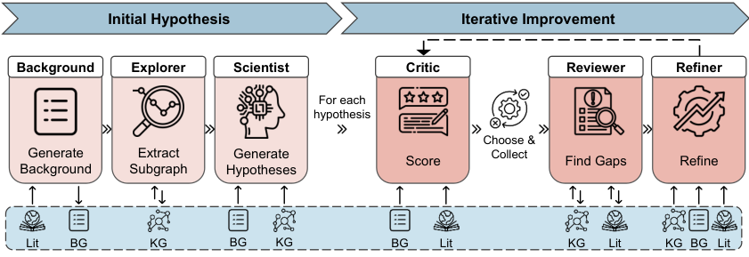
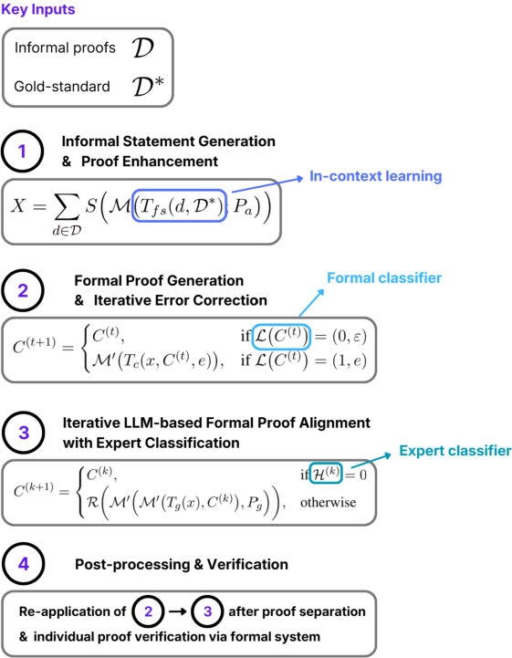

# 科学发现 RSI：值得关注的工作

仅选取 3 篇最新、与 RSI 关联最紧密的工作。研究问题与核心方法为英文摘要的中文概括，不推断实验数值；方法架构图取自 arXiv 官方 HTML 版论文原图。每篇均标注出版层级，若为准入的 2026 年 arXiv 预印本会额外注明未经同行评审。

## 1. A self-correcting multi-agent LLM framework for language-based physics simulation and explanation（2026）

- **研究问题**：基于物理的仿真对科学与工程至关重要，但构建仿真通常需要数值求解器与控制方程的专门知识。
- **核心方法**：提出 MCP-SIM：记忆协调的物理感知仿真框架，把欠明确的提示转化为经过验证的仿真与解释，并通过多智能体自纠错迭代修订。
- **RSI 价值**：改进对象为 Agent 规划、决策与协作机制；反馈闭环：是；多轮迭代：是；分级 L4（置信度 高）；定位：接近 RSI。
- **值得关注的原因**：T1 CCF-A，2026 年。该工作发表于 CCF-A 渠道，属本轮最高出版层级；
- **原文与全文**：[官方论文页](https://doi.org/10.1038/s44387-025-00057-z) ｜ 本地 PDF 未获取
- **发表渠道**：npj Artificial Intelligence

*该论文未检索到 arXiv 官方 HTML 版插图，故不插入架构图（不伪造图片）。*

## 2. BioDisco: Multi-Agent Hypothesis Generation with Dual-Mode Evidence, Iterative Feedback and Temporal Evaluation（2026）

- **研究问题**：提出新假设是科学研究的核心，但可用信息的规模与复杂性容易使这一过程不堪重负。
- **核心方法**：提出 BIODISCO 多智能体框架，结合语言模型推理与双模态证据系统（生物医学知识图谱与自动文献检索），并引入迭代反馈。
- **RSI 价值**：改进对象为 Agent 规划、决策与协作机制；反馈闭环：是；多轮迭代：是；分级 L4（置信度 高）；定位：接近 RSI。
- **值得关注的原因**：T1 CCF-A，2026 年。该工作发表于 CCF-A 渠道，属本轮最高出版层级；
- **原文与全文**：[官方论文页](https://doi.org/10.24963/ijcai.2026/752) ｜ [arXiv:2508.01285](https://arxiv.org/abs/2508.01285) ｜ [本地 PDF](docs/2026_BioDisco_Multi_Agent_Hypothesis_Generation_with.pdf)
- **发表渠道**：International Joint Conference on Artificial Intelligence

*图：论文 Figure 1（方法/框架总览，取自 arXiv 官方 HTML 版）。来源：[arXiv 官方 HTML 版原图](https://arxiv.org/html/2508.01285v2/Architecture_Diagram.png)*

## 3. FormalScience: Scalable Human-in-the-Loop Autoformalisation of Science with Agentic Code Generation in Lean（2026）

- **研究问题**：把非形式化的数学推理转成可形式化验证的代码，是大语言模型的重大挑战；物理等科学领域还依赖领域特定的形式化机制。
- **核心方法**：提出面向科学的可扩展「人在回路」自动形式化流程，以智能体代码生成支撑形式化（摘要未展开具体步骤）。
- **RSI 价值**：改进对象为 程序/系统实现与算法流程；反馈闭环：是；多轮迭代：未明确；分级 L1（置信度 高）；定位：接近 RSI。
- **值得关注的原因**：T1 CCF-A，2026 年。该工作发表于 CCF-A 渠道，属本轮最高出版层级；
- **原文与全文**：[官方论文页](https://doi.org/10.18653/v1/2026.acl-long.1057) ｜ [arXiv:2604.23002](https://arxiv.org/abs/2604.23002) ｜ [本地 PDF](docs/2026_FormalScience_Scalable_Human_in_the_Loop_Autoformalisation.pdf)
- **发表渠道**：Proceedings of the conference - Association for Computational Linguistics. Meeting

*图：论文 Figure 1（方法/框架总览，取自 arXiv 官方 HTML 版）。来源：[arXiv 官方 HTML 版原图](https://arxiv.org/html/2604.23002v1/fs-overview.png)*
