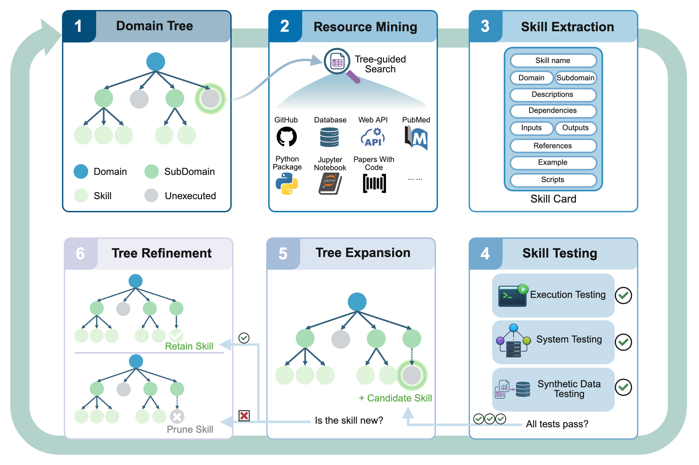

# 科学发现 RSI：值得关注的工作

仅选取 3 篇最新、与 RSI 关联最紧密的工作。研究问题与核心方法为英文摘要的中文概括，不推断实验数值；方法架构图取自 arXiv 官方 HTML 版论文原图。若条目来自补充层，会明确标注其未经同行评审。

## 1. Organon : From Evolutionary Search to Recursive Self-Improving Agents for Scientific Discovery（2026）

- **研究问题**：科学发现并不遵循单一固定方法论：研究方法随领域而异，并随研究展开通过实验不断演化；而现有的 LLM 引导进化搜索多依赖固定搜索流程或只允许 predefined 组件适配。
- **核心方法**：提出 Organon，一个面向科学发现的递归自我改进智能体，从进化搜索出发改进研究方法本身。
- **RSI 价值**：改进对象为改进方法/评价与搜索策略；反馈闭环：未明确；多轮迭代：是；分级 L6（置信度 高）；定位：直接 RSI（候选）。
- **值得关注的原因**：T5 arXiv 预印本，2026 年。**该条目来自补充层，仅 arXiv / 非顶级渠道，未经同行评审，供跟踪而非定论。**
- **原文与全文**：[官方论文页](https://arxiv.org/abs/2610.33046) ｜ [arXiv:2610.33046](https://arxiv.org/abs/2610.33046) ｜ 本地 PDF 未获取
- **发表渠道**：arXiv preprint（预印本，未经同行评审）

*该论文未检索到 arXiv 官方 HTML 版插图，故不插入架构图（不伪造图片）。*

## 2. MELD: Recursive Self-Improvement via Hierarchical Coordination for Multi-Agent Scientific Discovery（2026）

- **研究问题**：基于 LLM 的多智能体科学发现存在耦合学习问题：任务分配既决定做哪些实验，也决定智能体从哪些经验中适应。
- **核心方法**：提出 MELD 统一的分层测试时训练框架，在单次发现流程中联合调整团队级 Coordinator 策略与个体 Scientist 策略。
- **RSI 价值**：改进对象为Agent 规划、决策与协作机制；反馈闭环：未明确；多轮迭代：是；分级 L4（置信度 高）；定位：直接 RSI（候选）。
- **值得关注的原因**：T5 arXiv 预印本，2026 年。**该条目来自补充层，仅 arXiv / 非顶级渠道，未经同行评审，供跟踪而非定论。**
- **原文与全文**：[官方论文页](https://arxiv.org/abs/2610.24454) ｜ [arXiv:2610.24454](https://arxiv.org/abs/2610.24454) ｜ 本地 PDF 未获取
- **发表渠道**：arXiv preprint（预印本，未经同行评审）

*该论文未检索到 arXiv 官方 HTML 版插图，故不插入架构图（不伪造图片）。*

## 3. SKILLFOUNDRY: Building Self-Evolving Agent Skill Libraries from Heterogeneous Scientific Resources（2026）

- **研究问题**：现代科学生态在代码仓库、API、脚本、notebook、文档、数据库与论文中富含过程性知识，但这些知识碎片化地散落在智能体难以直接使用的异构产物中。
- **核心方法**：提出 SkillFoundry 自进化框架，把上述资源转化为经过验证的智能体技能：即编码任务范围、输入输出、执行步骤、环境假设与来源信息的可复用包。
- **RSI 价值**：改进对象为可复用技能/工具库；反馈闭环：是；多轮迭代：是；分级 L3（置信度 中）；定位：接近 RSI。
- **值得关注的原因**：T5 arXiv 预印本，2026 年。**该条目来自补充层，仅 arXiv / 非顶级渠道，未经同行评审，供跟踪而非定论。**
- **原文与全文**：[官方论文页](https://arxiv.org/abs/2604.03964) ｜ [arXiv:2604.03964](https://arxiv.org/abs/2604.03964) ｜ 本地 PDF 未获取
- **发表渠道**：arXiv preprint（预印本，未经同行评审）

*图：论文 Figure 1（方法/框架总览，取自 arXiv 官方 HTML 版）。来源：[arXiv 官方 HTML 版原图](https://arxiv.org/html/2604.03964v1/fig-main/SkillFoundry_concept.png)*
