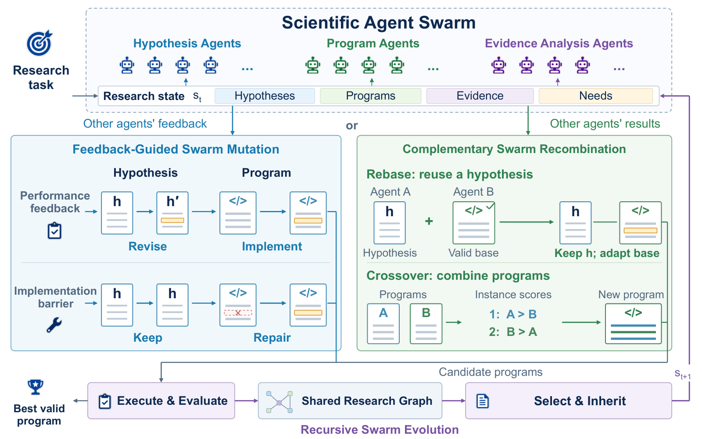
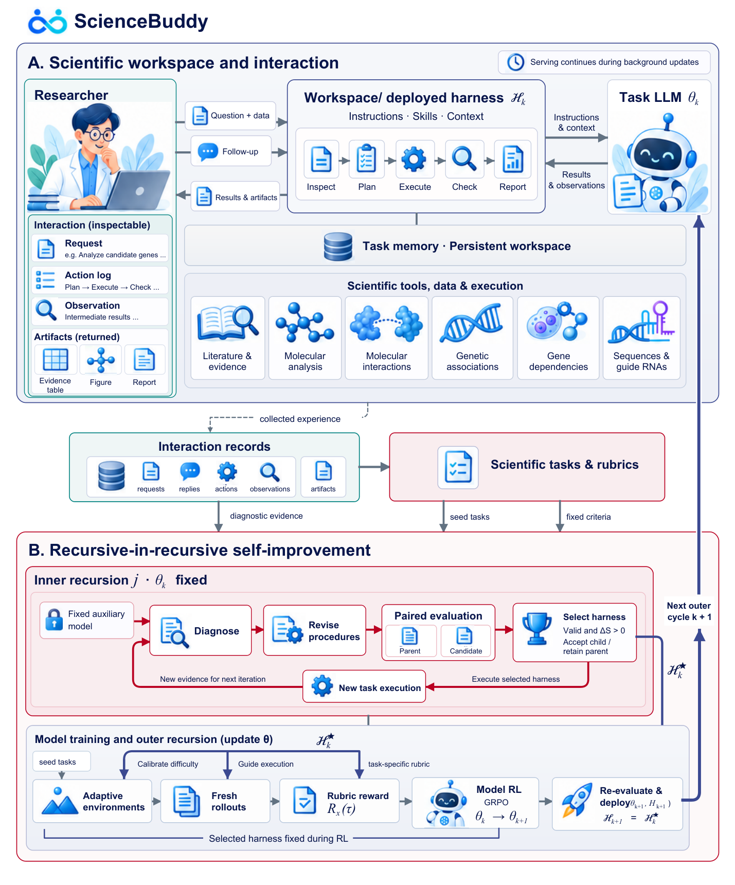

# 科学发现 RSI：值得关注的工作

仅选取本领域最新、与 RSI 关联最紧密的 3 篇工作；编号与「领域内发展状况.md」索引表一致。研究问题与核心方法为英文摘要的中文概括，不对实验数值作任何推断；方法架构图取自 arXiv 官方 HTML 版中的论文原图。

## 1. SwarmRSI: Recursive Self-Improvement through Evolving Scientific Agent Swarm（2026）

- **研究问题**：科学研究中的递归自我改进，目标是让智能体通过自身的实验经验提升研究能力。
- **核心方法**：提出 SwarmRSI 框架，通过演化科学智能体群体来实现递归自我改进。
- **RSI 价值**：改进对象：上下文、提示与记忆结构；反馈闭环：是；多轮迭代：是；分类 L2；定位：直接 RSI（候选）。
- **值得关注的原因**：2026 年工作，在本领域 45 篇收录论文中 RSI 关联度评分位列前段；其主攻方向为上下文与记忆进化，与「系统自主改进自身并参与下一轮改进」这一核心问题直接相关，但摘要层面尚不足以证明稳定的跨代递归闭环，需回到原文实验部分核实。
- **原文与全文**：[官方论文页](https://arxiv.org/abs/2610.20431) ｜ [arXiv:2610.20431](https://arxiv.org/abs/2610.20431) ｜ [本地 PDF](docs/2026_SwarmRSI_Recursive_Self_Improvement_through_Evolving.pdf)
- **发表渠道**：arXiv preprint（预印本，未经同行评审）

*图：论文方法 / 框架图（取自 arXiv 官方 HTML 版的原图）。来源：[arXiv 官方 HTML 版原图](https://arxiv.org/html/2610.20431v3/fig_architecture_review.png)*

## 2. ScienceBuddy: Recursive-in-Recursive Self-Improvement for Interactive Scientific Agents（2026）

- **研究问题**：发布 ScienceBuddy：一个把持续改进的科学智能体嵌入研究者日常流程的交互式科研工作台。
- **核心方法**：给出研究者交互、框架（harness）改进与模型学习的案例研究，基准覆盖四类科学任务。
- **RSI 价值**：改进对象：上下文、提示与记忆结构；反馈闭环：是；多轮迭代：是；分类 L2；定位：直接 RSI（候选）。
- **值得关注的原因**：2026 年工作，在本领域 45 篇收录论文中 RSI 关联度评分位列前段；其主攻方向为上下文与记忆进化，与「系统自主改进自身并参与下一轮改进」这一核心问题直接相关，但摘要层面尚不足以证明稳定的跨代递归闭环，需回到原文实验部分核实。
- **原文与全文**：[官方论文页](https://arxiv.org/abs/2609.17523) ｜ [arXiv:2609.17523](https://arxiv.org/abs/2609.17523) ｜ [本地 PDF](docs/2026_ScienceBuddy_Recursive_in_Recursive_Self_Improvement.pdf)
- **发表渠道**：arXiv preprint（预印本，未经同行评审）

*图：论文方法 / 框架图（取自 arXiv 官方 HTML 版的原图）。来源：[arXiv 官方 HTML 版原图](https://arxiv.org/html/2609.17523v1/sciencebuddy-system-diagram.png)*

## 3. MELD: Recursive Self-Improvement via Hierarchical Coordination for Multi-Agent Scientific Discovery（2026）

- **研究问题**：基于大语言模型的多智能体科学发现存在耦合学习问题：任务分配既决定做哪些实验，也决定智能体从哪些经验中适应。
- **核心方法**：提出 MELD 分层测试时训练框架，在单次发现流程中联合调整团队级协调策略与个体科学家策略。
- **RSI 价值**：改进对象：Agent 规划、决策与协作机制；反馈闭环：是；多轮迭代：是；分类 L4；定位：直接 RSI（候选）。
- **值得关注的原因**：2026 年工作，在本领域 45 篇收录论文中 RSI 关联度评分位列前段；其主攻方向为Agent 机制进化，与「系统自主改进自身并参与下一轮改进」这一核心问题直接相关，但摘要层面尚不足以证明稳定的跨代递归闭环，需回到原文实验部分核实。
- **原文与全文**：[官方论文页](https://arxiv.org/abs/2610.24454) ｜ [arXiv:2610.24454](https://arxiv.org/abs/2610.24454) ｜ [本地 PDF](docs/2026_MELD_Recursive_Self_Improvement_via_Hierarchical.pdf)
- **发表渠道**：arXiv preprint（预印本，未经同行评审）
