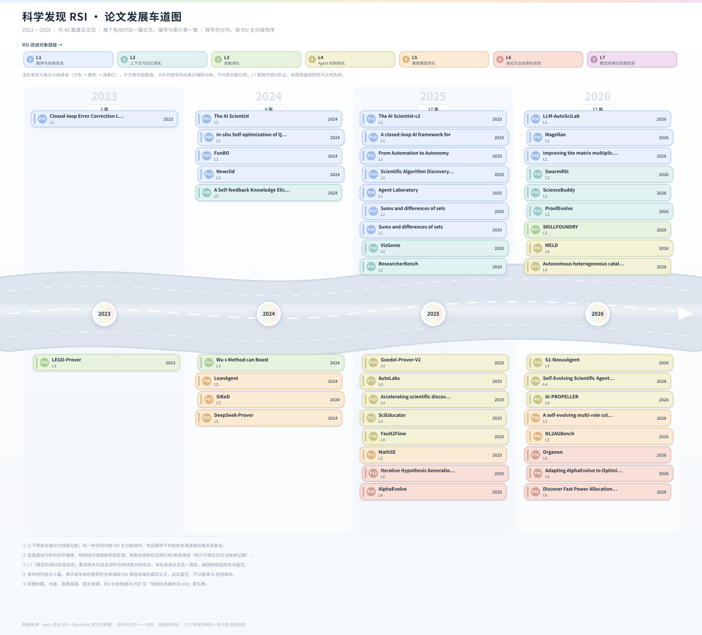

# 科学发现 RSI：领域内发展状况

[PNG 预览图](assets/lane_science.png) ｜ 图中每个色块对应一篇真实论文，编号与下表一致。 ｜ [七级配色规范](../assets/RSI_七级配色图例.svg)

## 发展脉络

本领域共收录 **28 篇** 2023—2026 年的真实论文，按年份分布为 2023 年 1 篇、2024 年 2 篇、2025 年 11 篇、2026 年 14 篇。其中 26 篇为 arXiv 预印本（未经同行评审），28 篇已下载原文 PDF 存档。

按 RSI 主分级统计，L1（程序与系统改进）13 篇、L2（上下文与记忆进化）4 篇、L3（技能进化）2 篇、L4（Agent 机制进化）7 篇、L5（基座模型进化）1 篇、L6（进化方法自身的改进）1 篇。定位上：直接 RSI 候选 12 篇、接近 RSI 8 篇、相关基础能力 8 篇。

**成熟度判断**：该领域已有较多以自我改进、迭代反馈与经验积累为核心机制的工作，但「改进后的系统能否稳定推动下一代改进」仍普遍缺少跨多代、可持续提升的实证；第 7 级（稳定的递归自我改进）在本轮收录中一律留空。

## 论文索引

| 编号 | 论文名称 | 年份 | 发表渠道 | RSI 分类 | 定位 | 官方来源 | PDF |
|---|---|---|---|---|---|---|---|
| P01 | LEGO-Prover: Neural Theorem Proving with Growing Libraries | 2023 | arXiv preprint（预印本，未经同行评审） | L3 | 相关基础能力 | [原文页](https://arxiv.org/abs/2310.00656) | [2023\_LEGO\_Prover\_Neural\_Theorem\_Proving\_with\_Growing.pdf](docs/2023_LEGO_Prover_Neural_Theorem_Proving_with_Growing.pdf) |
| P02 | In-situ Self-optimization of Quantum Dot Emission for Lasers by Machine-Learning Assisted Epitaxy | 2024 | arXiv preprint（预印本，未经同行评审） | L1 | 直接 RSI（候选） | [原文页](https://arxiv.org/abs/2411.00332) | [2024\_In\_situ\_Self\_optimization\_of\_Quantum\_Dot.pdf](docs/2024_In_situ_Self_optimization_of_Quantum_Dot.pdf) |
| P03 | SIKeD: Self-guided Iterative Knowledge Distillation for mathematical reasoning | 2024 | arXiv preprint（预印本，未经同行评审） | L5 | 相关基础能力 | [原文页](https://arxiv.org/abs/2410.18574) | [2024\_SIKeD\_Self\_guided\_Iterative\_Knowledge\_Distillation.pdf](docs/2024_SIKeD_Self_guided_Iterative_Knowledge_Distillation.pdf) |
| P04 | Iterative Hypothesis Generation for Scientific Discovery with Monte Carlo Nash Equilibrium Self-Refining Trees | 2025 | arXiv preprint（预印本，未经同行评审） | L2 | 直接 RSI（候选） | [原文页](https://arxiv.org/abs/2503.19309) | [2025\_Iterative\_Hypothesis\_Generation\_for\_Scientific\_Discovery.pdf](docs/2025_Iterative_Hypothesis_Generation_for_Scientific_Discovery.pdf) |
| P05 | Goedel-Prover-V2: Scaling Formal Theorem Proving with Scaffolded Data Synthesis and Self-Correction | 2025 | arXiv preprint（预印本，未经同行评审） | L1 + L4 | 接近 RSI | [原文页](https://arxiv.org/abs/2508.03613) | [2025\_Goedel\_Prover\_V2\_Scaling\_Formal\_Theorem\_Proving.pdf](docs/2025_Goedel_Prover_V2_Scaling_Formal_Theorem_Proving.pdf) |
| P06 | The AI Scientist-v2: Workshop-Level Automated Scientific Discovery via Agentic Tree Search | 2025 | arXiv preprint（预印本，未经同行评审） | L1 | 相关基础能力 | [原文页](https://arxiv.org/abs/2504.08066) | [2025\_The\_AI\_Scientist\_v2\_Workshop\_Level\_Automated.pdf](docs/2025_The_AI_Scientist_v2_Workshop_Level_Automated.pdf) |
| P07 | A closed-loop AI framework for hypothesis-driven and interpretable materials design | 2025 | arXiv preprint（预印本，未经同行评审） | L4 | 相关基础能力 | [原文页](https://arxiv.org/abs/2509.18604) | [2025\_A\_closed\_loop\_AI\_framework\_for\_hypothesis.pdf](docs/2025_A_closed_loop_AI_framework_for_hypothesis.pdf) |
| P08 | VizGenie: Toward Self-Refining, Domain-Aware Workflows for Next-Generation Scientific Visualization | 2025 | arXiv preprint（预印本，未经同行评审） | L1 + L4 + L5 | 直接 RSI（候选） | [原文页](https://arxiv.org/abs/2507.21124) | [2025\_VizGenie\_Toward\_Self\_Refining\_Domain\_Aware\_Workflows.pdf](docs/2025_VizGenie_Toward_Self_Refining_Domain_Aware_Workflows.pdf) |
| P09 | ResearcherBench: Evaluating Deep AI Research Systems on the Frontiers of Scientific Inquiry | 2025 | arXiv preprint（预印本，未经同行评审） | L2 | 接近 RSI | [原文页](https://arxiv.org/abs/2507.16280) | [2025\_ResearcherBench\_Evaluating\_Deep\_AI\_Research\_Systems.pdf](docs/2025_ResearcherBench_Evaluating_Deep_AI_Research_Systems.pdf) |
| P10 | Accelerating scientific discovery with Co-Scientist | 2025 | arXiv preprint（预印本，未经同行评审） | L4 | 接近 RSI | [原文页](https://arxiv.org/abs/2502.18864) | [2025\_Accelerating\_scientific\_discovery\_with\_Co\_Scientist.pdf](docs/2025_Accelerating_scientific_discovery_with_Co_Scientist.pdf) |
| P11 | From Automation to Autonomy: A Survey on Large Language Models in Scientific Discovery | 2025 | arXiv preprint（预印本，未经同行评审） | L1 | 接近 RSI | [原文页](https://arxiv.org/abs/2505.13259) | [2025\_From\_Automation\_to\_Autonomy\_A\_Survey\_on.pdf](docs/2025_From_Automation_to_Autonomy_A_Survey_on.pdf) |
| P12 | PlotGen: Multi-Agent LLM-based Scientific Data Visualization via Multimodal Feedback | 2025 | arXiv preprint（预印本，未经同行评审） | L1 + L4 | 相关基础能力 | [原文页](https://arxiv.org/abs/2502.00988) | [2025\_PlotGen\_Multi\_Agent\_LLM\_based\_Scientific\_Data.pdf](docs/2025_PlotGen_Multi_Agent_LLM_based_Scientific_Data.pdf) |
| P13 | An Evaluation-Centric Paradigm for Scientific Visualization Agents | 2025 | 1st Workshop on GenAI, Agents, and the Future of VIS (IEEE VIS Conference 2025) | L1 | 接近 RSI | [原文页](https://arxiv.org/abs/2509.15160) | [2025\_An\_Evaluation\_Centric\_Paradigm\_for\_Scientific\_Visualization.pdf](docs/2025_An_Evaluation_Centric_Paradigm_for_Scientific_Visualization.pdf) |
| P14 | TopoMAS: Large Language Model Driven Topological Materials Multiagent System | 2025 | arXiv preprint（预印本，未经同行评审） | L4 | 直接 RSI（候选） | [原文页](https://arxiv.org/abs/2507.04053) | [2025\_TopoMAS\_Large\_Language\_Model\_Driven\_Topological.pdf](docs/2025_TopoMAS_Large_Language_Model_Driven_Topological.pdf) |
| P15 | SwarmRSI: Recursive Self-Improvement through Evolving Scientific Agent Swarm | 2026 | arXiv preprint（预印本，未经同行评审） | L1 | 直接 RSI（候选） | [原文页](https://arxiv.org/abs/2610.20431) | [2026\_SwarmRSI\_Recursive\_Self\_Improvement\_through\_Evolving.pdf](docs/2026_SwarmRSI_Recursive_Self_Improvement_through_Evolving.pdf) |
| P16 | ScienceBuddy: Recursive-in-Recursive Self-Improvement for Interactive Scientific Agents | 2026 | arXiv preprint（预印本，未经同行评审） | L2 | 直接 RSI（候选） | [原文页](https://arxiv.org/abs/2609.17523) | [2026\_ScienceBuddy\_Recursive\_in\_Recursive\_Self\_Improvement.pdf](docs/2026_ScienceBuddy_Recursive_in_Recursive_Self_Improvement.pdf) |
| P17 | MELD: Recursive Self-Improvement via Hierarchical Coordination for Multi-Agent Scientific Discovery | 2026 | arXiv preprint（预印本，未经同行评审） | L4 + L5 | 直接 RSI（候选） | [原文页](https://arxiv.org/abs/2610.24454) | [2026\_MELD\_Recursive\_Self\_Improvement\_via\_Hierarchical.pdf](docs/2026_MELD_Recursive_Self_Improvement_via_Hierarchical.pdf) |
| P18 | Organon : From Evolutionary Search to Recursive Self-Improving Agents for Scientific Discovery | 2026 | arXiv preprint（预印本，未经同行评审） | L6 + L1 + L2 | 接近 RSI | [原文页](https://arxiv.org/abs/2610.33046) | [2026\_Organon\_From\_Evolutionary\_Search\_to\_Recursive\_Self.pdf](docs/2026_Organon_From_Evolutionary_Search_to_Recursive_Self.pdf) |
| P19 | Autonomous heterogeneous catalyst discovery with a self-evolving multi-agent digital twin | 2026 | arXiv preprint（预印本，未经同行评审） | L4 | 直接 RSI（候选） | [原文页](https://arxiv.org/abs/2606.05050) | [2026\_Autonomous\_heterogeneous\_catalyst\_discovery\_with.pdf](docs/2026_Autonomous_heterogeneous_catalyst_discovery_with.pdf) |
| P20 | ProofEvolve: Neuro-Symbolic Evolution for Formal Automated Theorem Proving | 2026 | arXiv preprint（预印本，未经同行评审） | L1 | 直接 RSI（候选） | [原文页](https://arxiv.org/abs/2608.26334) | [2026\_ProofEvolve\_Neuro\_Symbolic\_Evolution\_for\_Formal.pdf](docs/2026_ProofEvolve_Neuro_Symbolic_Evolution_for_Formal.pdf) |
| P21 | S1-NexusAgent: a Self-Evolving Agent Framework for Multidisciplinary Scientific Research | 2026 | arXiv preprint（预印本，未经同行评审） | L4 | 直接 RSI（候选） | [原文页](https://arxiv.org/abs/2602.01550) | [2026\_S1\_NexusAgent\_a\_Self\_Evolving\_Agent\_Framework.pdf](docs/2026_S1_NexusAgent_a_Self_Evolving_Agent_Framework.pdf) |
| P22 | SKILLFOUNDRY: Building Self-Evolving Agent Skill Libraries from Heterogeneous Scientific Resources | 2026 | arXiv preprint（预印本，未经同行评审） | L3 + L1 | 直接 RSI（候选） | [原文页](https://arxiv.org/abs/2604.03964) | [2026\_SKILLFOUNDRY\_Building\_Self\_Evolving\_Agent\_Skill.pdf](docs/2026_SKILLFOUNDRY_Building_Self_Evolving_Agent_Skill.pdf) |
| P23 | LLM-AutoSciLab: Closed-Loop Scientific Discovery via Active Experimentation with LLMs | 2026 | arXiv preprint（预印本，未经同行评审） | L1 | 接近 RSI | [原文页](https://arxiv.org/abs/2605.24043) | [2026\_LLM\_AutoSciLab\_Closed\_Loop\_Scientific\_Discovery.pdf](docs/2026_LLM_AutoSciLab_Closed_Loop_Scientific_Discovery.pdf) |
| P24 | One Reflection Is Not Enough: Self-Correcting Autonomous Research via Multi-Hypothesis Failure Attribution | 2026 | arXiv preprint（预印本，未经同行评审） | L1 | 相关基础能力 | [原文页](https://arxiv.org/abs/2606.31478) | [2026\_One\_Reflection\_Is\_Not\_Enough\_Self\_Correcting.pdf](docs/2026_One_Reflection_Is_Not_Enough_Self_Correcting.pdf) |
| P25 | Can AI Agents Make Open-Ended Scientific Discovery? Evidence from Station | 2026 | arXiv preprint（预印本，未经同行评审） | L1 | 相关基础能力 | [原文页](https://arxiv.org/abs/2610.08927) | [2026\_Can\_AI\_Agents\_Make\_Open\_Ended\_Scientific.pdf](docs/2026_Can_AI_Agents_Make_Open_Ended_Scientific.pdf) |
| P26 | ReasFlow: Assisting Reasoning-Centric Scientific Discovery in Applied Mathematics via a Knowledge-Based Multi-Agent System | 2026 | arXiv preprint（预印本，未经同行评审） | L4 + L2 | 直接 RSI（候选） | [原文页](https://arxiv.org/abs/2607.14178) | [2026\_ReasFlow\_Assisting\_Reasoning\_Centric\_Scientific.pdf](docs/2026_ReasFlow_Assisting_Reasoning_Centric_Scientific.pdf) |
| P27 | Contrastive Discovery: Open-Ended Scientific Discovery over Competing Explanations | 2026 | NeurIPS（作者注明：Accepted at NeurIPS 2026. 55 pages. Project page: https://codiscovery.） | L1 | 相关基础能力 | [原文页](https://arxiv.org/abs/2611.14514) | [2026\_Contrastive\_Discovery\_Open\_Ended\_Scientific\_Discovery.pdf](docs/2026_Contrastive_Discovery_Open_Ended_Scientific_Discovery.pdf) |
| P28 | SciToolAgent-Evo: An Ontology-Aware Self-Evolving Agent for Open-World Scientific Tool Acquisition | 2026 | arXiv preprint（预印本，未经同行评审） | L2 | 接近 RSI | [原文页](https://arxiv.org/abs/2607.28692) | [2026\_SciToolAgent\_Evo\_An\_Ontology\_Aware\_Self\_Evolving.pdf](docs/2026_SciToolAgent_Evo_An_Ontology_Aware_Self_Evolving.pdf) |

> 说明：「直接 RSI（候选）」表示摘要同时出现明确的自我改进措辞与反馈/迭代线索，是否真正构成严格递归闭环仍需回到原文实验部分核实；「相关基础能力」不计入 RSI 成果。

## 逐篇核实明细

| 编号 | 作者 | 改进对象 | 反馈闭环 | 多轮迭代 | RSI 分类依据（标题/摘要主题词） |
|---|---|---|---|---|---|
| P01 | Haiming Wang, Huajian Xin, Chuanyang Zheng et al. | 可复用技能/工具库 | 未明确 | 未明确 | 自我改进线索：skill library；L3 线索：reusable skill、skill、skill library |
| P02 | Chao Shen, Wenkang Zhan, Shujie Pan et al. | 程序/系统实现与算法流程 | 是 | 未明确 | 自我改进线索：self-optimiz、reflection；反馈/迭代线索：feedback |
| P03 | Shivam Adarsh, Kumar Shridhar, Caglar Gulcehre et al. | 模型参数与训练机制 | 未明确 | 是 | 自我改进线索：self-generated；反馈/迭代线索：iterative、iteration；L5 线索：distillation、fine-tun |
| P04 | Gollam Rabby, Diyana Muhammed, Prasenjit Mitra et al. | 上下文、提示与记忆结构 | 未明确 | 是 | 自我改进线索：self-refin、iterative refinement；反馈/迭代线索：iterative；L2 线索：prompt |
| P05 | Yong Lin, Shange Tang, Bohan Lyu et al. | 程序/系统实现与算法流程；兼及Agent 规划、决策与协作机制 | 是 | 是 | 自我改进线索：self-correct；反馈/迭代线索：feedback、iterative、iteration；L1 线索：code、compiler、pipeline；L4 线索：scaffold |
| P06 | Yutaro Yamada, Robert Tjarko Lange, Cong Lu et al. | 程序/系统实现与算法流程 | 是 | 是 | 自我改进线索：iterative refinement、feedback loop；反馈/迭代线索：feedback、iterative、loop；L1 线索：code、script |
| P07 | Kangyu Ji, Tianran Liu, Fang Sheng et al. | Agent 规划、决策与协作机制 | 是 | 是 | 自我改进线索：closed-loop；反馈/迭代线索：iteration、loop；L4 线索：workflow |
| P08 | Ayan Biswas, Terece L. Turton, Nishath Rajiv Ranasinghe et al. | 程序/系统实现与算法流程；兼及Agent 规划、决策与协作机制、模型参数与训练机制 | 未明确 | 是 | 自我改进线索：self-improv、self-refin；反馈/迭代线索：iterative；L1 线索：code、implementation、script；L4 线索：workflow |
| P09 | Tianze Xu, Pengrui Lu, Lyumanshan Ye et al. | 上下文、提示与记忆结构 | 未明确 | 未明确 | 自我改进线索：self-improv、open-ended、self-improvement；L2 线索：retrieval |
| P10 | Juraj Gottweis, Wei-Hung Weng, Alexander Daryin et al. | Agent 规划、决策与协作机制 | 未明确 | 是 | 自我改进线索：self-improv；L4 线索：agent architecture、multi-agent |
| P11 | Tianshi Zheng, Zheye Deng, Hong Ting Tsang et al. | 程序/系统实现与算法流程 | 未明确 | 未明确 | 自我改进线索：self-improv、self-improvement |
| P12 | Kanika Goswami, Puneet Mathur, Ryan Rossi et al. | 程序/系统实现与算法流程；兼及Agent 规划、决策与协作机制 | 是 | 是 | 自我改进线索：self-reflect、reflection；反馈/迭代线索：feedback、iterative；L1 线索：bug、code、debugging；L4 线索：multi-agent、planning |
| P13 | Kuangshi Ai, Haichao Miao, Zhimin Li et al. | 程序/系统实现与算法流程 | 未明确 | 未明确 | 自我改进线索：self-improv、self-improvement |
| P14 | Baohua Zhang, Xin Li, Huangchao Xu et al. | Agent 规划、决策与协作机制 | 是 | 未明确 | 自我改进线索：self-evolv；反馈/迭代线索：loop；L4 线索：multi-agent、orchestration、workflow |
| P15 | Qianru Meng, Xi Zhang, Konstantinos Papakostas et al. | 程序/系统实现与算法流程 | 是 | 是 | 自我改进线索：self-improv、recursive、feedback loop；反馈/迭代线索：feedback、loop、subsequent；L1 线索：implementation、program |
| P16 | Shuhan Xue, Jianyuan Zhong, Ziyuan Nan et al. | 上下文、提示与记忆结构 | 是 | 是 | 自我改进线索：self-improv、recursive、continual learning；反馈/迭代线索：feedback、continually、continual；L2 线索：experience |
| P17 | Sizhe Tang, Zuyuan Zhang, Zeyu Fang et al. | Agent 规划、决策与协作机制；兼及模型参数与训练机制 | 是 | 是 | 自我改进线索：self-improv、recursive、self-improvement；反馈/迭代线索：loop；L4 线索：coordination、multi-agent、policy；L5 线索：parameter… |
| P18 | Cheikh Ahmed, Zhiyu Zhang, Kun Mao et al. | 改进方法/评价与搜索策略；兼及程序/系统实现与算法流程、上下文、提示与记忆结构 | 未明确 | 是 | 自我改进线索：self-improv、recursive、self-improvement；L6 线索：evolutionary search；L1 线索：algorithm、code |
| P19 | Zhilong Song, Zongmin Zhang, Lixue Cheng | Agent 规划、决策与协作机制 | 是 | 未明确 | 自我改进线索：self-improv、self-evolv、self-improvement；反馈/迭代线索：loop；L4 线索：multi-agent |
| P20 | Wenqian Ye, Ziwei Guan, Eric Xie et al. | 程序/系统实现与算法流程 | 是 | 是 | 自我改进线索：self-improv、recursive、self-improvement；反馈/迭代线索：feedback、loop；L1 线索：repair |
| P21 | S1-NexusAgent Team | Agent 规划、决策与协作机制 | 是 | 是 | 自我改进线索：self-evolv、continual learning、self-evolution；反馈/迭代线索：loop、continual；L4 线索：orchestration、planning、workflow |
| P22 | Shuaike Shen, Wenduo Cheng, Mingqian Ma et al. | 可复用技能/工具库；兼及程序/系统实现与算法流程 | 是 | 是 | 自我改进线索：self-evolv、skill library、closed-loop；反馈/迭代线索：iterative、loop；L3 线索：skill、skill library；L1 线索：code、repair、s… |
| P23 | Sanchit Kabra, Nikhil Abhyankar, Saaketh Desai et al. | 程序/系统实现与算法流程 | 是 | 是 | 自我改进线索：closed-loop；反馈/迭代线索：iterative、loop；L1 线索：code |
| P24 | Jie Ma, Binfei Chu, Jie Gao et al. | 程序/系统实现与算法流程 | 未明确 | 未明确 | 自我改进线索：self-correct、reflection；L1 线索：code、implementation |
| P25 | Wenyu Du, Stephen Chung | 程序/系统实现与算法流程 | 未明确 | 未明确 | 自我改进线索：open-ended、reflection；L1 线索：code |
| P26 | Yutong He, Daibo Li, Guohong Li et al. | Agent 规划、决策与协作机制；兼及上下文、提示与记忆结构 | 是 | 未明确 | 自我改进线索：self-improv、self-improvement；反馈/迭代线索：loop；L4 线索：multi-agent；L2 线索：prompt、retrieval |
| P27 | Ziang Liu, James J. Kim, Yijia Dai et al. | 程序/系统实现与算法流程 | 未明确 | 未明确 | 自我改进线索：open-ended |
| P28 | Yuqi Tang, Chenyi Zhou, Libin Wang et al. | 上下文、提示与记忆结构 | 未明确 | 未明确 | 自我改进线索：self-evolv；L2 线索：experience、memory |

## 目前的主要技术路线及发展趋势

- **L1 程序与系统改进**（13 篇，代表：P02、P05、P06、P08、P11、P12）：围绕程序与系统改进展开，本领域相关工作主要体现为对该层改进对象的自主修改与反馈验证。
- **L2 上下文与记忆进化**（4 篇，代表：P04、P09、P16、P28）：围绕上下文与记忆进化展开，本领域相关工作主要体现为对该层改进对象的自主修改与反馈验证。
- **L3 技能进化**（2 篇，代表：P01、P22）：围绕技能进化展开，本领域相关工作主要体现为对该层改进对象的自主修改与反馈验证。
- **L4 Agent 机制进化**（7 篇，代表：P07、P10、P14、P17、P19、P21）：围绕Agent 机制进化展开，本领域相关工作主要体现为对该层改进对象的自主修改与反馈验证。
- **L5 基座模型进化**（1 篇，代表：P03）：围绕基座模型进化展开，本领域相关工作主要体现为对该层改进对象的自主修改与反馈验证。
- **L6 进化方法自身的改进**（1 篇，代表：P18）：围绕进化方法自身的改进展开，本领域相关工作主要体现为对该层改进对象的自主修改与反馈验证。
- **时间趋势**：收录论文从 2023 年的 1 篇到 2026 年的 14 篇，研究重心由一次性反馈修正逐步转向经验积累、技能库复用与改进方法本身的优化。
- **分级趋势**：本轮未发现满足第 7 级判据（跨多代稳定递归、可验证持续提升）的工作，该等级在车道图中保留图例但不占用任何色块。

## 尚未解决的关键问题

1. **闭环判定缺乏统一证据标准**：多数工作报告若干轮迭代后的性能提升，但很少验证「改进后的系统是否更擅长产生下一代改进」，这恰是 RSI 的核心判据。
2. **第 7 级证据空缺**：本领域收录论文中没有一篇提供跨多代、自主、可持续提升的递归闭环实验，因此未做任何 L7 归类。
3. **领域特有约束**：实验反馈周期长且代价高，假设生成—验证—修正的自主闭环多停留在受控任务。
4. **评价与复现**：不同工作使用各自的任务集与指标，且预印本占比偏高，改进效果的可比性与同行评审状态需要持续跟踪。
5. **改进对象的边界**：Agent 组件优化、基座模型再训练与真正的递归自我改进常被混称，需要按「改进对象 + 改进后的系统是否参与下一轮」两层标准分别判定。
