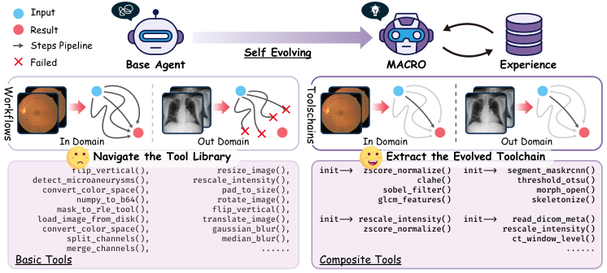
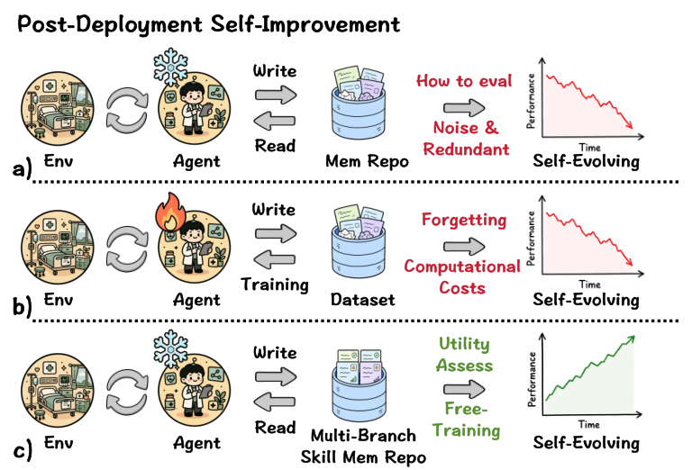
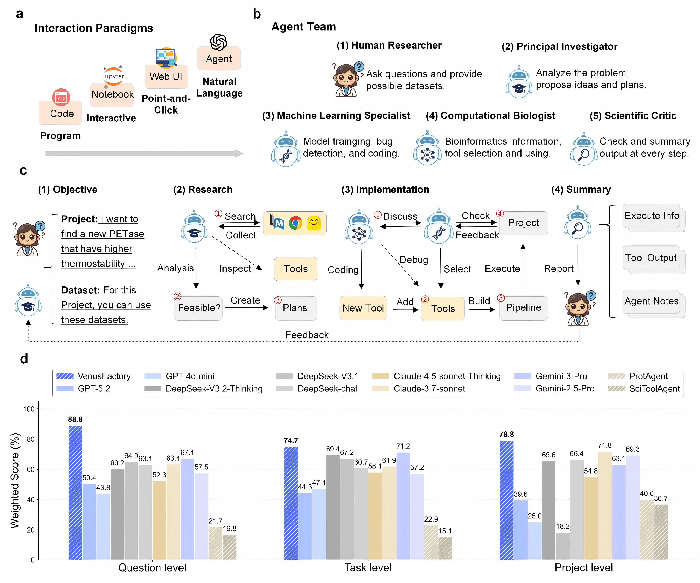

# 生物医药 RSI：值得关注的工作

仅选取 3 篇最新、与 RSI 关联最紧密的工作。研究问题与核心方法为英文摘要的中文概括，不推断实验数值；方法架构图取自 arXiv 官方 HTML 版论文原图。若条目来自补充层，会明确标注其未经同行评审。

## 1. Evolving Medical Imaging Agents via Experience-driven Self-skill Discovery（2026）

- **研究问题**：临床影像判读本质上是多步、以工具为中心的过程：临床医生迭代地把视觉证据与患者上下文结合、量化发现，并通过一系列专门流程修正判断。
- **核心方法**：提出 MACRO，一个自进化、经验增强的医疗智能体，从静态工具组合转向经验驱动的工具发现。
- **RSI 价值**：改进对象为可复用技能/工具库；反馈闭环：是；多轮迭代：是；分级 L3（置信度 高）；定位：接近 RSI。
- **值得关注的原因**：T5 arXiv 预印本，2026 年。**该条目来自补充层，仅 arXiv / 非顶级渠道，未经同行评审，供跟踪而非定论。**
- **原文与全文**：[官方论文页](https://arxiv.org/abs/2603.05860) ｜ [arXiv:2603.05860](https://arxiv.org/abs/2603.05860) ｜ 本地 PDF 未获取
- **发表渠道**：arXiv preprint（预印本，未经同行评审）

*图：论文 Figure 1（方法/框架总览，取自 arXiv 官方 HTML 版）。来源：[arXiv 官方 HTML 版原图](https://arxiv.org/html/2603.05860v1/Figure_1.png)*

## 2. Experience Makes Skillful: Enabling Generalizable Medical Agent Reasoning via Self-Evolving Skill Memory（2026）

- **研究问题**：医疗智能体系统越来越需要支持交互式临床决策，而不只是静态问答。
- **核心方法**：提出 SkeMex 部署后自进化框架，通过基于技能的记忆改进医疗智能体，且不更新模型权重。
- **RSI 价值**：改进对象为模型参数与训练机制；反馈闭环：是；多轮迭代：是；分级 L5（置信度 中）；定位：接近 RSI。
- **值得关注的原因**：T5 arXiv 预印本，2026 年。**该条目来自补充层，仅 arXiv / 非顶级渠道，未经同行评审，供跟踪而非定论。**
- **原文与全文**：[官方论文页](https://arxiv.org/abs/2606.09365) ｜ [arXiv:2606.09365](https://arxiv.org/abs/2606.09365) ｜ 本地 PDF 未获取
- **发表渠道**：arXiv preprint（预印本，未经同行评审）

*图：论文 Figure 1（方法/框架总览，取自 arXiv 官方 HTML 版）。来源：[arXiv 官方 HTML 版原图](https://arxiv.org/html/2606.09365v4/fig1.png)*

## 3. Self-evolving AI agents for protein discovery and directed evolution（2026）

- **研究问题**：蛋白质科学发现受限于信息与算法的人工编排，而通用智能体难以胜任复杂的领域项目。
- **核心方法**：提出 VenusFactory2 自主框架，通过自进化多智能体基础设施，从静态工具使用转向动态工作流合成。
- **RSI 价值**：改进对象为Agent 规划、决策与协作机制；反馈闭环：未明确；多轮迭代：未明确；分级 L4（置信度 中）；定位：相关基础能力。
- **值得关注的原因**：T5 arXiv 预印本，2026 年。**该条目来自补充层，仅 arXiv / 非顶级渠道，未经同行评审，供跟踪而非定论。**
- **原文与全文**：[官方论文页](https://arxiv.org/abs/2603.27303) ｜ [arXiv:2603.27303](https://arxiv.org/abs/2603.27303) ｜ 本地 PDF 未获取
- **发表渠道**：arXiv preprint（预印本，未经同行评审）

*图：论文 Figure 1（方法/框架总览，取自 arXiv 官方 HTML 版）。来源：[arXiv 官方 HTML 版原图](https://arxiv.org/html/2603.27303v1/figures/framework.png)*
