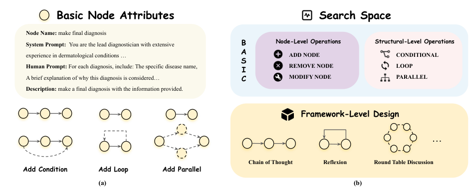
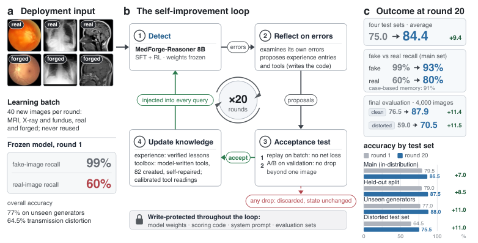

# 生物医药 RSI：值得关注的工作

仅选取 3 篇最新、与 RSI 关联最紧密的工作。研究问题与核心方法为英文摘要的中文概括，不推断实验数值；方法架构图取自 arXiv 官方 HTML 版论文原图。每篇均标注出版层级，若为准入的 2026 年 arXiv 预印本会额外注明未经同行评审。

## 1. Learning to Be a Doctor: Searching for Effective Medical Agent Architectures（2025）

- **研究问题**：基于 LLM 的智能体已在多类任务上展现能力，医疗领域因决策风险高而尤其需要可靠的智能体设计。
- **核心方法**：把医疗智能体建模为由多种功能节点构成的图结构，并支持以诊断反馈引导的迭代自我改进，用于搜索有效的智能体架构。
- **RSI 价值**：改进对象为 Agent 规划、决策与协作机制；反馈闭环：是；多轮迭代：是；分级 L4（置信度 高）；定位：接近 RSI。
- **值得关注的原因**：T1 CCF-A，2025 年。该工作发表于 CCF-A 渠道，属本轮最高出版层级；
- **原文与全文**：[官方论文页](https://doi.org/10.1145/3746027.3755559) ｜ [arXiv:2504.11301](https://arxiv.org/abs/2504.11301) ｜ [本地 PDF](docs/2025_Learning_to_Be_a_Doctor_Searching_for.pdf)
- **发表渠道**：ACM International Conference on Multimedia (ACM MM)

*图：论文 Figure 1（方法/框架总览，取自 arXiv 官方 HTML 版）。来源：[arXiv 官方 HTML 版原图](https://arxiv.org/html/2504.11301v2/overview.png)*

## 2. Evolving Medical Imaging Agents via Experience-driven Self-skill Discovery（2026）

- **研究问题**：临床影像判读本质上是多步、以工具为中心的过程：临床医生迭代地把视觉证据与患者上下文结合、量化发现，并通过一系列专门流程修正判断。
- **核心方法**：提出 MACRO，一个自进化、经验增强的医疗智能体，从静态工具组合转向经验驱动的工具发现。
- **RSI 价值**：改进对象为 可复用技能/工具库；反馈闭环：是；多轮迭代：是；分级 L3（置信度 高）；定位：接近 RSI。
- **值得关注的原因**：T4 其他正式出版，2026 年。该工作为其他正式出版渠道，层级低于 T1–T3，已在索引表标注；
- **原文与全文**：[官方论文页](https://arxiv.org/abs/2603.05860) ｜ [arXiv:2603.05860](https://arxiv.org/abs/2603.05860) ｜ [本地 PDF](docs/2026_Evolving_Medical_Imaging_Agents_via_Experience_driven.pdf)
- **发表渠道**：arXiv preprint（预印本，未经同行评审）

*图：论文 Figure 1（方法/框架总览，取自 arXiv 官方 HTML 版）。来源：[arXiv 官方 HTML 版原图](https://arxiv.org/html/2603.05860v1/Figure_1.png)*

## 3. MedForge-RSI: Medical Deepfake Detection via Recursive Self-Improvement（2026）

- **研究问题**：文本引导的图像编辑器可生成高保真医学深度伪造图像，威胁临床影像的可信度。
- **核心方法**：提出 MedForge-RSI 递归自我改进框架，让已部署的检测器在\*\*冻结模型权重\*\*的前提下持续适应。
- **RSI 价值**：改进对象为 模型参数与训练机制；反馈闭环：未明确；多轮迭代：是；分级 L5（置信度 中）；定位：接近 RSI。
- **值得关注的原因**：T4 其他正式出版，2026 年。该工作为其他正式出版渠道，层级低于 T1–T3，已在索引表标注；
- **原文与全文**：[官方论文页](https://doi.org/10.48550/arxiv.2609.36549) ｜ [arXiv:2609.36549](https://arxiv.org/abs/2609.36549) ｜ [本地 PDF](docs/2026_MedForge_RSI_Medical_Deepfake_Detection_via_Recursive.pdf)
- **发表渠道**：arXiv (Cornell University)（预印本，未经同行评审）

*图：论文 Figure 1（方法/框架总览，取自 arXiv 官方 HTML 版）。来源：[arXiv 官方 HTML 版原图](https://arxiv.org/html/2609.36549v1/fig_main_loop.png)*
