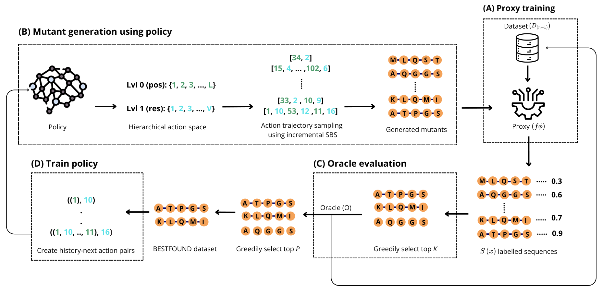
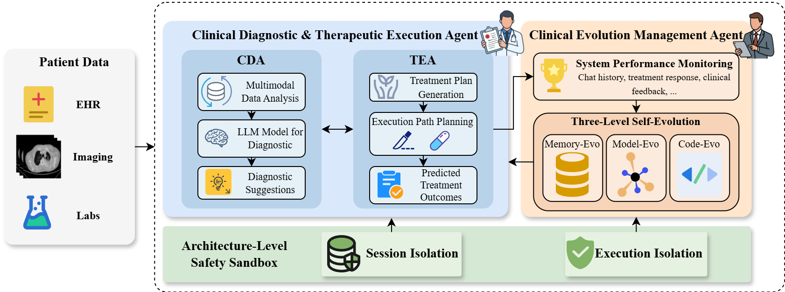
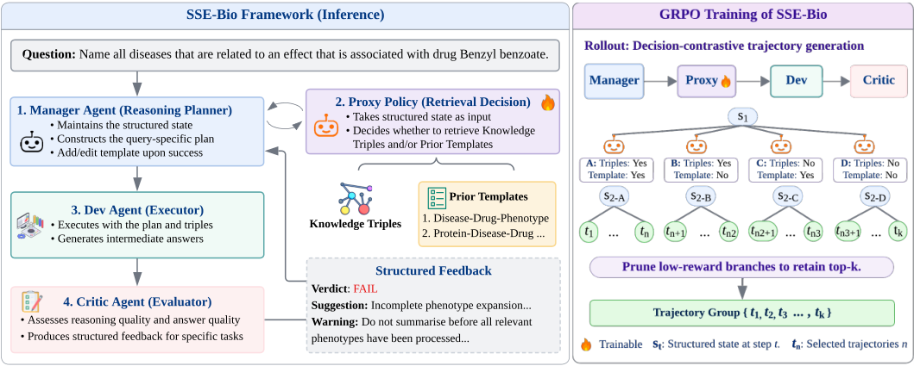

# 生物医药 RSI：值得关注的工作

仅选取本领域最新、与 RSI 关联最紧密的 3 篇工作；编号与「领域内发展状况.md」索引表一致。研究问题与核心方法为英文摘要的中文概括，不对实验数值作任何推断；方法架构图取自 arXiv 官方 HTML 版中的论文原图。

## 1. Self-Improvement Imitation with Biologically Guided Search for Protein Design Under Oracle Budgets（2026）

- **研究问题**：在紧张的评估（oracle）预算下做蛋白质序列优化，要求方法既能探索巨大组合空间，又让每次评估都带来信息增益。
- **核心方法**：提出 SILO：面向预算受限蛋白质设计的轨迹级自我改进模仿框架。
- **RSI 价值**：改进对象：改进方法/评价与搜索策略；反馈闭环：未明确；多轮迭代：是；分类 L6；定位：直接 RSI（候选）。
- **值得关注的原因**：2026 年工作，在本领域 32 篇收录论文中 RSI 关联度评分位列前段；其主攻方向为进化方法自身的改进，与「系统自主改进自身并参与下一轮改进」这一核心问题直接相关，但摘要层面尚不足以证明稳定的跨代递归闭环，需回到原文实验部分核实。
- **原文与全文**：[官方论文页](https://arxiv.org/abs/2605.26690) ｜ [arXiv:2605.26690](https://arxiv.org/abs/2605.26690) ｜ [本地 PDF](docs/2026_Self_Improvement_Imitation_with_Biologically_Guided.pdf)
- **发表渠道**：arXiv preprint（预印本，未经同行评审）

*图：论文方法 / 框架图（取自 arXiv 官方 HTML 版的原图）。来源：[arXiv 官方 HTML 版原图](https://arxiv.org/html/2605.26690v1/active.png)*

## 2. Toward Vibe Medicine: A Self-Evolving Multi-Agent Framework for Clinical Decision Support（2026）

- **研究问题**：大语言模型与自主智能体推动了医疗诊断与治疗，但现有系统在可靠性上仍有明显局限。
- **核心方法**：提出 VIBEMed 多智能体框架，内置自进化机制与架构级安全沙箱，用于稳健的临床决策支持。
- **RSI 价值**：改进对象：Agent 规划、决策与协作机制；反馈闭环：是；多轮迭代：是；分类 L4；定位：直接 RSI（候选）。
- **值得关注的原因**：2026 年工作，在本领域 32 篇收录论文中 RSI 关联度评分位列前段；其主攻方向为Agent 机制进化，与「系统自主改进自身并参与下一轮改进」这一核心问题直接相关，但摘要层面尚不足以证明稳定的跨代递归闭环，需回到原文实验部分核实。
- **原文与全文**：[官方论文页](https://arxiv.org/abs/2606.15504) ｜ [arXiv:2606.15504](https://arxiv.org/abs/2606.15504) ｜ [本地 PDF](docs/2026_Toward_Vibe_Medicine_A_Self_Evolving_Multi.pdf)
- **发表渠道**：arXiv preprint（预印本，未经同行评审）

*图：论文方法 / 框架图（取自 arXiv 官方 HTML 版的原图）。来源：[arXiv 官方 HTML 版原图](https://arxiv.org/html/2606.15504v2/overview-new.png)*

## 3. SSE-Bio: A Structured Self-Evolving Agent with Agentic Retrieval Policy for Multi-Hop Biomedical Reasoning（2026）

- **研究问题**：生物医药多跳问答要求模型把疾病、药物、蛋白质、表型等中间实体之间的证据串联起来。
- **核心方法**：提出 SSE-Bio：带智能体检索策略的结构化自进化智能体，用于多跳生物医药推理。
- **RSI 价值**：改进对象：上下文、提示与记忆结构；反馈闭环：未明确；多轮迭代：未明确；分类 L2；定位：接近 RSI。
- **值得关注的原因**：2026 年工作，在本领域 32 篇收录论文中 RSI 关联度评分位列前段；其主攻方向为上下文与记忆进化，与「系统自主改进自身并参与下一轮改进」这一核心问题直接相关，但摘要层面尚不足以证明稳定的跨代递归闭环，需回到原文实验部分核实。
- **原文与全文**：[官方论文页](https://arxiv.org/abs/2608.22132) ｜ [arXiv:2608.22132](https://arxiv.org/abs/2608.22132) ｜ [本地 PDF](docs/2026_SSE_Bio_A_Structured_Self_Evolving_Agent.pdf)
- **发表渠道**：EMNLP（作者注明：Accepted to EMNLP 2026）

*图：论文方法 / 框架图（取自 arXiv 官方 HTML 版的原图）。来源：[arXiv 官方 HTML 版原图](https://arxiv.org/html/2608.22132v1/SSE-Bio.png)*
