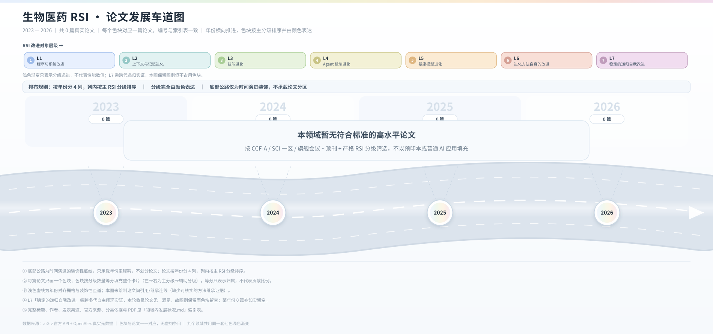

# 生物医药 RSI：领域内发展状况

[PNG 预览图](assets/lane_biomed.png) ｜ 图中每个色块对应一篇真实论文，编号与下表一致。 ｜ [七级配色规范](../assets/RSI_七级配色图例.svg)

## 发展脉络

本领域共收录 **21 篇** 2023—2026 年的真实论文，按年份分布为 2024 年 2 篇、2025 年 5 篇、2026 年 14 篇。其中 20 篇为 arXiv 预印本（未经同行评审），21 篇已下载原文 PDF 存档。

**2023 年未收录论文**：该年度未检索到同时满足「领域强相关」与「自我改进 / 反馈闭环线索」的真实工作；该领域 2023 年前后的文献多为普通 AI 应用或一次性优化，按调研原则不以这类工作填充，车道图对应年份列如实留空。

按 RSI 主分级统计，L1（程序与系统改进）4 篇、L2（上下文与记忆进化）3 篇、L3（技能进化）1 篇、L4（Agent 机制进化）6 篇、L5（基座模型进化）4 篇、L6（进化方法自身的改进）3 篇。定位上：直接 RSI 候选 10 篇、接近 RSI 10 篇、相关基础能力 1 篇。

**成熟度判断**：该领域已有较多以自我改进、迭代反馈与经验积累为核心机制的工作，但「改进后的系统能否稳定推动下一代改进」仍普遍缺少跨多代、可持续提升的实证；第 7 级（稳定的递归自我改进）在本轮收录中一律留空。

## 论文索引

| 编号 | 论文名称 | 年份 | 发表渠道 | RSI 分类 | 定位 | 官方来源 | PDF |
|---|---|---|---|---|---|---|---|
| P01 | Autonomous self-evolving research on biomedical data: the DREAM paradigm | 2024 | arXiv preprint（预印本，未经同行评审） | L1 | 直接 RSI（候选） | [原文页](https://arxiv.org/abs/2407.13637) | [2024\_Autonomous\_self\_evolving\_research\_on\_biomedical.pdf](docs/2024_Autonomous_self_evolving_research_on_biomedical.pdf) |
| P02 | GraphXForm: Graph transformer for computer-aided molecular design | 2024 | arXiv preprint（预印本，未经同行评审） | L5 + L1 | 直接 RSI（候选） | [原文页](https://arxiv.org/abs/2411.01667) | [2024\_GraphXForm\_Graph\_transformer\_for\_computer\_aided.pdf](docs/2024_GraphXForm_Graph_transformer_for_computer_aided.pdf) |
| P03 | Integrating Dynamical Systems Learning with Foundational Models: A Meta-Evolutionary AI Framework for Clinical Trials | 2025 | arXiv preprint（预印本，未经同行评审） | L6 | 直接 RSI（候选） | [原文页](https://arxiv.org/abs/2506.14782) | [2025\_Integrating\_Dynamical\_Systems\_Learning\_with\_Foundational.pdf](docs/2025_Integrating_Dynamical_Systems_Learning_with_Foundational.pdf) |
| P04 | STELLA: Self-Evolving LLM Agent for Biomedical Research | 2025 | arXiv preprint（预印本，未经同行评审） | L4 + L3 | 接近 RSI | [原文页](https://arxiv.org/abs/2507.02004) | [2025\_STELLA\_Self\_Evolving\_LLM\_Agent\_for\_Biomedical.pdf](docs/2025_STELLA_Self_Evolving_LLM_Agent_for_Biomedical.pdf) |
| P05 | Sparks: Multi-Agent Artificial Intelligence Model Discovers Protein Design Principles | 2025 | arXiv preprint（预印本，未经同行评审） | L4 | 接近 RSI | [原文页](https://arxiv.org/abs/2504.19017) | [2025\_Sparks\_Multi\_Agent\_Artificial\_Intelligence\_Model.pdf](docs/2025_Sparks_Multi_Agent_Artificial_Intelligence_Model.pdf) |
| P06 | LLM Agent Swarm for Hypothesis-Driven Drug Discovery | 2025 | arXiv preprint（预印本，未经同行评审） | L1 + L4 + L5 | 直接 RSI（候选） | [原文页](https://arxiv.org/abs/2504.17967) | [2025\_LLM\_Agent\_Swarm\_for\_Hypothesis\_Driven\_Drug.pdf](docs/2025_LLM_Agent_Swarm_for_Hypothesis_Driven_Drug.pdf) |
| P07 | Mitigating the Antigenic Data Bottleneck: Semi-supervised Learning with Protein Language Models for Influenza A Surveillance | 2025 | arXiv preprint（预印本，未经同行评审） | L5 | 接近 RSI | [原文页](https://arxiv.org/abs/2512.05222) | [2025\_Mitigating\_the\_Antigenic\_Data\_Bottleneck\_Semi\_supervised.pdf](docs/2025_Mitigating_the_Antigenic_Data_Bottleneck_Semi_supervised.pdf) |
| P08 | Self-Improvement Imitation with Biologically Guided Search for Protein Design Under Oracle Budgets | 2026 | arXiv preprint（预印本，未经同行评审） | L6 | 直接 RSI（候选） | [原文页](https://arxiv.org/abs/2605.26690) | [2026\_Self\_Improvement\_Imitation\_with\_Biologically\_Guided.pdf](docs/2026_Self_Improvement_Imitation_with_Biologically_Guided.pdf) |
| P09 | Toward Vibe Medicine: A Self-Evolving Multi-Agent Framework for Clinical Decision Support | 2026 | arXiv preprint（预印本，未经同行评审） | L4 + L2 | 直接 RSI（候选） | [原文页](https://arxiv.org/abs/2606.15504) | [2026\_Toward\_Vibe\_Medicine\_A\_Self\_Evolving\_Multi.pdf](docs/2026_Toward_Vibe_Medicine_A_Self_Evolving_Multi.pdf) |
| P10 | SSE-Bio: A Structured Self-Evolving Agent with Agentic Retrieval Policy for Multi-Hop Biomedical Reasoning | 2026 | EMNLP（作者注明：Accepted to EMNLP 2026） | L2 + L4 | 接近 RSI | [原文页](https://arxiv.org/abs/2608.22132) | [2026\_SSE\_Bio\_A\_Structured\_Self\_Evolving\_Agent.pdf](docs/2026_SSE_Bio_A_Structured_Self_Evolving_Agent.pdf) |
| P11 | Closing the Prior-Posterior Loop: Self-Reflective Molecular Design with Analysis-Driven LLM Iteration | 2026 | arXiv preprint（预印本，未经同行评审） | L1 | 接近 RSI | [原文页](https://arxiv.org/abs/2606.09520) | [2026\_Closing\_the\_Prior\_Posterior\_Loop\_Self\_Reflective.pdf](docs/2026_Closing_the_Prior_Posterior_Loop_Self_Reflective.pdf) |
| P12 | A Self-Evolving Agentic System for Automated Generation and Execution of Biological Protocols | 2026 | arXiv preprint（预印本，未经同行评审） | L4 + L3 | 直接 RSI（候选） | [原文页](https://arxiv.org/abs/2606.31763) | [2026\_A\_Self\_Evolving\_Agentic\_System\_for\_Automated.pdf](docs/2026_A_Self_Evolving_Agentic_System_for_Automated.pdf) |
| P13 | Active-GRPO: Adaptive Imitation and Self-Improving Reasoning for Molecular Optimization | 2026 | arXiv preprint（预印本，未经同行评审） | L5 | 直接 RSI（候选） | [原文页](https://arxiv.org/abs/2607.00531) | [2026\_Active\_GRPO\_Adaptive\_Imitation\_and\_Self\_Improving.pdf](docs/2026_Active_GRPO_Adaptive_Imitation_and_Self_Improving.pdf) |
| P14 | Self-evolving AI agents for protein discovery and directed evolution | 2026 | arXiv preprint（预印本，未经同行评审） | L4 | 接近 RSI | [原文页](https://arxiv.org/abs/2603.27303) | [2026\_Self\_evolving\_AI\_agents\_for\_protein\_discovery.pdf](docs/2026_Self_evolving_AI_agents_for_protein_discovery.pdf) |
| P15 | Emulating Clinician Cognition via Self-Evolving Deep Clinical Research | 2026 | arXiv preprint（预印本，未经同行评审） | L2 | 直接 RSI（候选） | [原文页](https://arxiv.org/abs/2603.10677) | [2026\_Emulating\_Clinician\_Cognition\_via\_Self\_Evolving.pdf](docs/2026_Emulating_Clinician_Cognition_via_Self_Evolving.pdf) |
| P16 | PrivMeSA: Privacy-Aware Self-Evolving Multi-Agent System for Medicine via Local-Remote LLM Collaboration | 2026 | arXiv preprint（预印本，未经同行评审） | L4 + L5 | 直接 RSI（候选） | [原文页](https://arxiv.org/abs/2609.38458) | [2026\_PrivMeSA\_Privacy\_Aware\_Self\_Evolving\_Multi\_Agent.pdf](docs/2026_PrivMeSA_Privacy_Aware_Self_Evolving_Multi_Agent.pdf) |
| P17 | ProTEUS: A mutation-resolved world model for closed-loop protein evolution | 2026 | arXiv preprint（预印本，未经同行评审） | L6 + L5 | 接近 RSI | [原文页](https://arxiv.org/abs/2611.13348) | [2026\_ProTEUS\_A\_mutation\_resolved\_world\_model\_for.pdf](docs/2026_ProTEUS_A_mutation_resolved_world_model_for.pdf) |
| P18 | MEMIG: Self-evolving Memory Construction for Antibody Optimization | 2026 | arXiv preprint（预印本，未经同行评审） | L2 | 接近 RSI | [原文页](https://arxiv.org/abs/2610.41245) | [2026\_MEMIG\_Self\_evolving\_Memory\_Construction\_for\_Antibody.pdf](docs/2026_MEMIG_Self_evolving_Memory_Construction_for_Antibody.pdf) |
| P19 | $\mathtt{Q^2SAR}$: overcoming classical bottlenecks in drug discovery via quantum multiple kernel learning | 2026 | arXiv preprint（预印本，未经同行评审） | L1 | 接近 RSI | [原文页](https://arxiv.org/abs/2607.11701) | [2026\_mathtt\_Q\_2SAR\_overcoming\_classical\_bottlenecks\_in.pdf](docs/2026_mathtt_Q_2SAR_overcoming_classical_bottlenecks_in.pdf) |
| P20 | Hardware-Accelerated Geometrical Simulation of Biological and Engineered In-Air Ultrasonic Systems | 2026 | arXiv preprint（预印本，未经同行评审） | L5 | 接近 RSI | [原文页](https://arxiv.org/abs/2602.19652) | [2026\_Hardware\_Accelerated\_Geometrical\_Simulation\_of\_Biological.pdf](docs/2026_Hardware_Accelerated_Geometrical_Simulation_of_Biological.pdf) |
| P21 | EvoSkillRec: Skill-Genome Evolution for Recommender Architecture Discovery | 2026 | arXiv preprint（预印本，未经同行评审） | L3 + L1 + L4 | 相关基础能力 | [原文页](https://arxiv.org/abs/2609.34552) | [2026\_EvoSkillRec\_Skill\_Genome\_Evolution\_for\_Recommender.pdf](docs/2026_EvoSkillRec_Skill_Genome_Evolution_for_Recommender.pdf) |

> 说明：「直接 RSI（候选）」表示摘要同时出现明确的自我改进措辞与反馈/迭代线索，是否真正构成严格递归闭环仍需回到原文实验部分核实；「相关基础能力」不计入 RSI 成果。

## 逐篇核实明细

| 编号 | 作者 | 改进对象 | 反馈闭环 | 多轮迭代 | RSI 分类依据（标题/摘要主题词） |
|---|---|---|---|---|---|
| P01 | Luojia Deng, Yijie Wu, Yongyong Ren et al. | 程序/系统实现与算法流程 | 未明确 | 是 | 自我改进线索：self-evolv；反馈/迭代线索：iterative；L1 线索：code、configuration |
| P02 | Jonathan Pirnay, Jan G. Rittig, Alexander B. Wolf et al. | 模型参数与训练机制；兼及程序/系统实现与算法流程 | 未明确 | 是 | 自我改进线索：self-improv、self-improvement；反馈/迭代线索：iterative；L5 线索：fine-tun、pretrain；L1 线索：algorithm、code |
| P03 | Joseph Geraci, Bessi Qorri, Christian Cumbaa et al. | 改进方法/评价与搜索策略 | 是 | 是 | 自我改进线索：self-improv、self-reflect、meta-evolution；反馈/迭代线索：iterative、loop；L6 线索：meta-evolution |
| P04 | Ruofan Jin, Zaixi Zhang, Mengdi Wang et al. | Agent 规划、决策与协作机制；兼及可复用技能/工具库 | 未明确 | 未明确 | 自我改进线索：self-evolv；L4 线索：agent architecture、multi-agent；L3 线索：tool creation |
| P05 | Alireza Ghafarollahi, Markus J. Buehler | Agent 规划、决策与协作机制 | 未明确 | 是 | 自我改进线索：self-correct、iterative refinement、reflection；反馈/迭代线索：iterative；L4 线索：multi-agent |
| P06 | Kevin Song, Andrew Trotter, Jake Y. Chen | 程序/系统实现与算法流程；兼及Agent 规划、决策与协作机制、模型参数与训练机制 | 未明确 | 是 | 自我改进线索：self-improv；反馈/迭代线索：iterative；L1 线索：code、pipeline、script；L4 线索：multi-agent、workflow |
| P07 | Yanhua Xu | 模型参数与训练机制 | 未明确 | 未明确 | 自我改进线索：self-train；L5 线索：self-training |
| P08 | Ashima Khanna, Dominik Grimm | 改进方法/评价与搜索策略 | 未明确 | 是 | 自我改进线索：self-improv、self-improvement；反馈/迭代线索：iterative；L6 线索：critic、fitness、mutation |
| P09 | Qianxue Zhang, Yiming Ren, Shihuan Qin et al. | Agent 规划、决策与协作机制；兼及上下文、提示与记忆结构 | 是 | 是 | 自我改进线索：self-evolv、self-evolution；反馈/迭代线索：feedback、iterative；L4 线索：decision-making、multi-agent、planning；L2 线索：exp… |
| P10 | Zhaohan Meng, Zaiqiao Meng, Siwei Liu et al. | 上下文、提示与记忆结构；兼及Agent 规划、决策与协作机制 | 未明确 | 未明确 | 自我改进线索：self-evolv；L2 线索：memory、prompt、retrieval；L4 线索：policy、workflow |
| P11 | Junyi Gong, Zijie Qiu, Ben Zhong Tang | 程序/系统实现与算法流程 | 是 | 是 | 自我改进线索：self-reflect、feedback loop、reflection；反馈/迭代线索：feedback、iterative、iteration；L1 线索：configuration |
| P12 | Yankai Jiang, Weiting Tang, Haoran Sun et al. | Agent 规划、决策与协作机制；兼及可复用技能/工具库 | 是 | 未明确 | 自我改进线索：self-evolv、skill library；反馈/迭代线索：feedback；L4 线索：multi-agent、orchestration、workflow；L3 线索：skill、skill library |
| P13 | Xuefeng Liu, Mingxuan Cao, Qinan Huang et al. | 模型参数与训练机制 | 是 | 是 | 自我改进线索：self-improv、self-improvement；反馈/迭代线索：feedback、progressively；L5 线索：fine-tun |
| P14 | Yang Tan, Lingrong Zhang, Mingchen Li et al. | Agent 规划、决策与协作机制 | 未明确 | 未明确 | 自我改进线索：self-evolv；L4 线索：multi-agent、orchestration、workflow |
| P15 | Ruiyang Ren, Yuhao Wang, Yunsen Liang et al. | 上下文、提示与记忆结构 | 未明确 | 是 | 自我改进线索：self-evolv；反馈/迭代线索：continually、continual；L2 线索：experience |
| P16 | Dannong Wang, Yuran Zhang, Bian Sun et al. | Agent 规划、决策与协作机制；兼及模型参数与训练机制 | 未明确 | 是 | 自我改进线索：self-evolv；反馈/迭代线索：repeated、subsequent；L4 线索：multi-agent；L5 线索：parameter update |
| P17 | Yikun Zhang, Minghao Guo, Guangxue Xu et al. | 改进方法/评价与搜索策略；兼及模型参数与训练机制 | 是 | 未明确 | 自我改进线索：closed-loop；反馈/迭代线索：feedback、loop；L6 线索：fitness、mutation；L5 线索：fine-tun、pretrain |
| P18 | Yunhui Jang, Zach Wang, Jai Doshi et al. | 上下文、提示与记忆结构 | 未明确 | 未明确 | 自我改进线索：self-evolv；L2 线索：experience、memory、retrieval |
| P19 | Mariano Caruso, Daniel Ruiz, Alejandro Giraldo et al. | 程序/系统实现与算法流程 | 未明确 | 未明确 | 自我改进线索：self-improv；L1 线索：pipeline、script |
| P20 | Wouter Jansen, Jan Steckel | 模型参数与训练机制 | 是 | 未明确 | 自我改进线索：closed-loop、reflection；反馈/迭代线索：loop；L5 线索：synthetic data |
| P21 | Xiaopeng Li, Kuo Cai, Bo Chen et al. | 可复用技能/工具库；兼及程序/系统实现与算法流程、Agent 规划、决策与协作机制 | 未明确 | 未明确 | 自我改进线索：open-ended、skill library；反馈/迭代线索：cumulative；L3 线索：skill、skill library；L1 线索：code、implementation |

## 目前的主要技术路线及发展趋势

- **L1 程序与系统改进**（4 篇，代表：P01、P06、P11、P19）：围绕程序与系统改进展开，本领域相关工作主要体现为对该层改进对象的自主修改与反馈验证。
- **L2 上下文与记忆进化**（3 篇，代表：P10、P15、P18）：围绕上下文与记忆进化展开，本领域相关工作主要体现为对该层改进对象的自主修改与反馈验证。
- **L3 技能进化**（1 篇，代表：P21）：围绕技能进化展开，本领域相关工作主要体现为对该层改进对象的自主修改与反馈验证。
- **L4 Agent 机制进化**（6 篇，代表：P04、P05、P09、P12、P14、P16）：围绕Agent 机制进化展开，本领域相关工作主要体现为对该层改进对象的自主修改与反馈验证。
- **L5 基座模型进化**（4 篇，代表：P02、P07、P13、P20）：围绕基座模型进化展开，本领域相关工作主要体现为对该层改进对象的自主修改与反馈验证。
- **L6 进化方法自身的改进**（3 篇，代表：P03、P08、P17）：围绕进化方法自身的改进展开，本领域相关工作主要体现为对该层改进对象的自主修改与反馈验证。
- **时间趋势**：收录论文从 2024 年的 2 篇到 2026 年的 14 篇，研究重心由一次性反馈修正逐步转向经验积累、技能库复用与改进方法本身的优化。
- **分级趋势**：本轮未发现满足第 7 级判据（跨多代稳定递归、可验证持续提升）的工作，该等级在车道图中保留图例但不占用任何色块。

## 尚未解决的关键问题

1. **闭环判定缺乏统一证据标准**：多数工作报告若干轮迭代后的性能提升，但很少验证「改进后的系统是否更擅长产生下一代改进」，这恰是 RSI 的核心判据。
2. **第 7 级证据空缺**：本领域收录论文中没有一篇提供跨多代、自主、可持续提升的递归闭环实验，因此未做任何 L7 归类。
3. **领域特有约束**：湿实验反馈昂贵且受伦理约束，设计—合成—测试的自主闭环难以多轮快速运行。
4. **评价与复现**：不同工作使用各自的任务集与指标，且预印本占比偏高，改进效果的可比性与同行评审状态需要持续跟踪。
5. **改进对象的边界**：Agent 组件优化、基座模型再训练与真正的递归自我改进常被混称，需要按「改进对象 + 改进后的系统是否参与下一轮」两层标准分别判定。
