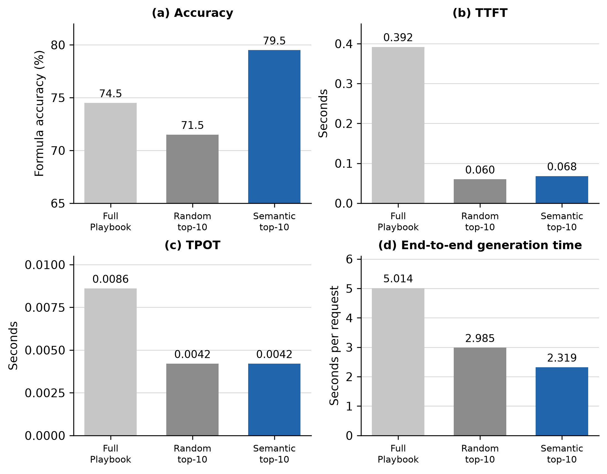

# 教育 RSI：值得关注的工作

仅选取 3 篇最新、与 RSI 关联最紧密的工作。研究问题与核心方法为英文摘要的中文概括，不推断实验数值；方法架构图取自 arXiv 官方 HTML 版论文原图。每篇均标注出版层级，若为准入的 2026 年 arXiv 预印本会额外注明未经同行评审。

## 1. ManimAgent: Self-Evolving Multimodal Agents for Visual Education（2026）

- **研究问题**：多轮反思能让 LLM 智能体在单个任务内从失败恢复，但每个任务仍是孤立片段：一个任务上积累的经验在进入下一任务前就被丢弃。
- **核心方法**：提出 ManimAgent 自进化多模态智能体，通过完全由自身任务流生长的双通道情景记忆库跨任务携带反思经验，不更新权重、不依赖人工种子。
- **RSI 价值**：改进对象为 上下文、提示与记忆结构；反馈闭环：是；多轮迭代：是；分级 L2（置信度 中）；定位：接近 RSI。
- **值得关注的原因**：T3 旗舰会议/领域顶刊，2026 年。该工作发表于 CCF-B / SCI 二区 / 领域顶尖会议期刊；
- **原文与全文**：[官方论文页](https://arxiv.org/abs/2606.30296) ｜ [arXiv:2606.30296](https://arxiv.org/abs/2606.30296) ｜ [本地 PDF](docs/2026_ManimAgent_Self_Evolving_Multimodal_Agents_for_Visual.pdf)
- **发表渠道**：EMNLP（作者注明：Accepted to EMNLP 2026 (Main Conference). Project page: https://manima）

*图：论文 Figure 1（方法/框架总览，取自 arXiv 官方 HTML 版）。来源：[arXiv 官方 HTML 版原图](https://arxiv.org/html/2606.30296v3/motivation.png)*

## 2. DeepEdu-v1: Efficient and Scalable Agentic LLMs for Vietnamese Education（2026）

- **研究问题**：AI 辅导本可显著改善发展中地区学生的学习成效，但现有两条常见路径都存在明显不足。
- **核心方法**：提出 DeepEdu-v1 越南语教育 AI 辅导系统，核心为 SCALE（自改进的情境感知学习引擎）框架。
- **RSI 价值**：改进对象为 模型参数与训练机制；反馈闭环：是；多轮迭代：是；分级 L5（置信度 低）；定位：接近 RSI。
- **值得关注的原因**：T4 其他正式出版，2026 年。该工作为其他正式出版渠道，层级低于 T1–T3，已在索引表标注；
- **原文与全文**：[官方论文页](https://arxiv.org/abs/2609.31568) ｜ [arXiv:2609.31568](https://arxiv.org/abs/2609.31568) ｜ [本地 PDF](docs/2026_DeepEdu_v1_Efficient_and_Scalable_Agentic_LLMs.pdf)
- **发表渠道**：arXiv preprint（预印本，未经同行评审）

*图：论文 Figure 1（方法/框架总览，取自 arXiv 官方 HTML 版）。来源：[arXiv 官方 HTML 版原图](https://arxiv.org/html/2609.31568v1/figures/time_rae.png)*

## 3. LLM-Based Multi-Agent System for Personalized Lesson Plan Generation in Multi-Domain Adaptive Learning（2026）

- **研究问题**：在自适应学习中，个性化教案生成仍是关键挑战：教学内容必须贴合学习者不断变化的能力画像。
- **核心方法**：提出 EduPlanner+ 多智能体框架，联合建模学生能力演化、自反思式教案修订与弱能力定向内容生成。
- **RSI 价值**：改进对象为 Agent 规划、决策与协作机制；反馈闭环：是；多轮迭代：未明确；分级 L4（置信度 高）；定位：接近 RSI。
- **值得关注的原因**：T4 其他正式出版，2026 年。该工作为其他正式出版渠道，层级低于 T1–T3，已在索引表标注；
- **原文与全文**：[官方论文页](https://doi.org/10.1109/tlt.2026.3742134) ｜ 本地 PDF 未获取
- **发表渠道**：IEEE Transactions on Learning Technologies

*该论文未检索到 arXiv 官方 HTML 版插图，故不插入架构图（不伪造图片）。*
