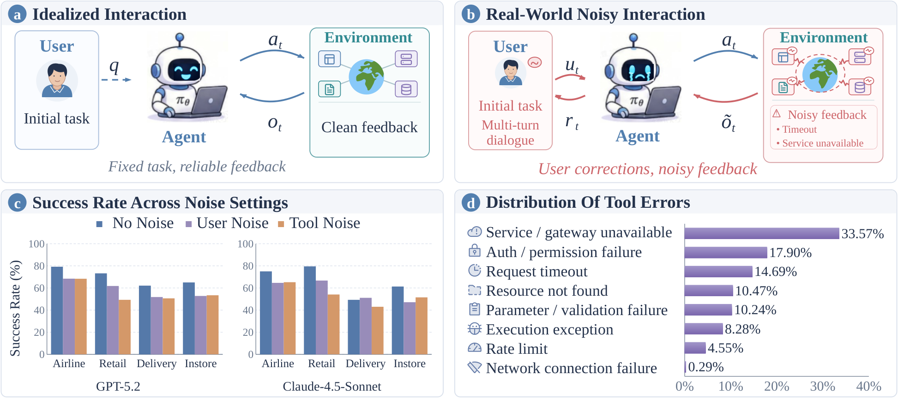
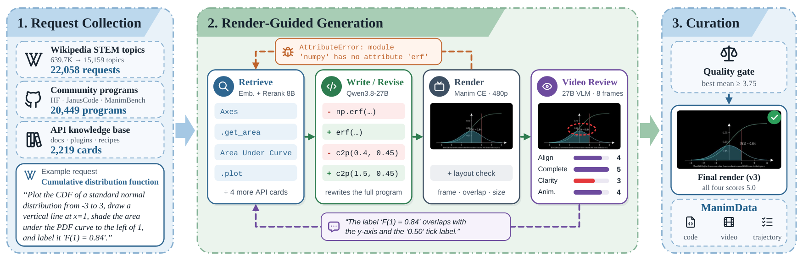

# 教育 RSI：值得关注的工作

仅选取 3 篇最新、与 RSI 关联最紧密的工作。研究问题与核心方法为英文摘要的中文概括，不推断实验数值；方法架构图取自 arXiv 官方 HTML 版论文原图。若条目来自补充层，会明确标注其未经同行评审。

## 1. ManimAgent: Self-Evolving Multimodal Agents for Visual Education（2026）

- **研究问题**：多轮反思能让 LLM 智能体在单个任务内从失败恢复，但每个任务仍是孤立片段：一个任务上积累的经验在进入下一任务前就被丢弃。
- **核心方法**：提出 ManimAgent 自进化多模态智能体，通过完全由自身任务流生长的双通道情景记忆库跨任务携带反思经验，不更新权重、不依赖人工种子。
- **RSI 价值**：改进对象为上下文、提示与记忆结构；反馈闭环：是；多轮迭代：是；分级 L2（置信度 中）；定位：接近 RSI。
- **值得关注的原因**：T3 旗舰会议/领域顶刊，2026 年。该工作发表于可核查的高水平渠道，且明确描述系统自主修改自身组成；
- **原文与全文**：[官方论文页](https://arxiv.org/abs/2606.30296) ｜ [arXiv:2606.30296](https://arxiv.org/abs/2606.30296) ｜ [本地 PDF](docs/2026_ManimAgent_Self_Evolving_Multimodal_Agents_for_Visual.pdf)
- **发表渠道**：EMNLP（作者注明：Accepted to EMNLP 2026 (Main Conference). Project page: https://manima）

*图：论文 Figure 1（方法/框架总览，取自 arXiv 官方 HTML 版）。来源：[arXiv 官方 HTML 版原图](https://arxiv.org/html/2606.30296v3/motivation.png)*

## 2. Agent-Reflex: Teaching Language Agents to Act Reflectively（2026）

- **研究问题**：大语言模型已从单轮聊天机器人演化为能进行长时程推理的交互式智能体；真实部署中 MCP 工具服务会返回噪声反馈、用户也可能介入纠正，但现有方法对反思学习与失败恢复提供的监督有限。
- **核心方法**：提出 Agent-Reflex 通用训练框架，用于激励智能体进行主动反思。
- **RSI 价值**：改进对象为可复用技能/工具库；兼及模型参数与训练机制；反馈闭环：是；多轮迭代：未明确；分级 L3 + L5（置信度 中）；定位：接近 RSI。
- **值得关注的原因**：T5 arXiv 预印本，2026 年。**该条目来自补充层，仅 arXiv / 非顶级渠道，未经同行评审，供跟踪而非定论。**
- **原文与全文**：[官方论文页](https://arxiv.org/abs/2610.17953) ｜ [arXiv:2610.17953](https://arxiv.org/abs/2610.17953) ｜ 本地 PDF 未获取
- **发表渠道**：arXiv preprint（预印本，未经同行评审）

*图：论文 Figure 1（方法/框架总览，取自 arXiv 官方 HTML 版）。来源：[arXiv 官方 HTML 版原图](https://arxiv.org/html/2610.17953v1/fig1_motivation_compact.png)*

## 3. ManimCode: Learning Visual Self-Correction for Educational Animation（2026）

- **研究问题**：Manim 支持精确的程序化视频生成，但成功渲染的教学动画仍可能存在视觉缺陷、解释缺失或内容错误；渲染过程并不直接指出需要改哪些代码，因此需要反馈驱动的修订。
- **核心方法**：提出面向教学动画的视觉自纠正方法，通过迭代渲染与修订来修正视觉失败（摘要指出已有智能体框架多依赖大型闭源模型）。
- **RSI 价值**：改进对象为模型参数与训练机制；反馈闭环：是；多轮迭代：是；分级 L5（置信度 中）；定位：接近 RSI。
- **值得关注的原因**：T5 arXiv 预印本，2026 年。**该条目来自补充层，仅 arXiv / 非顶级渠道，未经同行评审，供跟踪而非定论。**
- **原文与全文**：[官方论文页](https://arxiv.org/abs/2611.08294) ｜ [arXiv:2611.08294](https://arxiv.org/abs/2611.08294) ｜ 本地 PDF 未获取
- **发表渠道**：arXiv preprint（预印本，未经同行评审）

*图：论文 Figure 1（方法/框架总览，取自 arXiv 官方 HTML 版）。来源：[arXiv 官方 HTML 版原图](https://arxiv.org/html/2611.08294v1/manimdata_pipeline.png)*
