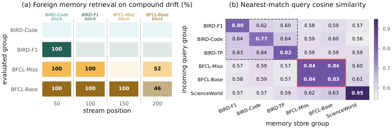
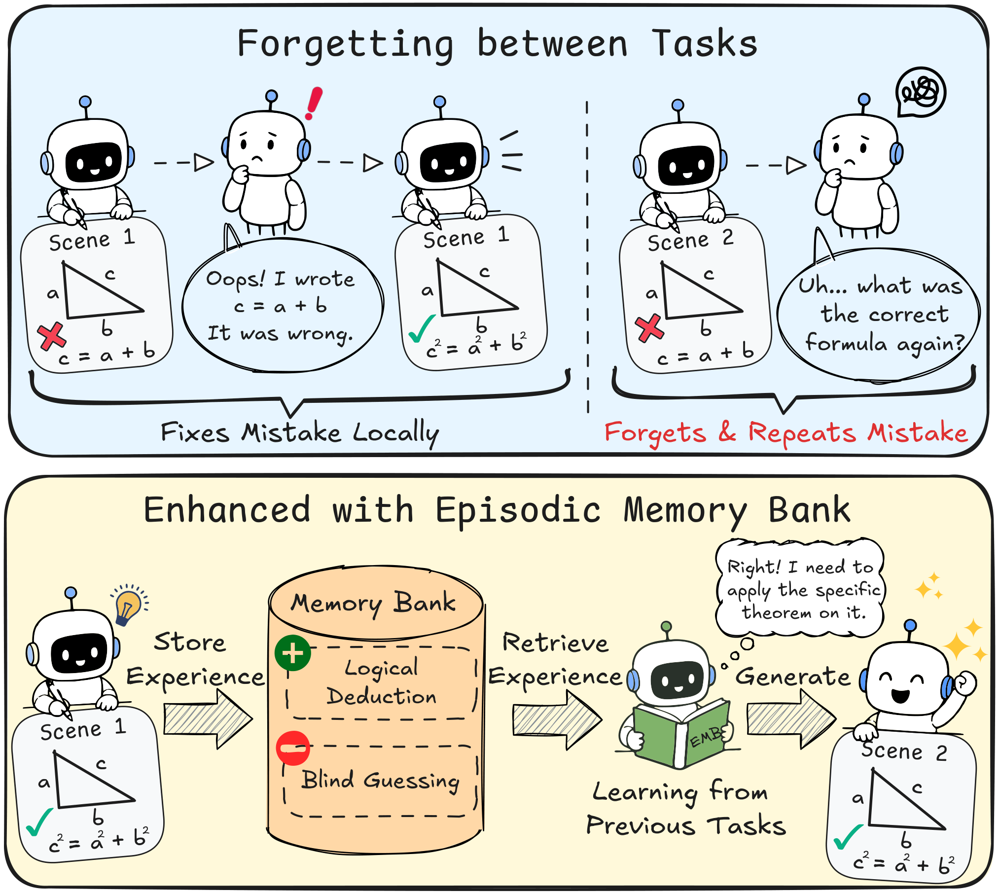

# 教育 RSI：值得关注的工作

仅选取本领域最新、与 RSI 关联最紧密的 3 篇工作；编号与「领域内发展状况.md」索引表一致。研究问题与核心方法为英文摘要的中文概括，不对实验数值作任何推断；方法架构图取自 arXiv 官方 HTML 版中的论文原图。

## 1. Are Self-Evolving Agents Continual Learners?（2026）

- **研究问题**：大语言模型智能体常部署在新知识、新工具与新工作流不断出现的环境中。
- **核心方法**：因此智能体需要持续适应：陆续学习新任务而不遗忘旧任务；论文据此检验自进化智能体是否真正具备持续学习能力。
- **RSI 价值**：改进对象：上下文、提示与记忆结构；反馈闭环：是；多轮迭代：是；分类 L2；定位：直接 RSI（候选）。
- **值得关注的原因**：2026 年工作，在本领域 50 篇收录论文中 RSI 关联度评分位列前段；其主攻方向为上下文与记忆进化，与「系统自主改进自身并参与下一轮改进」这一核心问题直接相关，但摘要层面尚不足以证明稳定的跨代递归闭环，需回到原文实验部分核实。
- **原文与全文**：[官方论文页](https://arxiv.org/abs/2610.25858) ｜ [arXiv:2610.25858](https://arxiv.org/abs/2610.25858) ｜ [本地 PDF](docs/2026_Are_Self_Evolving_Agents_Continual_Learners.pdf)
- **发表渠道**：arXiv preprint（预印本，未经同行评审）

*图：论文方法 / 框架图（取自 arXiv 官方 HTML 版的原图）。来源：[arXiv 官方 HTML 版原图](https://arxiv.org/html/2610.25858v1/fig_rb_mechanisms.png)*

## 2. ManimAgent: Self-Evolving Multimodal Agents for Visual Education（2026）

- **研究问题**：多轮反思能让智能体在单个任务内从失败中恢复，但每个任务仍是孤立片段——一个任务上积累的经验在进入下一任务前就被丢弃。
- **核心方法**：提出 ManimAgent 自进化多模态智能体，用完全由自身任务流生长的双通道情景记忆库跨任务携带反思经验，不更新权重、不依赖人工种子。
- **RSI 价值**：改进对象：上下文、提示与记忆结构；反馈闭环：未明确；多轮迭代：是；分类 L2；定位：直接 RSI（候选）。
- **值得关注的原因**：2026 年工作，在本领域 50 篇收录论文中 RSI 关联度评分位列前段；其主攻方向为上下文与记忆进化，与「系统自主改进自身并参与下一轮改进」这一核心问题直接相关，但摘要层面尚不足以证明稳定的跨代递归闭环，需回到原文实验部分核实。
- **原文与全文**：[官方论文页](https://arxiv.org/abs/2606.30296) ｜ [arXiv:2606.30296](https://arxiv.org/abs/2606.30296) ｜ [本地 PDF](docs/2026_ManimAgent_Self_Evolving_Multimodal_Agents_for_Visual.pdf)
- **发表渠道**：EMNLP（作者注明：Accepted to EMNLP 2026 (Main Conference). Project page: https://manima）

*图：论文方法 / 框架图（取自 arXiv 官方 HTML 版的原图）。来源：[arXiv 官方 HTML 版原图](https://arxiv.org/html/2606.30296v3/motivation.png)*

## 3. Agent-Reflex: Teaching Language Agents to Act Reflectively（2026）

- **研究问题**：大语言模型已从单轮聊天机器人演化为能够进行长时程推理的交互式智能体。
- **核心方法**：提出 Agent-Reflex 通用训练框架，用于激励智能体进行主动反思。
- **RSI 价值**：改进对象：可复用技能/工具库；兼及模型参数与训练机制；反馈闭环：是；多轮迭代：未明确；分类 L3 + L5；定位：接近 RSI。
- **值得关注的原因**：2026 年工作，在本领域 50 篇收录论文中 RSI 关联度评分位列前段；其主攻方向为技能进化，与「系统自主改进自身并参与下一轮改进」这一核心问题直接相关，但摘要层面尚不足以证明稳定的跨代递归闭环，需回到原文实验部分核实。
- **原文与全文**：[官方论文页](https://arxiv.org/abs/2610.17953) ｜ [arXiv:2610.17953](https://arxiv.org/abs/2610.17953) ｜ [本地 PDF](docs/2026_Agent_Reflex_Teaching_Language_Agents_to_Act.pdf)
- **发表渠道**：arXiv preprint（预印本，未经同行评审）

*图：论文方法 / 框架图（取自 arXiv 官方 HTML 版的原图）。来源：[arXiv 官方 HTML 版原图](https://arxiv.org/html/2610.17953v1/fig1_motivation_compact.png)*
