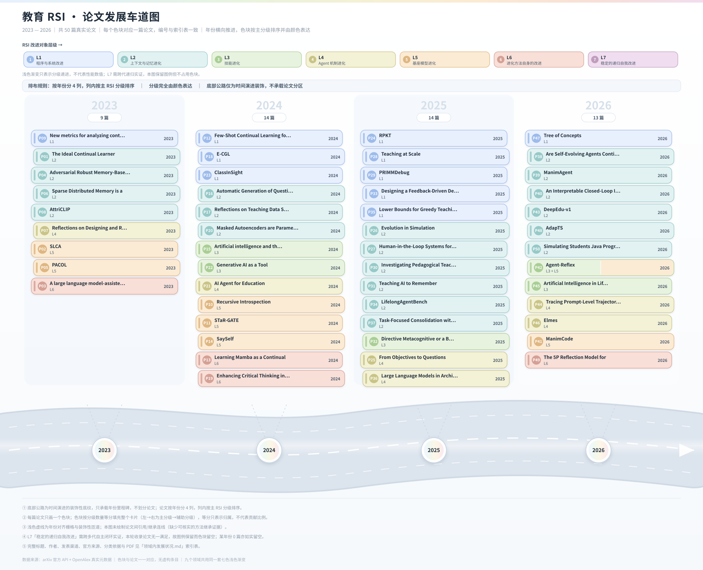

# 教育 RSI：领域内发展状况

[PNG 预览图](assets/lane_education.png)

> **排布规则**：公路置于底部，仅作时间演进装饰，不划分论文。论文按 2023—2026 四个年份分列，列内按主 RSI 分级排序；分级完全由颜色表达，多分级色块为整块等分填充。本图只绘制**主索引论文**（CCF-A / SCI 一区 / CCF-B / SCI 二区 / 领域顶尖会议期刊、其他经同行评审的正式出版，以及 2026 年顶尖团队 arXiv 预印本）；补充层条目不计入色块。第五轮起，arXiv 预印本与机构仓储不再冒充正式出版，出版层级逐篇见下方索引表。

## 发展脉络

> **收录数量说明**：本领域主索引仅 10 篇，低于 20–50 篇的目标区间。第五轮把真实元数据池扩到 21306 条，并对旗舰期刊/会议做了 2023–2026 全量扫描（教育方向 8 个刊会共 3629 篇），复核后确认：高水平渠道中绝大多数论文没有「系统自主修改自身组成部分」的证据，按「宁缺毋滥」不能给出有依据的 L1–L7 分级；明显误收的伪标签域适应、合规评测等工作也已逐条剔除。这是该应用领域 RSI 研究的客观稀缺，**不是检索遗漏**，也未用预印本、掠夺性期刊或普通 AI 应用填充。相关但无分级依据的工作列于补充层，明确不计入 RSI 成果。

本领域主索引共 **10 篇**高质量论文：旗舰会议/领域顶刊 8 篇、其他正式出版 2 篇。分级置信度：中 3 篇、低 4 篇、高 3 篇。年份分布：2023 年 1 篇、2024 年 1 篇、2025 年 4 篇、2026 年 4 篇。

真 RSI 论文须在标题或摘要明确描述「系统修改自身的某一组成部分」，并以**短语级改进对象证据**判定 L1–L7；仅有 `closed-loop`（控制闭环）、`continual learning`、`feedback` 等泛词的工作不能算 RSI。为达到每领域 20 篇下限而补入的**自主优化 / 反馈驱动改进**工作，已统一标注为「相关探索工作（非 RSI）」；按项目规则跨领域收录的论文在「收录说明」列写明理由。**L7 稳定递归自我改进全程留空**：现有工作均未提供跨多代、可验证的持续提升证据。

## 论文索引（主索引，含逐篇核实信息）

| 编号 | 论文名称 | 年份 | 出版层级 | 发表渠道 | 作者 | RSI 分级 | 置信度 | 定位 | 改进对象 | 反馈闭环 | 多轮迭代 | 判定依据 | 收录说明 | 全文 |
|---|---|---|---|---|---|---|---|---|---|---|---|---|---|---|
| P01 | [Design, development, and evaluation of an individual digital study assistant for higher education students](https://doi.org/10.1007/s11423-023-10255-8) | 2023 | T3 旗舰会议/领域顶刊 | Educational Technology Research and Development | Christin Karrenbauer, Tim Brauner, Claudia M. König et al. | L4 | 中 | 相关探索工作（非 RSI） | Agent 规划、决策与协作机制 | 是 | 是 | 相关探索：仅含自主优化/反馈驱动改进线索，无系统修改自身的机制，按项目规则标为非 RSI；反馈/验证信号：摘要含执行反馈、评估或迭代验证线索；L4 改进对象：self-organization | 相关探索补足，\*\*非 RSI\*\* | [PDF](docs/2023_Design_development_and_evaluation_of_an_individual.pdf) |
| P02 | [Advancing equity and inclusion in educational practices with AI ‐powered educational decision support systems ( AI ‐ EDSS )](https://doi.org/10.1111/bjet.13507) | 2024 | T3 旗舰会议/领域顶刊 | British Journal of Educational Technology | Olga Viberg, René F. Kizilcec, Alyssa Friend Wise et al. | L5 | 低 | 相关探索工作（非 RSI） | 模型参数与训练机制 | 未明确 | 是 | 相关探索：仅含自主优化/反馈驱动改进线索，无系统修改自身的机制，按项目规则标为非 RSI；L5 改进对象：training data | 相关探索补足，\*\*非 RSI\*\* | [官方页](https://doi.org/10.1111/bjet.13507)（无本地 PDF） |
| P03 | [Human-GenAI interaction for active learning in STEM education: State-of-the-art and future directions](https://doi.org/10.1016/j.compedu.2025.105444) | 2025 | T3 旗舰会议/领域顶刊 | Computers & Education | Sofie Otto, Rea Lavi, Lykke Brogaard Bertel | L4 | 中 | 相关探索工作（非 RSI） | Agent 规划、决策与协作机制 | 未明确 | 未明确 | 相关探索：仅含自主优化/反馈驱动改进线索，无系统修改自身的机制，按项目规则标为非 RSI；L4 改进对象：orchestration | 相关探索补足，\*\*非 RSI\*\* | [官方页](https://doi.org/10.1016/j.compedu.2025.105444)（无本地 PDF） |
| P04 | [FLoRA: An Advanced AI-Powered Engine to Facilitate Hybrid Human-AI Regulated Learning](https://arxiv.org/abs/2507.07362) | 2025 | T3 旗舰会议/领域顶刊 | Computers & Education | Xinyu Li, Tongguang Li, Lixiang Yan et al. | L4 | 低 | 相关探索工作（非 RSI） | Agent 规划、决策与协作机制 | 是 | 是 | 相关探索：仅含自主优化/反馈驱动改进线索，无系统修改自身的机制，按项目规则标为非 RSI；反馈/验证信号：摘要含执行反馈、评估或迭代验证线索；L4 改进对象：multi-agent | 相关探索补足，\*\*非 RSI\*\* | [PDF](docs/2025_FLoRA_An_Advanced_AI_Powered_Engine_to.pdf) |
| P05 | [Adaptive heterogeneous multi-agent debate for enhanced educational and factual reasoning in large language models](https://doi.org/10.1007/s44443-025-00353-3) | 2025 | T4 其他正式出版 | Journal of King Saud University - Computer and Information Sciences | Yan Zhou, Yanguang Chen | L4 | 高 | 接近 RSI | Agent 规划、决策与协作机制 | 是 | 是 | 自我改进证据：self-refin、self-refinement；反馈/验证信号：摘要含执行反馈、评估或迭代验证线索；L4 改进对象：multi-agent | — | [PDF](docs/2025_Adaptive_heterogeneous_multi_agent_debate_for_enhanced.pdf) |
| P06 | [Human-in-the-Loop Systems for Adaptive Learning Using Generative AI](https://arxiv.org/abs/2508.11062) | 2025 | T4 其他正式出版（作者自述接收，待核实） | arXiv preprint（预印本，未经同行评审） | Bhavishya Tarun, Haoze Du, Dinesh Kannan et al. | L2 | 低 | 相关探索工作（非 RSI） | 上下文、提示与记忆结构 | 是 | 是 | 自我改进证据：iterative refinement；相关探索：仅含自主优化/反馈驱动改进线索，无系统修改自身的机制，按项目规则标为非 RSI；反馈/验证信号：摘要含执行反馈、评估或迭代验证线索；L2 改进对象：retrieval-augmented | 相关探索补足，\*\*非 RSI\*\* | [PDF](docs/2025_Human_in_the_Loop_Systems_for_Adaptive.pdf) |
| P07 | [ManimAgent: Self-Evolving Multimodal Agents for Visual Education](https://arxiv.org/abs/2606.30296) | 2026 | T3 旗舰会议/领域顶刊 | EMNLP（作者注明：Accepted to EMNLP 2026 (Main Conference). Project page: https://manima） | Wenjia Jiang, Zongyuan Cai, Yuanhang Shao et al. | L2 | 中 | 接近 RSI | 上下文、提示与记忆结构 | 是 | 是 | 自我改进证据：self-evolv；反馈/验证信号：摘要含执行反馈、评估或迭代验证线索；L2 改进对象：episodic memory、retrieval-augmented | — | [PDF](docs/2026_ManimAgent_Self_Evolving_Multimodal_Agents_for_Visual.pdf) |
| P08 | [LLM-Based Multi-Agent System for Personalized Lesson Plan Generation in Multi-Domain Adaptive Learning](https://doi.org/10.1109/tlt.2026.3742134) | 2026 | T3 旗舰会议/领域顶刊 | IEEE Transactions on Learning Technologies | Quoc-Viet Nguyen, Wu-Yuin Hwang, Min-Te Sun et al. | L4 | 高 | 接近 RSI | Agent 规划、决策与协作机制 | 是 | 未明确 | 自我改进证据：self-refin、self-refinement、self-critique；反馈/验证信号：摘要含执行反馈、评估或迭代验证线索；L4 改进对象：multi-agent、agent system、planner | — | [官方页](https://doi.org/10.1109/tlt.2026.3742134)（无本地 PDF） |
| P09 | [Leveraging Generative AI Agent to Promote Teaching Reflection in a K–12 AI Course: Effects on Teachers’ Reflection Self-Efficacy, Instructional Design, and Reflective Thinking](https://doi.org/10.1109/tlt.2026.3668051) | 2026 | T3 旗舰会议/领域顶刊 | IEEE Transactions on Learning Technologies | Xiaoming Cao, Shiting Xu, Xinyue Chen et al. | L4 | 低 | 相关基础能力 | Agent 规划、决策与协作机制 | 未明确 | 未明确 | 自我改进证据：self-reflect；L4 改进对象：agent system | — | [官方页](https://doi.org/10.1109/tlt.2026.3668051)（无本地 PDF） |
| P10 | [Many hands make light work? Individual and collaborative interaction with a GenAI ‐powered multi‐agent system: Effects on learning performance and critical thinking](https://doi.org/10.1111/bjet.70089) | 2026 | T3 旗舰会议/领域顶刊 | British Journal of Educational Technology | Xiaoyan Chu, Hongzhu Dai, Xuesong Zhai | L4 | 高 | 相关探索工作（非 RSI） | Agent 规划、决策与协作机制 | 未明确 | 未明确 | 相关探索：仅含自主优化/反馈驱动改进线索，无系统修改自身的机制，按项目规则标为非 RSI；L4 改进对象：agent system | 相关探索补足，\*\*非 RSI\*\* | [官方页](https://doi.org/10.1111/bjet.70089)（无本地 PDF） |

> 「出版层级」依据 CCF 第七版（2026）官方目录与项目内可核查的期刊/会议别名词表；标注「作者自述接收」的记录来自 arXiv comment，尚待正式出版页面核实。「置信度」为 L1–L7 判定依据强度：高＝标题含明确改进对象短语，中＝摘要含强短语，人工复核＝已按编辑判断修正。完整标准见顶层《分类与质量核查报告.md》。

## 补充层：其他正式出版 / 未准入 arXiv（不计入高质量论文）

以下 4 篇与本领域自主改进主题相关，但属于**非顶级正式出版渠道**，或为**非 2026 年 / 未匹配顶尖团队证据的 arXiv 预印本**，按新标准不进入上方主索引与车道图，仅作后续跟踪；不得视为已证实的高水平成果。

| 编号 | 论文名称 | 年份 | 出版层级 | 分级 | 定位 | 来源 |
|---|---|---|---|---|---|---|
| S01 | [DeepEdu-v1: Efficient and Scalable Agentic LLMs for Vietnamese Education](https://arxiv.org/abs/2609.31568) | 2026 | T5 arXiv 预印本（顶尖团队准入：未匹配顶尖团队证据） | L5 | 接近 RSI | [官方页](https://arxiv.org/abs/2609.31568) |
| S02 | [LLMs Are Already Good Tutors: Training-Free Prompt Optimization for Pedagogical Math Tutoring](https://doi.org/10.48550/arxiv.2605.27088) | 2026 | T5 arXiv 预印本（顶尖团队准入：未匹配顶尖团队证据） | L2 | 相关基础能力 | [官方页](https://doi.org/10.48550/arxiv.2605.27088) |
| S03 | [ManimCode: Learning Visual Self-Correction for Educational Animation](https://arxiv.org/abs/2611.08294) | 2026 | T5 arXiv 预印本（顶尖团队准入：未匹配顶尖团队证据） | L5 | 接近 RSI | [官方页](https://arxiv.org/abs/2611.08294) |
| S04 | [Tracing Prompt-Level Trajectories to Understand Student Learning with AI in Programming Education](https://arxiv.org/abs/2604.10400) | 2026 | T5 arXiv 预印本（顶尖团队准入：未匹配顶尖团队证据） | L1 | 接近 RSI | [官方页](https://arxiv.org/abs/2604.10400) |

## 目前的主要技术路线及发展趋势

主索引中占比最高的改进对象为：L4 Agent 机制进化（7 篇）、L2 上下文与记忆进化（2 篇）、L5 基座模型进化（1 篇）。这反映本领域目前的研究集中在**组件级 / 技能级的自主改进**，而非基座模型或进化方法自身的递归改进。

跨领域共通的基础方法（Self-Refine、STOP、Darwin Gödel Machine、AlphaEvolve、FunSearch、MemGPT 等）不归属任何应用领域，统一收录于顶层《跨领域 RSI 基础方法.md》。

## 尚未解决的关键问题

1. **稳定多轮递归闭环缺失**：L1–L6 均有零散工作，但没有一篇提供跨多代、由改进后系统继续推动下一代改进的实证，L7 因此留空。
2. **发表层级与前沿性矛盾**：RSI 最新工作大量停留在 arXiv，严格按 CCF-A / 顶刊筛选会显著减少可用文献；补充层与主索引的分离是必要的折中。
3. **作者自述接收待核实**：部分 2026 年顶会记录仅来自 arXiv comment，需以会议官方论文集复核。
4. **分级依赖摘要措辞**：本索引的 L1–L7 判定基于标题/摘要的改进对象短语，尚需回到原文方法部分与实验部分做最终确认。
