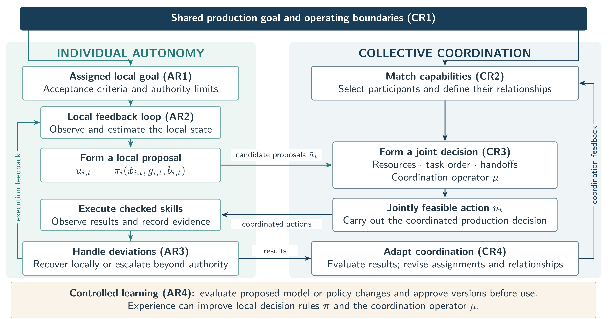
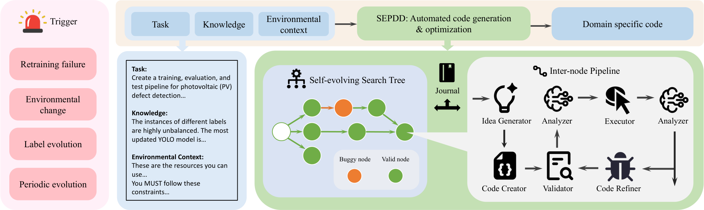

# 工业制造 RSI：值得关注的工作

仅选取本领域最新、与 RSI 关联最紧密的 3 篇工作；编号与「领域内发展状况.md」索引表一致。研究问题与核心方法为英文摘要的中文概括，不对实验数值作任何推断；方法架构图取自 arXiv 官方 HTML 版中的论文原图。

## 1. Self-Evolving Multi-Agent Network for Industrial IoT Predictive Maintenance（2026）

- **研究问题**：工业物联网预测性维护要求系统能实时检测异常，同时不牺牲可解释性、也不带来过高算力开销。
- **核心方法**：提出 SEMAS 自进化分层多智能体系统，把专用智能体分布在边缘、雾与云三层计算节点上。
- **RSI 价值**：改进对象：Agent 规划、决策与协作机制；反馈闭环：未明确；多轮迭代：未明确；分类 L4；定位：接近 RSI。
- **值得关注的原因**：2026 年工作，在本领域 36 篇收录论文中 RSI 关联度评分位列前段；其主攻方向为Agent 机制进化，与「系统自主改进自身并参与下一轮改进」这一核心问题直接相关，但摘要层面尚不足以证明稳定的跨代递归闭环，需回到原文实验部分核实。
- **原文与全文**：[官方论文页](https://arxiv.org/abs/2602.16738) ｜ [arXiv:2602.16738](https://arxiv.org/abs/2602.16738) ｜ [本地 PDF](docs/2026_Self_Evolving_Multi_Agent_Network_for_Industrial.pdf)
- **发表渠道**：arXiv preprint（预印本，未经同行评审）

*图：论文方法 / 框架图（取自 arXiv 官方 HTML 版的原图）。来源：[arXiv 官方 HTML 版原图](https://arxiv.org/html/2602.16738v1/images/pipeline_performance_comparison.png)*

## 2. Autonomy and Coordination in Intelligent Manufacturing: A Recursive Autonomous Agent Framework（2026）

- **研究问题**：智能生产要求系统依据生产目标与运行状况自主决策并组织工作。
- **核心方法**：提出递归自主智能体（RAA）框架，把目标驱动的自主智能体与递归组织结构结合起来。
- **RSI 价值**：改进对象：Agent 规划、决策与协作机制；反馈闭环：是；多轮迭代：是；分类 L4；定位：直接 RSI（候选）。
- **值得关注的原因**：2026 年工作，在本领域 36 篇收录论文中 RSI 关联度评分位列前段；其主攻方向为Agent 机制进化，与「系统自主改进自身并参与下一轮改进」这一核心问题直接相关，但摘要层面尚不足以证明稳定的跨代递归闭环，需回到原文实验部分核实。
- **原文与全文**：[官方论文页](https://arxiv.org/abs/2611.05828) ｜ [arXiv:2611.05828](https://arxiv.org/abs/2611.05828) ｜ [本地 PDF](docs/2026_Autonomy_and_Coordination_in_Intelligent_Manufacturing.pdf)
- **发表渠道**：arXiv preprint（预印本，未经同行评审）

*图：论文方法 / 框架图（取自 arXiv 官方 HTML 版的原图）。来源：[arXiv 官方 HTML 版原图](https://arxiv.org/html/2611.05828v1/figures/decision_coordination.png)*

## 3. A Self-Evolving Defect Detection Framework for Industrial Photovoltaic Systems（2026）

- **研究问题**：可靠的光伏发电需要及时检出组件缺陷，否则会降低发电量、加速老化并抬高全生命周期运维成本。
- **核心方法**：提出 SEPDD 自进化光伏缺陷检测框架，面向不断变化的工业光伏巡检场景。
- **RSI 价值**：改进对象：程序/系统实现与算法流程；反馈闭环：未明确；多轮迭代：未明确；分类 L1；定位：接近 RSI。
- **值得关注的原因**：2026 年工作，在本领域 36 篇收录论文中 RSI 关联度评分位列前段；其主攻方向为程序与系统改进，与「系统自主改进自身并参与下一轮改进」这一核心问题直接相关，但摘要层面尚不足以证明稳定的跨代递归闭环，需回到原文实验部分核实。
- **原文与全文**：[官方论文页](https://arxiv.org/abs/2603.14869) ｜ [arXiv:2603.14869](https://arxiv.org/abs/2603.14869) ｜ [本地 PDF](docs/2026_A_Self_Evolving_Defect_Detection_Framework_for.pdf)
- **发表渠道**：arXiv preprint（预印本，未经同行评审）

*图：论文方法 / 框架图（取自 arXiv 官方 HTML 版的原图）。来源：[arXiv 官方 HTML 版原图](https://arxiv.org/html/2603.14869v4/big_fig.png)*
