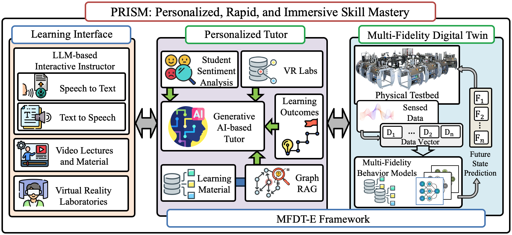

# 工业制造 RSI：值得关注的工作

仅选取 3 篇最新、与 RSI 关联最紧密的工作。研究问题与核心方法为英文摘要的中文概括，不推断实验数值；方法架构图取自 arXiv 官方 HTML 版论文原图。每篇均标注出版层级，若为准入的 2026 年 arXiv 预印本会额外注明未经同行评审。

## 1. Fusion of digital twins and self-evolving algorithms: Construction of real-time early warning and optimization decision-making system for industrial economic resilience（2026）

- **研究问题**：工业经济面对外部冲击时，实时感知系统状态并预测风险，是提升韧性的关键。
- **核心方法**：构建融合数字孪生与自进化算法的决策系统，用于实时预警（该工作属相关探索，摘要未描述系统修改自身的机制）。
- **RSI 价值**：改进对象为 改进方法/评价与搜索策略；反馈闭环：是；多轮迭代：未明确；分级 L6（置信度 中）；定位：接近 RSI。
- **值得关注的原因**：T4 其他正式出版，2026 年。该工作为其他正式出版渠道，层级低于 T1–T3，已在索引表标注；
- **原文与全文**：[官方论文页](https://doi.org/10.1016/j.sasc.2026.200579) ｜ 本地 PDF 未获取
- **发表渠道**：Systems and Soft Computing

*该论文未检索到 arXiv 官方 HTML 版插图，故不插入架构图（不伪造图片）。*

## 2. Beyond Predictive AI: A Systems Architecture for Self-Optimizing Industrial Intelligence Using Multi-Modal Artificial Intelligence（2026）

- **研究问题**：人工智能已成为工业数字化转型的基础能力，用于预测性维护、质检、工艺优化等；但多数工业 AI 仍围绕孤立的预测模型，未优化制造系统整体。
- **核心方法**：提出面向自优化工业智能的系统架构，用多智能体组织把孤立预测模型连接为可持续改进的整体（摘要未给出具体自我修改机制）。
- **RSI 价值**：改进对象为 Agent 规划、决策与协作机制；反馈闭环：是；多轮迭代：是；分级 L4（置信度 中）；定位：接近 RSI。
- **值得关注的原因**：T4 其他正式出版，2026 年。该工作为其他正式出版渠道，层级低于 T1–T3，已在索引表标注；
- **原文与全文**：[官方论文页](https://doi.org/10.47119/ijrp1002031820269712) ｜ [本地 PDF](docs/2026_Beyond_Predictive_AI_A_Systems_Architecture_for.pdf)
- **发表渠道**：International Journal of Research Publications

*该论文未检索到 arXiv 官方 HTML 版插图，故不插入架构图（不伪造图片）。*

## 3. PRISM: A Personalized, Rapid, and Immersive Skill Mastery framework for personalizing experiential learning through Generative AI（2024）

- **研究问题**：生成式 AI 正在改变教育培训等行业，尤其是体验式学习的个性化。
- **核心方法**：介绍 PRISM 框架，结合生成式 AI 与数字孪生，提供自适应、可规模化的沉浸式技能掌握训练；属书章/框架介绍，而非递归自我改进方法。
- **RSI 价值**：改进对象为 上下文、提示与记忆结构；反馈闭环：是；多轮迭代：未明确；分级 L2（置信度 低）；定位：接近 RSI。
- **值得关注的原因**：T4 其他正式出版，2024 年。该工作为其他正式出版渠道，层级低于 T1–T3，已在索引表标注；
- **原文与全文**：[官方论文页](https://arxiv.org/abs/2411.14433) ｜ [arXiv:2411.14433](https://arxiv.org/abs/2411.14433) ｜ [本地 PDF](docs/2024_PRISM_A_Personalized_Rapid_and_Immersive_Skill.pdf)
- **发表渠道**：arXiv preprint（预印本，未经同行评审）

*图：论文 Figure 1（方法/框架总览，取自 arXiv 官方 HTML 版）。来源：[arXiv 官方 HTML 版原图](https://arxiv.org/html/2411.14433v2/figures/PRISM.png)*
