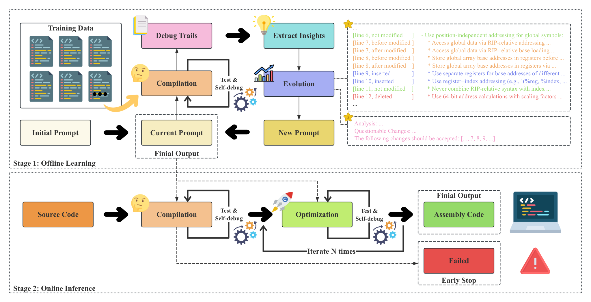

# 工业制造 RSI：值得关注的工作

仅选取 1 篇最新、与 RSI 关联最紧密的工作。研究问题与核心方法为英文摘要的中文概括，不推断实验数值；方法架构图取自 arXiv 官方 HTML 版论文原图。每篇均标注出版层级，若为准入的 2026 年 arXiv 预印本会额外注明未经同行评审。

## 1. QiMeng-NeuComBack: Self-Evolving Translation from IR to Assembly Code（2025）

- **研究问题**：编译器开发维护高度依赖昂贵的人工专家；神经编译有望简化新架构编译器开发并发现新优化，但缺少专用基准与稳健评测方法，且系统性提升大模型生成汇编代码的可靠性与性能仍是难题。
- **核心方法**：构建面向 IR→汇编编译的 NeuComBack 基准数据集，据此定义基础神经编译工作流，系统评测前沿大模型在该任务上的能力并建立性能基线；论文标题所述为从中间表示到汇编代码的自进化翻译。（摘要未展开自进化机制细节，具体以原文方法部分为准。）
- **RSI 价值**：改进对象为 程序/系统实现与算法流程；反馈闭环：是；多轮迭代：是；分级 L1（置信度 高（人工复核））；定位：接近 RSI。
- **值得关注的原因**：T1 CCF-A，2025 年。该工作发表于 CCF-A 渠道，属本轮最高出版层级；
- **原文与全文**：[官方论文页](https://arxiv.org/abs/2511.01183) ｜ [arXiv:2511.01183](https://arxiv.org/abs/2511.01183) ｜ [本地 PDF](docs/2025_QiMeng_NeuComBack_Self_Evolving_Translation_from.pdf)
- **发表渠道**：NeurIPS（作者注明：Accepted at NeurIPS 2025）
- **跨领域收录说明**：标题同时命中 软件工程 与 工业制造 的领域证据；按项目规则跨领域收录，主领域为 软件工程

*图：论文 Figure 1（方法/框架总览，取自 arXiv 官方 HTML 版）。来源：[arXiv 官方 HTML 版原图](https://arxiv.org/html/2511.01183v1/Neural_Compilation.png)*
