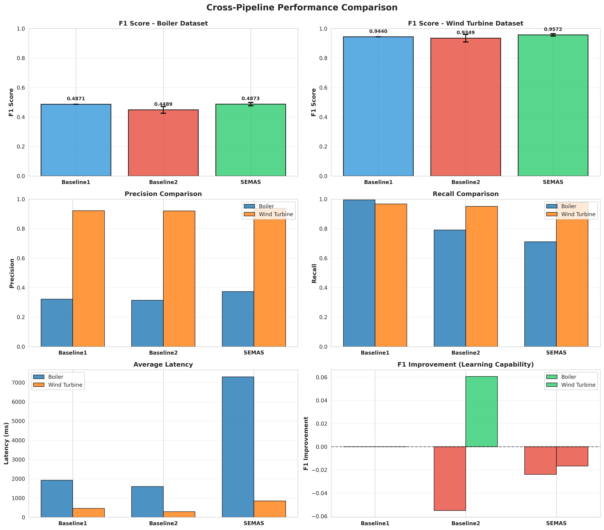

# 工业制造 RSI：值得关注的工作

仅选取 1 篇最新、与 RSI 关联最紧密的工作。研究问题与核心方法为英文摘要的中文概括，不推断实验数值；方法架构图取自 arXiv 官方 HTML 版论文原图。若条目来自补充层，会明确标注其未经同行评审。

## 1. Self-Evolving Multi-Agent Network for Industrial IoT Predictive Maintenance（2026）

- **研究问题**：工业物联网预测性维护要求系统能实时检测异常，同时不牺牲可解释性、也不带来过高算力开销。
- **核心方法**：提出 SEMAS 自进化分层多智能体系统，把专用智能体分布在边缘、雾与云三层计算节点上。
- **RSI 价值**：改进对象为Agent 规划、决策与协作机制；反馈闭环：未明确；多轮迭代：未明确；分级 L4（置信度 高）；定位：相关基础能力。
- **值得关注的原因**：T5 arXiv 预印本，2026 年。**该条目来自补充层，仅 arXiv / 非顶级渠道，未经同行评审，供跟踪而非定论。**
- **原文与全文**：[官方论文页](https://arxiv.org/abs/2602.16738) ｜ [arXiv:2602.16738](https://arxiv.org/abs/2602.16738) ｜ 本地 PDF 未获取
- **发表渠道**：arXiv preprint（预印本，未经同行评审）

*图：论文 Figure 1（方法/框架总览，取自 arXiv 官方 HTML 版）。来源：[arXiv 官方 HTML 版原图](https://arxiv.org/html/2602.16738v1/images/pipeline_performance_comparison.png)*
