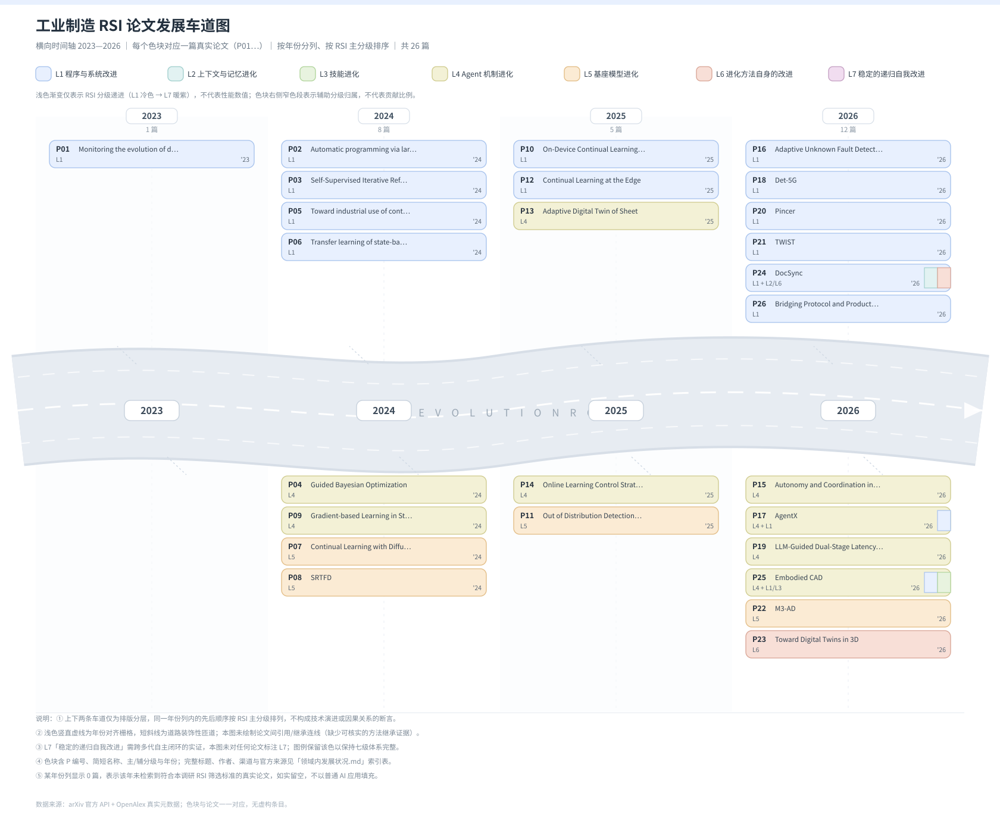

# 工业制造 RSI：领域内发展状况

[PNG 预览图](assets/lane_manufacturing.png) ｜ 图中每个色块对应一篇真实论文，编号与下表一致。 ｜ [七级配色规范](../assets/RSI_七级配色图例.svg)

## 发展脉络

本领域共收录 **26 篇** 2023—2026 年的真实论文，按年份分布为 2023 年 1 篇、2024 年 8 篇、2025 年 5 篇、2026 年 12 篇。其中 19 篇为 arXiv 预印本（未经同行评审），26 篇已下载原文 PDF 存档。

按 RSI 主分级统计，L1（程序与系统改进）13 篇、L4（Agent 机制进化）8 篇、L5（基座模型进化）4 篇、L6（进化方法自身的改进）1 篇。定位上：直接 RSI 候选 4 篇、接近 RSI 10 篇、相关基础能力 12 篇。

**成熟度判断**：该领域严格意义上「系统自主改进自身、并由改进后的系统继续推动下一轮改进」的证据仍然有限，多数工作属于反馈驱动的优化、持续学习或自主技能积累，为 RSI 提供基础能力但尚未构成稳定的递归闭环。本表按判定标准逐篇区分「直接 RSI / 接近 RSI / 相关基础能力」，未把普通自动优化或一次性人工微调认定为 RSI。

## 论文索引

| 编号 | 论文名称 | 年份 | 发表渠道 | RSI 分类 | 定位 | 官方来源 | PDF |
|---|---|---|---|---|---|---|---|
| P01 | Monitoring the evolution of dimensional accuracy and product properties in property-controlled forming processes | 2023 | arXiv preprint（预印本，未经同行评审） | L1 | 相关基础能力 | [原文页](https://arxiv.org/abs/2305.19601) | [2023\_Monitoring\_the\_evolution\_of\_dimensional\_accuracy.pdf](docs/2023_Monitoring_the_evolution_of_dimensional_accuracy.pdf) |
| P02 | Automatic programming via large language models with population self-evolution for dynamic fuzzy job shop scheduling problem | 2024 | IEEE（作者注明：13 pages, 10 figures. Accepted for publication in IEEE Transactions on） | L1 | 接近 RSI | [原文页](https://arxiv.org/abs/2410.22657) | [2024\_Automatic\_programming\_via\_large\_language\_models.pdf](docs/2024_Automatic_programming_via_large_language_models.pdf) |
| P03 | Self-Supervised Iterative Refinement for Anomaly Detection in Industrial Quality Control | 2024 | In Proceedings of the 20th International Joint Conference on Computer Vision, Imaging and Computer Graphics Theory and Applications - Volume 2: VISAPP, ISBN 978-989-758-728-3, ISSN 2184-4321, pages 173-183 (2025) | L1 | 相关基础能力 | [原文页](https://arxiv.org/abs/2408.11561) | [2024\_Self\_Supervised\_Iterative\_Refinement\_for\_Anomaly.pdf](docs/2024_Self_Supervised_Iterative_Refinement_for_Anomaly.pdf) |
| P04 | Guided Bayesian Optimization: Data-Efficient Controller Tuning with Digital Twin | 2024 | IEEE Transactions on Automation Science and Engineering, vol. 22, pp. 11304-11317, 2025 | L4 | 接近 RSI | [原文页](https://arxiv.org/abs/2403.16619) | [2024\_Guided\_Bayesian\_Optimization\_Data\_Efficient\_Controller.pdf](docs/2024_Guided_Bayesian_Optimization_Data_Efficient_Controller.pdf) |
| P05 | Toward industrial use of continual learning : new metrics proposal for class incremental learning | 2024 | IJCNN（作者注明：7 pages, Accepted at IJCNN 2023） | L1 | 接近 RSI | [原文页](https://arxiv.org/abs/2404.06972) | [2024\_Toward\_industrial\_use\_of\_continual\_learning\_new.pdf](docs/2024_Toward_industrial_use_of_continual_learning_new.pdf) |
| P06 | Transfer learning of state-based potential games for process optimization in decentralized manufacturing systems | 2024 | arXiv preprint（预印本，未经同行评审） | L1 | 接近 RSI | [原文页](https://arxiv.org/abs/2408.05992) | [2024\_Transfer\_learning\_of\_state\_based\_potential\_games.pdf](docs/2024_Transfer_learning_of_state_based_potential_games.pdf) |
| P07 | Continual Learning with Diffusion-based Generative Replay for Industrial Streaming Data | 2024 | arXiv preprint（预印本，未经同行评审） | L5 | 相关基础能力 | [原文页](https://arxiv.org/abs/2406.15766) | [2024\_Continual\_Learning\_with\_Diffusion\_based\_Generative.pdf](docs/2024_Continual_Learning_with_Diffusion_based_Generative.pdf) |
| P08 | SRTFD: Scalable Real-Time Fault Diagnosis through Online Continual Learning | 2024 | arXiv preprint（预印本，未经同行评审） | L5 | 相关基础能力 | [原文页](https://arxiv.org/abs/2408.05681) | [2024\_SRTFD\_Scalable\_Real\_Time\_Fault\_Diagnosis\_through.pdf](docs/2024_SRTFD_Scalable_Real_Time_Fault_Diagnosis_through.pdf) |
| P09 | Gradient-based Learning in State-based Potential Games for Self-Learning Production Systems | 2024 | arXiv preprint（预印本，未经同行评审） | L4 | 接近 RSI | [原文页](https://arxiv.org/abs/2406.10015) | [2024\_Gradient\_based\_Learning\_in\_State\_based\_Potential.pdf](docs/2024_Gradient_based_Learning_in_State_based_Potential.pdf) |
| P10 | On-Device Continual Learning for Unsupervised Visual Anomaly Detection in Dynamic Manufacturing | 2025 | arXiv preprint（预印本，未经同行评审） | L1 | 相关基础能力 | [原文页](https://arxiv.org/abs/2512.13497) | [2025\_On\_Device\_Continual\_Learning\_for\_Unsupervised\_Visual.pdf](docs/2025_On_Device_Continual_Learning_for_Unsupervised_Visual.pdf) |
| P11 | Out of Distribution Detection for Efficient Continual Learning in Quality Prediction for Arc Welding | 2025 | Proceedings of the 34th ACM International Conference on Information and Knowledge Management (CIKM '25), 2025, pp. 5699-5706 | L5 | 相关基础能力 | [原文页](https://arxiv.org/abs/2508.16832) | [2025\_Out\_of\_Distribution\_Detection\_for\_Efficient\_Continual.pdf](docs/2025_Out_of_Distribution_Detection_for_Efficient_Continual.pdf) |
| P12 | Continual Learning at the Edge: An Agnostic IIoT Architecture | 2025 | García-Santaclara, P., Fernández-Castro, B., Díaz-Redondo, R. P., Calvo-Moa, C., & Mariño-Bodelón, H. (2025). Continual learning at the edge: An agnostic IIoT architecture. In Lecture Notes in Networks and Systems. Springer | L1 | 相关基础能力 | [原文页](https://arxiv.org/abs/2512.14311) | [2025\_Continual\_Learning\_at\_the\_Edge\_An\_Agnostic.pdf](docs/2025_Continual_Learning_at_the_Edge_An_Agnostic.pdf) |
| P13 | Adaptive Digital Twin of Sheet Metal Forming via Proper Orthogonal Decomposition-Based Koopman Operator with Model Predictive Control | 2025 | arXiv preprint（预印本，未经同行评审） | L4 | 接近 RSI | [原文页](https://arxiv.org/abs/2511.10852) | [2025\_Adaptive\_Digital\_Twin\_of\_Sheet\_Metal\_Forming.pdf](docs/2025_Adaptive_Digital_Twin_of_Sheet_Metal_Forming.pdf) |
| P14 | Online Learning Control Strategies for Industrial Processes with Application for Loosening and Conditioning | 2025 | arXiv preprint（预印本，未经同行评审） | L4 | 接近 RSI | [原文页](https://arxiv.org/abs/2506.08983) | [2025\_Online\_Learning\_Control\_Strategies\_for\_Industrial.pdf](docs/2025_Online_Learning_Control_Strategies_for_Industrial.pdf) |
| P15 | Autonomy and Coordination in Intelligent Manufacturing: A Recursive Autonomous Agent Framework | 2026 | arXiv preprint（预印本，未经同行评审） | L4 | 直接 RSI（候选） | [原文页](https://arxiv.org/abs/2611.05828) | [2026\_Autonomy\_and\_Coordination\_in\_Intelligent\_Manufacturing.pdf](docs/2026_Autonomy_and_Coordination_in_Intelligent_Manufacturing.pdf) |
| P16 | Adaptive Unknown Fault Detection and Few-Shot Continual Learning for Condition Monitoring in Ultrasonic Metal Welding | 2026 | arXiv preprint（预印本，未经同行评审） | L1 | 接近 RSI | [原文页](https://arxiv.org/abs/2604.13465) | [2026\_Adaptive\_Unknown\_Fault\_Detection\_and\_Few\_Shot.pdf](docs/2026_Adaptive_Unknown_Fault_Detection_and_Few_Shot.pdf) |
| P17 | AgentX: Towards Agent-Driven Self-Iteration of Industrial Recommender Systems | 2026 | arXiv preprint（预印本，未经同行评审） | L4 + L1 | 直接 RSI（候选） | [原文页](https://arxiv.org/abs/2606.26859) | [2026\_AgentX\_Towards\_Agent\_Driven\_Self\_Iteration\_of.pdf](docs/2026_AgentX_Towards_Agent_Driven_Self_Iteration_of.pdf) |
| P18 | Det-5G: Closing the Determinism Gap in 5G-Advanced for Industrial Closed-Loop Control | 2026 | IEEE（作者注明：Accepted for publication in the IEEE Next Generation Communications (N） | L1 | 接近 RSI | [原文页](https://arxiv.org/abs/2609.07386) | [2026\_Det\_5G\_Closing\_the\_Determinism\_Gap\_in.pdf](docs/2026_Det_5G_Closing_the_Determinism_Gap_in.pdf) |
| P19 | LLM-Guided Dual-Stage Latency Optimization for Closed-Loop 6G V2I Digital Twins | 2026 | arXiv preprint（预印本，未经同行评审） | L4 | 接近 RSI | [原文页](https://arxiv.org/abs/2610.22848) | [2026\_LLM\_Guided\_Dual\_Stage\_Latency\_Optimization\_for.pdf](docs/2026_LLM_Guided_Dual_Stage_Latency_Optimization_for.pdf) |
| P20 | Pincer: Resource Authorization for Agents using a Digital Twin | 2026 | arXiv preprint（预印本，未经同行评审） | L1 | 直接 RSI（候选） | [原文页](https://arxiv.org/abs/2610.02569) | [2026\_Pincer\_Resource\_Authorization\_for\_Agents\_using\_a.pdf](docs/2026_Pincer_Resource_Authorization_for_Agents_using_a.pdf) |
| P21 | TWIST: Closed-Loop token Synchronization for Application-Aware Wireless Digital Twins | 2026 | arXiv preprint（预印本，未经同行评审） | L1 | 相关基础能力 | [原文页](https://arxiv.org/abs/2605.27205) | [2026\_TWIST\_Closed\_Loop\_token\_Synchronization\_for\_Application.pdf](docs/2026_TWIST_Closed_Loop_token_Synchronization_for_Application.pdf) |
| P22 | M3-AD: Reflection-aware Multi-modal, Multi-category, and Multi-dimensional Benchmark and Framework for Industrial Anomaly Detection | 2026 | arXiv preprint（预印本，未经同行评审） | L5 | 相关基础能力 | [原文页](https://arxiv.org/abs/2603.00055) | [2026\_M3\_AD\_Reflection\_aware\_Multi\_modal\_Multi.pdf](docs/2026_M3_AD_Reflection_aware_Multi_modal_Multi.pdf) |
| P23 | Toward Digital Twins in 3D IC Packaging: A Critical Review of Physics, Data, and Hybrid Architectures | 2026 | arXiv preprint（预印本，未经同行评审） | L6 | 直接 RSI（候选） | [原文页](https://arxiv.org/abs/2601.23226) | [2026\_Toward\_Digital\_Twins\_in\_3D\_IC\_Packaging.pdf](docs/2026_Toward_Digital_Twins_in_3D_IC_Packaging.pdf) |
| P24 | DocSync: Agentic Documentation Maintenance via Critic-Guided Reflexion | 2026 | arXiv preprint（预印本，未经同行评审） | L1 + L2 + L6 | 相关基础能力 | [原文页](https://arxiv.org/abs/2605.02163) | [2026\_DocSync\_Agentic\_Documentation\_Maintenance\_via\_Critic.pdf](docs/2026_DocSync_Agentic_Documentation_Maintenance_via_Critic.pdf) |
| P25 | Embodied CAD: Solver-Grounded LLM Agents for Parametric B-Rep Assembly Modeling | 2026 | arXiv preprint（预印本，未经同行评审） | L4 + L1 + L3 | 相关基础能力 | [原文页](https://arxiv.org/abs/2606.31252) | [2026\_Embodied\_CAD\_Solver\_Grounded\_LLM\_Agents\_for.pdf](docs/2026_Embodied_CAD_Solver_Grounded_LLM_Agents_for.pdf) |
| P26 | Bridging Protocol and Production: Design Patterns for Deploying AI Agents with Model Context Protocol | 2026 | arXiv preprint（预印本，未经同行评审） | L1 | 相关基础能力 | [原文页](https://arxiv.org/abs/2603.13417) | [2026\_Bridging\_Protocol\_and\_Production\_Design\_Patterns.pdf](docs/2026_Bridging_Protocol_and_Production_Design_Patterns.pdf) |

> 说明：「直接 RSI（候选）」表示摘要同时出现明确的自我改进措辞与反馈/迭代线索，是否真正构成严格递归闭环仍需回到原文实验部分核实；「相关基础能力」不计入 RSI 成果。

## 逐篇核实明细

| 编号 | 作者 | 改进对象 | 反馈闭环 | 多轮迭代 | RSI 分类依据（标题/摘要主题词） |
|---|---|---|---|---|---|
| P01 | Sophie Charlotte Stebner, Juri Martschin, Bahman Arian et al. | 程序/系统实现与算法流程 | 是 | 未明确 | 自我改进线索：closed-loop；反馈/迭代线索：loop |
| P02 | Jin Huang, Qihao Liu, Xinyu Li et al. | 程序/系统实现与算法流程 | 未明确 | 未明确 | 自我改进线索：self-reflect、self-evolution；L1 线索：algorithm、patch、program |
| P03 | Muhammad Aqeel, Shakiba Sharifi, Marco Cristani et al. | 程序/系统实现与算法流程 | 未明确 | 是 | 自我改进线索：iterative refinement；反馈/迭代线索：iterative |
| P04 | Mahdi Nobar, Jürg Keller, Alisa Rupenyan et al. | Agent 规划、决策与协作机制 | 是 | 是 | 自我改进线索：closed-loop；反馈/迭代线索：iterative、loop、progressively；L4 线索：controller |
| P05 | Konaté Mohamed Abbas, Anne-Françoise Yao, Thierry Chateau et al. | 程序/系统实现与算法流程 | 未明确 | 是 | 自我改进线索：continual learning；反馈/迭代线索：continual |
| P06 | Steve Yuwono, Dorothea Schwung, Andreas Schwung | 程序/系统实现与算法流程 | 未明确 | 未明确 | 自我改进线索：self-optimiz |
| P07 | Jiayi He, Jiao Chen, Qianmiao Liu et al. | 模型参数与训练机制 | 未明确 | 是 | 自我改进线索：continual learning；反馈/迭代线索：continual；L5 线索：distillation |
| P08 | Dandan Zhao, Karthick Sharma, Hongpeng Yin et al. | 模型参数与训练机制 | 未明确 | 是 | 自我改进线索：continual learning；反馈/迭代线索：continual；L5 线索：loss |
| P09 | Steve Yuwono, Marlon Löppenberg, Dorothea Schwung et al. | Agent 规划、决策与协作机制 | 未明确 | 未明确 | 自我改进线索：self-optimiz；L4 线索：multi-agent |
| P10 | Haoyu Ren, Kay Koehle, Kirill Dorofeev et al. | 程序/系统实现与算法流程 | 未明确 | 是 | 自我改进线索：continual learning；反馈/迭代线索：continual；L1 线索：patch |
| P11 | Yannik Hahn, Jan Voets, Antonin Koenigsfeld et al. | 模型参数与训练机制 | 未明确 | 是 | 自我改进线索：continual learning；反馈/迭代线索：continual；L5 线索：loss |
| P12 | Pablo García-Santaclara, Bruno Fernández-Castro, Rebeca P. Díaz-Redondo et al. | 程序/系统实现与算法流程 | 未明确 | 是 | 自我改进线索：continual learning；反馈/迭代线索：continual；L1 线索：algorithm |
| P13 | Yi-Ping Chen, Derick Suarez, Ying-Kuan Tsai et al. | Agent 规划、决策与协作机制 | 未明确 | 是 | 自我改进线索：recursive；L4 线索：decision-making、decomposition |
| P14 | Yue Wu, Jianfu Cao, Ye Cao | Agent 规划、决策与协作机制 | 未明确 | 是 | 自我改进线索：recursive；L4 线索：controller、decomposition |
| P15 | Yuning Chen, Hongda Zhang, Linqiang Hu et al. | Agent 规划、决策与协作机制 | 是 | 是 | 自我改进线索：recursive；反馈/迭代线索：feedback；L4 线索：coordination |
| P16 | Ahmadreza Eslaminia, Kuan-Chieh Lu, Klara Nahrstedt et al. | 程序/系统实现与算法流程 | 未明确 | 是 | 自我改进线索：continual learning；反馈/迭代线索：continual；L1 线索：algorithm |
| P17 | Changxin Lao, Fei Pan, Guozhuang Ma et al. | Agent 规划、决策与协作机制；兼及程序/系统实现与算法流程 | 是 | 是 | 自我改进线索：self-improv、self-evolv；反馈/迭代线索：iteration、loop；L4 线索：multi-agent、workflow；L1 线索：algorithm、code |
| P18 | Adnan Aijaz | 程序/系统实现与算法流程 | 是 | 未明确 | 自我改进线索：closed-loop；反馈/迭代线索：feedback、loop |
| P19 | Liu Cao, Peide Li, Yuan Yang et al. | Agent 规划、决策与协作机制 | 是 | 未明确 | 自我改进线索：closed-loop；反馈/迭代线索：loop；L4 线索：multi-agent、planner、policy |
| P20 | Mayank Rathee, Alexander Stepanov, Shalin Madabhavi et al. | 程序/系统实现与算法流程 | 未明确 | 是 | 自我改进线索：self-improv、self-improvement；反馈/迭代线索：continually、repeated、continual；L1 线索：code、script |
| P21 | Sige Liu, Kezhi Wang | 程序/系统实现与算法流程 | 是 | 是 | 自我改进线索：closed-loop；反馈/迭代线索：feedback、loop、repeated |
| P22 | Chao Huang, Yanhui Li, Yunkang Cao et al. | 模型参数与训练机制 | 未明确 | 未明确 | 自我改进线索：self-correct、reflection；L5 线索：fine-tun |
| P23 | Gourab Datta, Sarah Safura Sharif, Yaser Mike Banad | 改进方法/评价与搜索策略 | 是 | 未明确 | 自我改进线索：self-optimiz、closed-loop；反馈/迭代线索：loop；L6 线索：critic |
| P24 | Sidhesh Badrinarayan, Adithya Parthasarathy | 程序/系统实现与算法流程；兼及上下文、提示与记忆结构、改进方法/评价与搜索策略 | 是 | 是 | 自我改进线索：self-correct；反馈/迭代线索：iterative、loop；L1 线索：code、codebase、implementation；L2 线索：documentation、retrieval |
| P25 | Fumin Liu, Haoyu Zhou, Fei Hao et al. | Agent 规划、决策与协作机制；兼及程序/系统实现与算法流程、可复用技能/工具库 | 是 | 是 | 自我改进线索：skill library；反馈/迭代线索：feedback、iterative；L4 线索：controller、planner、planning；L1 线索：code、repair、script |
| P26 | Vasundra Srinivasan | 程序/系统实现与算法流程 | 未明确 | 未明确 | 自我改进线索：self-correct；L1 线索：algorithm、pipeline |

## 目前的主要技术路线及发展趋势

- **L1 程序与系统改进**（13 篇，代表：P01、P02、P03、P05、P06、P10）：围绕程序与系统改进展开，本领域相关工作主要体现为对该层改进对象的自主修改与反馈验证。
- **L4 Agent 机制进化**（8 篇，代表：P04、P09、P13、P14、P15、P17）：围绕Agent 机制进化展开，本领域相关工作主要体现为对该层改进对象的自主修改与反馈验证。
- **L5 基座模型进化**（4 篇，代表：P07、P08、P11、P22）：围绕基座模型进化展开，本领域相关工作主要体现为对该层改进对象的自主修改与反馈验证。
- **L6 进化方法自身的改进**（1 篇，代表：P23）：围绕进化方法自身的改进展开，本领域相关工作主要体现为对该层改进对象的自主修改与反馈验证。
- **时间趋势**：收录论文从 2023 年的 1 篇到 2026 年的 12 篇，研究重心由一次性反馈修正逐步转向经验积累、技能库复用与改进方法本身的优化。
- **分级趋势**：本轮未发现满足第 7 级判据（跨多代稳定递归、可验证持续提升）的工作，该等级在车道图中保留图例但不占用任何色块。

## 尚未解决的关键问题

1. **闭环判定缺乏统一证据标准**：多数工作报告若干轮迭代后的性能提升，但很少验证「改进后的系统是否更擅长产生下一代改进」，这恰是 RSI 的核心判据。
2. **第 7 级证据空缺**：本领域收录论文中没有一篇提供跨多代、自主、可持续提升的递归闭环实验，因此未做任何 L7 归类。
3. **领域特有约束**：产线停机成本高，自主优化策略的在线试错空间受限，闭环多依赖数字孪生。
4. **评价与复现**：不同工作使用各自的任务集与指标，且预印本占比偏高，改进效果的可比性与同行评审状态需要持续跟踪。
5. **改进对象的边界**：Agent 组件优化、基座模型再训练与真正的递归自我改进常被混称，需要按「改进对象 + 改进后的系统是否参与下一轮」两层标准分别判定。
