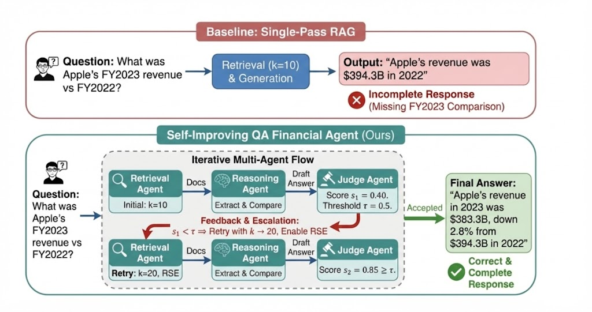
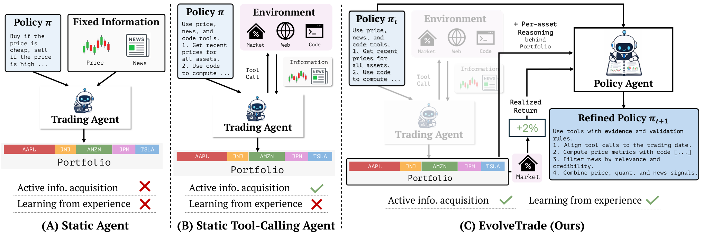

# 金融 RSI：值得关注的工作

仅选取本领域最新、与 RSI 关联最紧密的 3 篇工作；编号与「领域内发展状况.md」索引表一致。研究问题与核心方法为英文摘要的中文概括，不对实验数值作任何推断；方法架构图取自 arXiv 官方 HTML 版中的论文原图。

## 1. AQuA: Recursively Self-Improving Quantitative Trading Research Agents（2026）

- **研究问题**：研究量化投资研究层面的递归自我改进：自主系统能否用先前实验的证据，改进后续迭代提出的假设与候选方案。
- **核心方法**：提出 AQuA，包含两套语言模型驱动的研究系统：一套做符号因子发现，一套做可训练模型开发。
- **RSI 价值**：改进对象：Agent 规划、决策与协作机制；反馈闭环：是；多轮迭代：是；分类 L4；定位：直接 RSI（候选）。
- **值得关注的原因**：2026 年工作，在本领域 28 篇收录论文中 RSI 关联度评分位列前段；其主攻方向为Agent 机制进化，与「系统自主改进自身并参与下一轮改进」这一核心问题直接相关，但摘要层面尚不足以证明稳定的跨代递归闭环，需回到原文实验部分核实。
- **原文与全文**：[官方论文页](https://arxiv.org/abs/2608.12841) ｜ [arXiv:2608.12841](https://arxiv.org/abs/2608.12841) ｜ [本地 PDF](docs/2026_AQuA_Recursively_Self_Improving_Quantitative_Trading.pdf)
- **发表渠道**：arXiv preprint（预印本，未经同行评审）

*图：论文方法 / 框架图（取自 arXiv 官方 HTML 版的原图）。来源：[arXiv 官方 HTML 版原图](https://arxiv.org/html/2608.12841v3/figures/figure1_overview.png)*

## 2. Towards Expert Financial QA via Self-Improving RAG（2026）

- **研究问题**：专家级金融问答既要可溯源核验以发现数字幻觉，又要满足合规审计留痕，而标准单遍 RAG 不具备这些能力。
- **核心方法**：提出 Self-Improving RAG：把文档问答拆成检索、推理、评判三个专门智能体，由编排器以反馈驱动的自纠错进行协调。
- **RSI 价值**：改进对象：上下文、提示与记忆结构；反馈闭环：是；多轮迭代：未明确；分类 L2；定位：直接 RSI（候选）。
- **值得关注的原因**：2026 年工作，在本领域 28 篇收录论文中 RSI 关联度评分位列前段；其主攻方向为上下文与记忆进化，与「系统自主改进自身并参与下一轮改进」这一核心问题直接相关，但摘要层面尚不足以证明稳定的跨代递归闭环，需回到原文实验部分核实。
- **原文与全文**：[官方论文页](https://arxiv.org/abs/2608.26706) ｜ [arXiv:2608.26706](https://arxiv.org/abs/2608.26706) ｜ [本地 PDF](docs/2026_Towards_Expert_Financial_QA_via_Self_Improving.pdf)
- **发表渠道**：ICLR（作者注明：17 pages, 2 figures. Accepted at the ICLR 2026 Workshop on Advances in）

*图：论文方法 / 框架图（取自 arXiv 官方 HTML 版的原图）。来源：[arXiv 官方 HTML 版原图](https://arxiv.org/html/2608.26706v2/figures/figure2.png)*

## 3. EvolveTrade: Experience-Driven Policy Refinement for Self-Evolving LLM Trading Agents（2026）

- **研究问题**：大语言模型交易智能体能综合行情、新闻与可执行分析，但其行为常由部署前固定的手写工具使用策略控制。
- **核心方法**：提出 EvolveTrade 自进化框架，把工具型交易智能体的系统提示视作文本参数化策略，用经验驱动策略精化。
- **RSI 价值**：改进对象：上下文、提示与记忆结构；反馈闭环：是；多轮迭代：是；分类 L2；定位：直接 RSI（候选）。
- **值得关注的原因**：2026 年工作，在本领域 28 篇收录论文中 RSI 关联度评分位列前段；其主攻方向为上下文与记忆进化，与「系统自主改进自身并参与下一轮改进」这一核心问题直接相关，但摘要层面尚不足以证明稳定的跨代递归闭环，需回到原文实验部分核实。
- **原文与全文**：[官方论文页](https://arxiv.org/abs/2609.17632) ｜ [arXiv:2609.17632](https://arxiv.org/abs/2609.17632) ｜ [本地 PDF](docs/2026_EvolveTrade_Experience_Driven_Policy_Refinement.pdf)
- **发表渠道**：arXiv preprint（预印本，未经同行评审）

*图：论文方法 / 框架图（取自 arXiv 官方 HTML 版的原图）。来源：[arXiv 官方 HTML 版原图](https://arxiv.org/html/2609.17632v1/concept_evolvetrade.png)*
