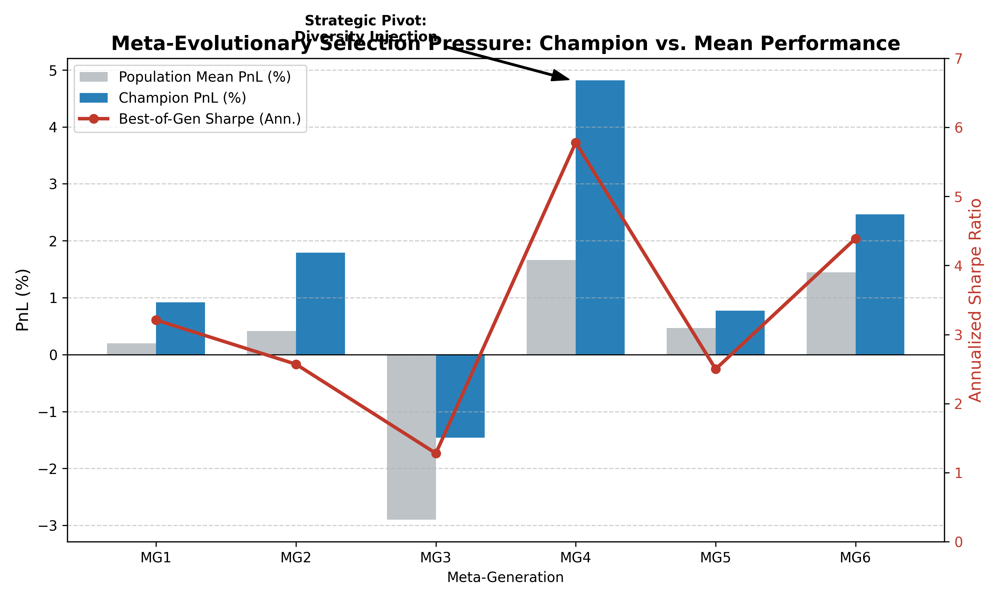

# 金融 RSI：值得关注的工作

仅选取 3 篇最新、与 RSI 关联最紧密的工作。研究问题与核心方法为英文摘要的中文概括，不推断实验数值；方法架构图取自 arXiv 官方 HTML 版论文原图。若条目来自补充层，会明确标注其未经同行评审。

## 1. Auditing Self-Evolution in Financial Agents: Capability Gains, Security Drift, and Execution-Interface Mismatch（2026）

- **研究问题**：自进化智能体把经验转化为可复用技能、工作流或记忆，但仅看进化后的准确率，无法说明习得行为是否保留了先前正确的行为与安全性。
- **核心方法**：在模拟电子银行环境中审计 SkillOpt、Agent Workflow Memory 与 ReasoningBank，采用匹配的良性获取轨迹、密封评估端点、基于执行的检查与独立状态重放。
- **RSI 价值**：改进对象为可复用技能/工具库；反馈闭环：未明确；多轮迭代：未明确；分级 L3（置信度 中）；定位：相关基础能力。
- **值得关注的原因**：T5 arXiv 预印本，2026 年。**该条目来自补充层，仅 arXiv / 非顶级渠道，未经同行评审，供跟踪而非定论。**
- **原文与全文**：[官方论文页](https://arxiv.org/abs/2608.17684) ｜ [arXiv:2608.17684](https://arxiv.org/abs/2608.17684) ｜ 本地 PDF 未获取
- **发表渠道**：arXiv preprint（预印本，未经同行评审）

*该论文未检索到 arXiv 官方 HTML 版插图，故不插入架构图（不伪造图片）。*

## 2. AlgoEvolve: LLM-driven Meta-evolution of Algorithmic Trading Programs（2026）

- **研究问题**：近期工作表明，大语言模型可作为语义变异算子，用于程序与证明的进化式发现。
- **核心方法**：提出 AlgoEvolve：一个 LLM 驱动的进化框架，生成、评估并迭代改进可执行的交易策略。
- **RSI 价值**：改进对象为改进方法/评价与搜索策略；反馈闭环：是；多轮迭代：是；分级 L6（置信度 高）；定位：接近 RSI。
- **值得关注的原因**：T5 arXiv 预印本，2026 年。**该条目来自补充层，仅 arXiv / 非顶级渠道，未经同行评审，供跟踪而非定论。**
- **原文与全文**：[官方论文页](https://arxiv.org/abs/2606.26173) ｜ [arXiv:2606.26173](https://arxiv.org/abs/2606.26173) ｜ 本地 PDF 未获取
- **发表渠道**：arXiv preprint（预印本，未经同行评审）

*图：论文 Figure 1（方法/框架总览，取自 arXiv 官方 HTML 版）。来源：[arXiv 官方 HTML 版原图](https://arxiv.org/html/2606.26173v1/selection_pressure_chart.png)*

## 3. EvoSteer: Online Self-Evolving Graph Orchestration via Reference-Anchored Credit Assignment（2026）

- **研究问题**：近年来基于 LLM 的多智能体系统被广泛用于把工具型智能体编排成可执行通信图，但现有自进化编排仍面临事后才修订团队、信用扩散、技能准入未校准等问题。
- **核心方法**：提出 EvoSteer 在线自进化图编排范式：编排器组建运行中的团队，并依据执行特征与参考锚定的信用分配修复看似合理却失败的步骤。
- **RSI 价值**：改进对象为Agent 规划、决策与协作机制；反馈闭环：未明确；多轮迭代：未明确；分级 L4（置信度 高）；定位：相关基础能力。
- **值得关注的原因**：T5 arXiv 预印本，2026 年。**该条目来自补充层，仅 arXiv / 非顶级渠道，未经同行评审，供跟踪而非定论。**
- **原文与全文**：[官方论文页](https://arxiv.org/abs/2609.38661) ｜ [arXiv:2609.38661](https://arxiv.org/abs/2609.38661) ｜ 本地 PDF 未获取
- **发表渠道**：arXiv preprint（预印本，未经同行评审）

*该论文未检索到 arXiv 官方 HTML 版插图，故不插入架构图（不伪造图片）。*
