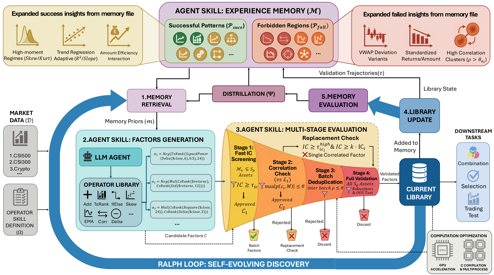
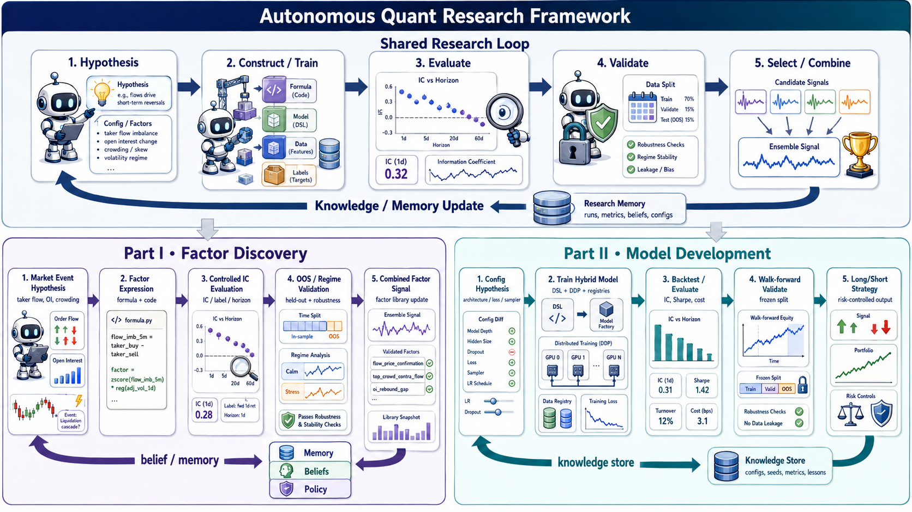
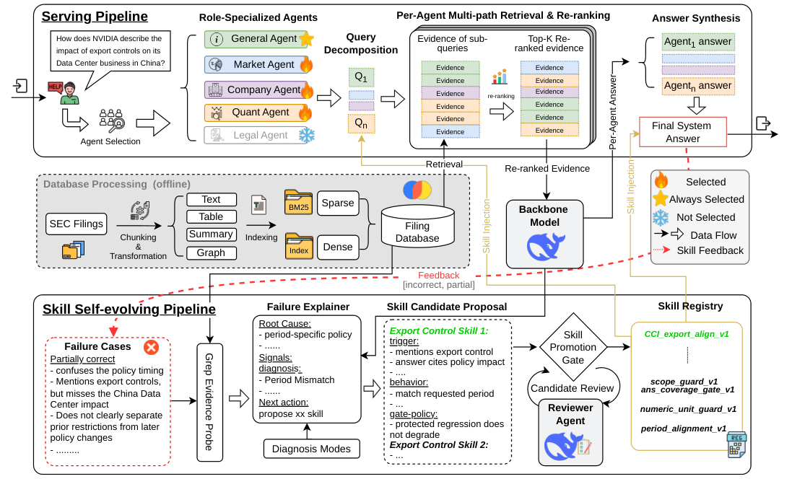

# 金融 RSI：值得关注的工作

仅选取 3 篇最新、与 RSI 关联最紧密的工作。研究问题与核心方法为英文摘要的中文概括，不推断实验数值；方法架构图取自 arXiv 官方 HTML 版论文原图。每篇均标注出版层级，若为准入的 2026 年 arXiv 预印本会额外注明未经同行评审。

## 1. FactorMiner: A Self-Evolving Agent with Skills and Experience Memory for Financial Alpha Discovery（2026）

- **研究问题**：公式化阿尔法因子挖掘是量化投资的关键难点：搜索空间巨大，且需要领域知识支撑、可解释的信号。
- **核心方法**：提出 FactorMiner 轻量级自进化智能体框架，通过持续的知识积累在搜索空间中导航。
- **RSI 价值**：改进对象为 改进方法/评价与搜索策略；反馈闭环：是；多轮迭代：是；分级 L6（置信度 低）；定位：接近 RSI。
- **值得关注的原因**：T1 CCF-A，2026 年。该工作发表于 CCF-A 渠道，属本轮最高出版层级；
- **原文与全文**：[官方论文页](https://doi.org/10.1145/3770855.3818978) ｜ [arXiv:2602.14670](https://arxiv.org/abs/2602.14670) ｜ [本地 PDF](docs/2026_FactorMiner_A_Self_Evolving_Agent_with_Skills.pdf)
- **发表渠道**：ACM SIGKDD Conference on Knowledge Discovery and Data Mining (KDD)

*图：论文 Figure 1（方法/框架总览，取自 arXiv 官方 HTML 版）。来源：[arXiv 官方 HTML 版原图](https://arxiv.org/html/2602.14670v2/main_process.png)*

## 2. AQuA: Recursively Self-Improving Quantitative Trading Research Agents（2026）

- **研究问题**：研究量化投资研究层面的递归自我改进：自主系统能否用先前实验的证据，改进后续迭代提出的假设与候选方案。
- **核心方法**：提出 AQuA，包含两套语言模型驱动的研究系统：一套做符号因子发现，一套做可训练模型开发。
- **RSI 价值**：改进对象为 Agent 规划、决策与协作机制；反馈闭环：是；多轮迭代：是；分级 L4（置信度 低）；定位：接近 RSI。
- **值得关注的原因**：T4 其他正式出版，2026 年。该工作为其他正式出版渠道，层级低于 T1–T3，已在索引表标注；
- **原文与全文**：[官方论文页](https://arxiv.org/abs/2608.12841) ｜ [arXiv:2608.12841](https://arxiv.org/abs/2608.12841) ｜ [本地 PDF](docs/2026_AQuA_Recursively_Self_Improving_Quantitative_Trading.pdf)
- **发表渠道**：arXiv preprint（预印本，未经同行评审）

*图：论文 Figure 1（方法/框架总览，取自 arXiv 官方 HTML 版）。来源：[arXiv 官方 HTML 版原图](https://arxiv.org/html/2608.12841v3/figures/figure1_overview.png)*

## 3. FINSKILLOPS: A Self-Evolving Multi-Agent System for SEC Filing QA（2026）

- **研究问题**：金融问答系统通常在部署前通过改进检索、提示或智能体协作来提升，部署后可靠性行为便固定下来；而新的 SEC 文件问题会不断暴露周期、实体、证据使用与计算等方面的异质错误。
- **核心方法**：提出 FINSKILLOPS 自进化多智能体系统，面向 SEC 文件问答持续累积与修订技能（摘要强调部署后改进的需求）。
- **RSI 价值**：改进对象为 Agent 规划、决策与协作机制；反馈闭环：是；多轮迭代：是；分级 L4（置信度 高）；定位：接近 RSI。
- **值得关注的原因**：T4 其他正式出版，2026 年。该工作为其他正式出版渠道，层级低于 T1–T3，已在索引表标注；
- **原文与全文**：[官方论文页](https://doi.org/10.48550/arxiv.2609.19680) ｜ [arXiv:2609.19680](https://arxiv.org/abs/2609.19680) ｜ [本地 PDF](docs/2026_FINSKILLOPS_A_Self_Evolving_Multi_Agent_System.pdf)
- **发表渠道**：arXiv (Cornell University)（预印本，未经同行评审）

*图：论文 Figure 1（方法/框架总览，取自 arXiv 官方 HTML 版）。来源：[arXiv 官方 HTML 版原图](https://arxiv.org/html/2609.19680v1/emnlp-FinEvo-Final.png)*
