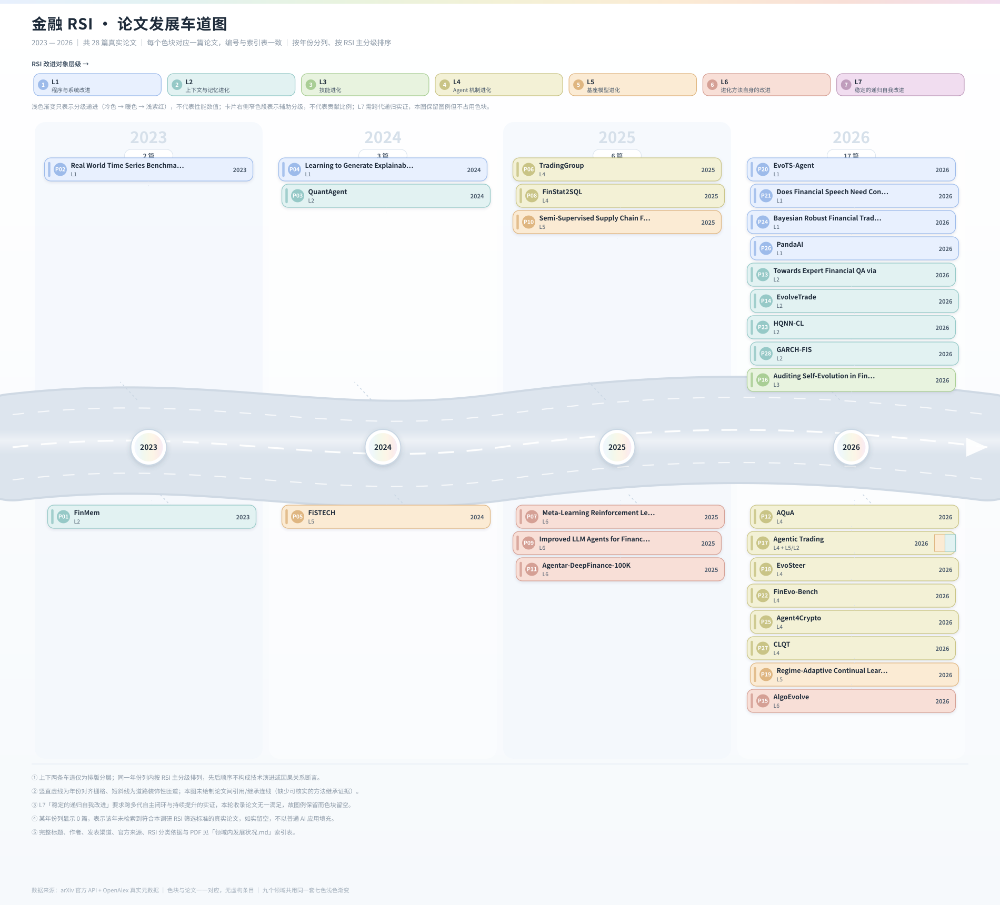

# 金融 RSI：领域内发展状况

[PNG 预览图](assets/lane_finance.png) ｜ 图中每个色块对应一篇真实论文，编号与下表一致 ｜ [七级配色规范](../assets/RSI_七级配色图例.svg)

> **排布规则**：论文按年份分为 4 列，列内按**主 RSI 分级**排序，分级完全由颜色表达；底部公路只是时间演进的装饰性底纹，承载年份里程碑，**不用于划分论文**（避免无语义的上下分区）。多分级论文的色块为**整块等宽填充**（左→右为主分级→辅助分级，两个分级即左右各一半），等分只表示归属，不代表贡献比例。

## 发展脉络

本领域共收录 **28 篇** 2023—2026 年的真实论文，按年份分布为 2023 年 2 篇、2024 年 3 篇、2025 年 6 篇、2026 年 17 篇。其中 22 篇为未经同行评审的预印本，28 篇已下载原文 PDF 存档。

按 RSI 主分级统计，L1（程序与系统改进）6 篇、L2（上下文与记忆进化）6 篇、L3（技能进化）1 篇、L4（Agent 机制进化）8 篇、L5（基座模型进化）3 篇、L6（进化方法自身的改进）4 篇。定位上：直接 RSI 候选 8 篇、接近 RSI 9 篇、相关基础能力 11 篇。

**成熟度判断**：本领域严格意义上「系统自主改进自身、并由改进后的系统继续推动下一轮改进」的证据仍然有限；多数工作属于反馈驱动的优化、持续学习或自主技能积累，为 RSI 提供基础能力但尚未构成稳定的递归闭环。本表逐篇区分「直接 RSI / 接近 RSI / 相关基础能力」，未把普通自动优化或一次性人工微调认定为 RSI。

## 论文索引

论文名称链接到可追溯的官方页面；下表一次性给出核实所需的全部字段（作者、改进对象、闭环、多轮迭代、分类依据、PDF）。

| 编号 | 论文名称 | 年份 | 发表渠道 | 作者 | RSI 分级 | 定位 | 改进对象 | 反馈闭环 | 多轮迭代 | 分类依据 | PDF |
|---|---|---|---|---|---|---|---|---|---|---|---|
| P01 | [FinMem: A Performance-Enhanced LLM Trading Agent with Layered Memory and Character Design](https://arxiv.org/abs/2311.13743) | 2023 | arXiv preprint（预印本，未经同行评审） | Yangyang Yu, Haohang Li, Zhi Chen et al. | L2 | 直接 RSI（候选） | 上下文、提示与记忆结构 | 未明确 | 未明确 | 自我改进线索：self-evolv；反馈/迭代线索：cumulative；L2 线索：memory、memory module | [2023\_FinMem\_A\_Performance\_Enhanced\_LLM\_Trading\_Agent.pdf](docs/2023_FinMem_A_Performance_Enhanced_LLM_Trading_Agent.pdf) |
| P02 | [Real World Time Series Benchmark Datasets with Distribution Shifts: Global Crude Oil Price and Volatility](https://arxiv.org/abs/2308.10846) | 2023 | arXiv preprint（预印本，未经同行评审） | Pranay Pasula | L1 | 相关基础能力 | 程序/系统实现与算法流程 | 未明确 | 是 | 自我改进线索：continual learning；反馈/迭代线索：continual | [2023\_Real\_World\_Time\_Series\_Benchmark\_Datasets\_with.pdf](docs/2023_Real_World_Time_Series_Benchmark_Datasets_with.pdf) |
| P03 | [QuantAgent: Seeking Holy Grail in Trading by Self-Improving Large Language Model](https://doi.org/10.48550/arxiv.2402.03755) | 2024 | RePEc: Research Papers in Economics | Saizhuo Wang, Hang Yuan, Lionel Ming-shuan Ni et al. | L2 | 直接 RSI（候选） | 上下文、提示与记忆结构 | 是 | 是 | 自我改进线索：self-improv；反馈/迭代线索：loop、progressively；L2 线索：knowledge base | [2024\_QuantAgent\_Seeking\_Holy\_Grail\_in\_Trading\_by.pdf](docs/2024_QuantAgent_Seeking_Holy_Grail_in_Trading_by.pdf) |
| P04 | [Learning to Generate Explainable Stock Predictions using Self-Reflective Large Language Models](https://arxiv.org/abs/2402.03659) | 2024 | arXiv preprint（预印本，未经同行评审） | Kelvin J. L. Koa, Yunshan Ma, Ritchie Ng et al. | L1 | 接近 RSI | 程序/系统实现与算法流程 | 未明确 | 是 | 自我改进线索：self-reflect；反馈/迭代线索：progressively | [2024\_Learning\_to\_Generate\_Explainable\_Stock\_Predictions.pdf](docs/2024_Learning_to_Generate_Explainable_Stock_Predictions.pdf) |
| P05 | [FiSTECH: Financial Style Transfer to Enhance Creativity without Hallucinations in LLMs](https://arxiv.org/abs/2408.05365) | 2024 | IEEE Big Data 2024 | Sohini Roychowdhury, Marko Krema, Brian Moore et al. | L5 | 相关基础能力 | 模型参数与训练机制 | 未明确 | 未明确 | 自我改进线索：self-correct；L5 线索：fine-tuning | [2024\_FiSTECH\_Financial\_Style\_Transfer\_to\_Enhance\_Creativity.pdf](docs/2024_FiSTECH_Financial_Style_Transfer_to_Enhance_Creativity.pdf) |
| P06 | [TradingGroup: A Multi-Agent Trading System with Self-Reflection and Data-Synthesis](https://arxiv.org/abs/2508.17565) | 2025 | arXiv preprint（预印本，未经同行评审） | Feng Tian, Flora D. Salim, Hao Xue | L4 | 相关基础能力 | Agent 规划、决策与协作机制 | 未明确 | 未明确 | 自我改进线索：self-reflect、reflection；L4 线索：coordination、multi-agent | [2025\_TradingGroup\_A\_Multi\_Agent\_Trading\_System\_with.pdf](docs/2025_TradingGroup_A_Multi_Agent_Trading_System_with.pdf) |
| P07 | [Meta-Learning Reinforcement Learning for Crypto-Return Prediction](https://arxiv.org/abs/2509.09751) | 2025 | arXiv preprint（预印本，未经同行评审） | Junqiao Wang, Zhaoyang Guan, Guanyu Liu et al. | L6 | 直接 RSI（候选） | 改进方法/评价与搜索策略 | 是 | 是 | 自我改进线索：self-improv、closed-loop；反馈/迭代线索：feedback、iterative、loop；L6 线索：meta-learning | [2025\_Meta\_Learning\_Reinforcement\_Learning\_for\_Crypto.pdf](docs/2025_Meta_Learning_Reinforcement_Learning_for_Crypto.pdf) |
| P08 | [FinStat2SQL: A Text2SQL Pipeline for Financial Statement Analysis](https://arxiv.org/abs/2506.23273) | 2025 | aclanthology.org（官方出版页面） | Quang Hung Nguyen, Phuong Anh Trinh, Phan Quoc Hung Mai et al. | L4 | 相关基础能力 | Agent 规划、决策与协作机制 | 未明确 | 未明确 | 自我改进线索：self-correct；L4 线索：multi-agent | [2025\_FinStat2SQL\_A\_Text2SQL\_Pipeline\_for\_Financial\_Statement.pdf](docs/2025_FinStat2SQL_A_Text2SQL_Pipeline_for_Financial_Statement.pdf) |
| P09 | [Improved LLM Agents for Financial Document Question Answering](https://arxiv.org/abs/2506.08726) | 2025 | arXiv preprint（预印本，未经同行评审） | Nelvin Tan, Zian Seng, Liang Zhang et al. | L6 | 相关基础能力 | 改进方法/评价与搜索策略 | 未明确 | 未明确 | 自我改进线索：self-correct；L6 线索：critic | [2025\_Improved\_LLM\_Agents\_for\_Financial\_Document\_Question.pdf](docs/2025_Improved_LLM_Agents_for_Financial_Document_Question.pdf) |
| P10 | [Semi-Supervised Supply Chain Fraud Detection with Unsupervised Pre-Filtering](https://arxiv.org/abs/2508.06574) | 2025 | arXiv preprint（预印本，未经同行评审） | Fatemeh Moradi, Mehran Tarif, Mohammadhossein Homaei | L5 | 接近 RSI | 模型参数与训练机制 | 未明确 | 未明确 | 自我改进线索：self-train；L5 线索：self-training | [2025\_Semi\_Supervised\_Supply\_Chain\_Fraud\_Detection\_with.pdf](docs/2025_Semi_Supervised_Supply_Chain_Fraud_Detection_with.pdf) |
| P11 | [Agentar-DeepFinance-100K: A Large-Scale Financial Dataset via Systematic Chain-of-Thought Synthesis Optimization](https://arxiv.org/abs/2507.12901) | 2025 | arXiv preprint（预印本，未经同行评审） | Xiaoke Zhao, Zhaowen Zhou, Lin Chen et al. | L6 | 相关基础能力 | 改进方法/评价与搜索策略 | 未明确 | 未明确 | 自我改进线索：self-correct；L6 线索：critic | [2025\_Agentar\_DeepFinance\_100K\_A\_Large\_Scale\_Financial.pdf](docs/2025_Agentar_DeepFinance_100K_A_Large_Scale_Financial.pdf) |
| P12 | [AQuA: Recursively Self-Improving Quantitative Trading Research Agents](https://arxiv.org/abs/2608.12841) | 2026 | arXiv preprint（预印本，未经同行评审） | Jiacheng Guo, Suozhi Huang, Yunlong Gao et al. | L4 | 直接 RSI（候选） | Agent 规划、决策与协作机制 | 是 | 是 | 自我改进线索：self-improv、recursive、self-improvement；反馈/迭代线索：iteration、loop、subsequent；L4 线索：multi-agent | [2026\_AQuA\_Recursively\_Self\_Improving\_Quantitative\_Trading.pdf](docs/2026_AQuA_Recursively_Self_Improving_Quantitative_Trading.pdf) |
| P13 | [Towards Expert Financial QA via Self-Improving RAG](https://arxiv.org/abs/2608.26706) | 2026 | ICLR（作者注明：17 pages, 2 figures. Accepted at the ICLR 2026 Workshop on Advances in） | Junjie Xiong, Shawheen Ghezavat, Aum Hirpara | L2 | 直接 RSI（候选） | 上下文、提示与记忆结构 | 是 | 未明确 | 自我改进线索：self-improv、self-correct；反馈/迭代线索：feedback；L2 线索：prompt、retrieval | [2026\_Towards\_Expert\_Financial\_QA\_via\_Self\_Improving.pdf](docs/2026_Towards_Expert_Financial_QA_via_Self_Improving.pdf) |
| P14 | [EvolveTrade: Experience-Driven Policy Refinement for Self-Evolving LLM Trading Agents](https://arxiv.org/abs/2609.17632) | 2026 | arXiv preprint（预印本，未经同行评审） | Sehee Kim, Yumin Choi, Minki Kang et al. | L2 | 直接 RSI（候选） | 上下文、提示与记忆结构 | 是 | 是 | 自我改进线索：self-evolv；反馈/迭代线索：feedback、cumulative；L2 线索：experience、prompt | [2026\_EvolveTrade\_Experience\_Driven\_Policy\_Refinement.pdf](docs/2026_EvolveTrade_Experience_Driven_Policy_Refinement.pdf) |
| P15 | [AlgoEvolve: LLM-driven Meta-evolution of Algorithmic Trading Programs](https://arxiv.org/abs/2606.26173) | 2026 | arXiv preprint（预印本，未经同行评审） | Dhruv Sharma, Gautam Shroff | L6 | 接近 RSI | 改进方法/评价与搜索策略 | 是 | 是 | 自我改进线索：meta-evolution；反馈/迭代线索：iterative、loop、continual；L6 线索：meta-evolution、mutation operator | [2026\_AlgoEvolve\_LLM\_driven\_Meta\_evolution\_of\_Algorithmic.pdf](docs/2026_AlgoEvolve_LLM_driven_Meta_evolution_of_Algorithmic.pdf) |
| P16 | [Auditing Self-Evolution in Financial Agents: Capability Gains, Security Drift, and Execution-Interface Mismatch](https://arxiv.org/abs/2608.17684) | 2026 | arXiv preprint（预印本，未经同行评审） | Jialong Li, Jialing Zhu | L3 | 接近 RSI | 可复用技能/工具库 | 未明确 | 未明确 | 自我改进线索：self-evolv、self-evolution；L3 线索：reusable skill、skill | [2026\_Auditing\_Self\_Evolution\_in\_Financial\_Agents\_Capability.pdf](docs/2026_Auditing_Self_Evolution_in_Financial_Agents_Capability.pdf) |
| P17 | [Agentic Trading: When LLM Agents Meet Financial Markets](https://arxiv.org/abs/2605.19337) | 2026 | arXiv preprint（预印本，未经同行评审） | Yihan Xia, Panpan You, Taotao Wang et al. | L4 + L5 + L2 | 直接 RSI（候选） | Agent 规划、决策与协作机制；兼及模型参数与训练机制、上下文、提示与记忆结构 | 是 | 未明确 | 自我改进线索：closed-loop、self-evolution；反馈/迭代线索：loop；L4 线索：agent architecture、coordination、multi-agent；L5 线索… | [2026\_Agentic\_Trading\_When\_LLM\_Agents\_Meet\_Financial.pdf](docs/2026_Agentic_Trading_When_LLM_Agents_Meet_Financial.pdf) |
| P18 | [EvoSteer: Online Self-Evolving Graph Orchestration via Reference-Anchored Credit Assignment](https://arxiv.org/abs/2609.38661) | 2026 | arXiv preprint（预印本，未经同行评审） | Mingda Zhang, Hanwen Zhang, Qiang Huang et al. | L4 | 接近 RSI | Agent 规划、决策与协作机制 | 未明确 | 未明确 | 自我改进线索：self-evolv；L4 线索：agent system、multi-agent、orchestration | [2026\_EvoSteer\_Online\_Self\_Evolving\_Graph\_Orchestration.pdf](docs/2026_EvoSteer_Online_Self_Evolving_Graph_Orchestration.pdf) |
| P19 | [Regime-Adaptive Continual Learning for Portfolio Management](https://arxiv.org/abs/2606.00143) | 2026 | KDD（作者注明：Accepted by KDD 2026） | Chaofan Pan, Lingfei Ren, Linbo Xiong et al. | L5 | 相关基础能力 | 模型参数与训练机制 | 未明确 | 是 | 自我改进线索：continual learning；反馈/迭代线索：continually、continual；L5 线索：fine-tuning | [2026\_Regime\_Adaptive\_Continual\_Learning\_for\_Portfolio.pdf](docs/2026_Regime_Adaptive_Continual_Learning_for_Portfolio.pdf) |
| P20 | [EvoTS-Agent: A Self-Evolving LLM Agent for Financial Time Series Change Point Detection](https://arxiv.org/abs/2608.17933) | 2026 | arXiv preprint（预印本，未经同行评审） | Lei Jiang, Ye Wei, Xinyu Xi et al. | L1 | 直接 RSI（候选） | 程序/系统实现与算法流程 | 是 | 未明确 | 自我改进线索：self-evolv；反馈/迭代线索：feedback | [2026\_EvoTS\_Agent\_A\_Self\_Evolving\_LLM\_Agent.pdf](docs/2026_EvoTS_Agent_A_Self_Evolving_LLM_Agent.pdf) |
| P21 | [Does Financial Speech Need Continual Learning Regularization? A Study of EWC and mini-KFAC on Earnings Call ASR](https://arxiv.org/abs/2610.13432) | 2026 | ACL（作者注明：10 pages, 7 figures, 3 tables. Presented at the 9th International Conf） | Thai Quoc On, Homayoon Beigi | L1 | 接近 RSI | 程序/系统实现与算法流程 | 未明确 | 是 | 自我改进线索：continual learning；反馈/迭代线索：continual | [2026\_Does\_Financial\_Speech\_Need\_Continual\_Learning\_Regularization.pdf](docs/2026_Does_Financial_Speech_Need_Continual_Learning_Regularization.pdf) |
| P22 | [FinEvo-Bench: A Longitudinal Benchmark for Self-Evolving Agents in Professional Financial Workflows](https://arxiv.org/abs/2608.06144) | 2026 | arXiv preprint（预印本，未经同行评审） | Bo Deng, Kang Zhou, Lifan Guo et al. | L4 | 接近 RSI | Agent 规划、决策与协作机制 | 未明确 | 是 | 自我改进线索：self-evolv、open-ended；L4 线索：scaffold | [2026\_FinEvo\_Bench\_A\_Longitudinal\_Benchmark\_for\_Self.pdf](docs/2026_FinEvo_Bench_A_Longitudinal_Benchmark_for_Self.pdf) |
| P23 | [HQNN-CL: Regime-Aware Hybrid Quantum Neural Network with Continual Learning for Financial Forecasting](https://arxiv.org/abs/2611.02091) | 2026 | arXiv preprint（预印本，未经同行评审） | Muhammad Atif Saeed, Akhtar Jamil, Subhan Ullah | L2 | 相关基础能力 | 上下文、提示与记忆结构 | 未明确 | 是 | 自我改进线索：continual learning；反馈/迭代线索：continual；L2 线索：experience | [2026\_HQNN\_CL\_Regime\_Aware\_Hybrid\_Quantum\_Neural.pdf](docs/2026_HQNN_CL_Regime_Aware_Hybrid_Quantum_Neural.pdf) |
| P24 | [Bayesian Robust Financial Trading with Adversarial Synthetic Market Data](https://arxiv.org/abs/2601.17008) | 2026 | arXiv preprint（预印本，未经同行评审） | Haochong Xia, Simin Li, Ruixiao Xu et al. | L1 | 接近 RSI | 程序/系统实现与算法流程 | 未明确 | 未明确 | 自我改进线索：self-play | [2026\_Bayesian\_Robust\_Financial\_Trading\_with\_Adversarial.pdf](docs/2026_Bayesian_Robust_Financial_Trading_with_Adversarial.pdf) |
| P25 | [Agent4Crypto: A Dual-Reflective and Market-Feedback-Aligned LLM-Based Multi-Agent System for Cryptocurrency Trading](https://arxiv.org/abs/2611.12269) | 2026 | arXiv preprint（预印本，未经同行评审） | Guangyan Gan, Jiahao Li, Jiashun Wang et al. | L4 | 相关基础能力 | Agent 规划、决策与协作机制 | 是 | 未明确 | 自我改进线索：reflection；反馈/迭代线索：feedback、subsequent；L4 线索：agent system、decision mechanism、multi-agent | [2026\_Agent4Crypto\_A\_Dual\_Reflective\_and\_Market\_Feedback.pdf](docs/2026_Agent4Crypto_A_Dual_Reflective_and_Market_Feedback.pdf) |
| P26 | [PandaAI: A Practical Agent CQ2 for Neuro-symbolic Data Analysis And Integrated Decision-Making in Quantitative Finance](https://arxiv.org/abs/2606.06823) | 2026 | arXiv preprint（预印本，未经同行评审） | Yuqi Li, Siyuan Liu, Bingjun Liu | L1 | 相关基础能力 | 程序/系统实现与算法流程 | 是 | 未明确 | 自我改进线索：closed-loop；反馈/迭代线索：loop | [2026\_PandaAI\_A\_Practical\_Agent\_CQ2\_for\_Neuro.pdf](docs/2026_PandaAI_A_Practical_Agent_CQ2_for_Neuro.pdf) |
| P27 | [CLQT: A Closed-Loop, Cost-Aware, Strategy-Consistent Benchmark for Diagnostic Evaluation of LLM Portfolio-Management Agents](https://arxiv.org/abs/2606.29771) | 2026 | arXiv preprint（预印本，未经同行评审） | Bo Qu, Mingguang Chen | L4 | 相关基础能力 | Agent 规划、决策与协作机制 | 是 | 是 | 自我改进线索：closed-loop；反馈/迭代线索：loop、rounds；L4 线索：scaffold | [2026\_CLQT\_A\_Closed\_Loop\_Cost\_Aware\_Strategy.pdf](docs/2026_CLQT_A_Closed_Loop_Cost_Aware_Strategy.pdf) |
| P28 | [GARCH-FIS: A Hybrid Forecasting Model with Dynamic Volatility-Driven Parameter Adaptation](https://arxiv.org/abs/2603.14793) | 2026 | arXiv preprint（预印本，未经同行评审） | Wen-Jing Li, Da-Qing Zhang | L2 | 接近 RSI | 上下文、提示与记忆结构 | 未明确 | 是 | 自我改进线索：recursive；L2 线索：memory | [2026\_GARCH\_FIS\_A\_Hybrid\_Forecasting\_Model\_with.pdf](docs/2026_GARCH_FIS_A_Hybrid_Forecasting_Model_with.pdf) |

> 说明：「直接 RSI（候选）」表示摘要同时出现明确的自我改进措辞与反馈/迭代线索，是否真正构成严格递归闭环仍需回到原文实验部分核实；「相关基础能力」不计入 RSI 成果。第 7 级（稳定的递归自我改进）需跨多代自主闭环的实证，本轮收录论文无一满足，故一律未标注。

## 目前的主要技术路线及发展趋势

- **L1 程序与系统改进**（6 篇，代表：P02、P04、P20、P21、P24、P26）：围绕程序与系统改进展开，相关工作主要体现为对该层改进对象的自主修改与反馈验证。
- **L2 上下文与记忆进化**（6 篇，代表：P01、P03、P13、P14、P23、P28）：围绕上下文与记忆进化展开，相关工作主要体现为对该层改进对象的自主修改与反馈验证。
- **L3 技能进化**（1 篇，代表：P16）：围绕技能进化展开，相关工作主要体现为对该层改进对象的自主修改与反馈验证。
- **L4 Agent 机制进化**（8 篇，代表：P06、P08、P12、P17、P18、P22）：围绕Agent 机制进化展开，相关工作主要体现为对该层改进对象的自主修改与反馈验证。
- **L5 基座模型进化**（3 篇，代表：P05、P10、P19）：围绕基座模型进化展开，相关工作主要体现为对该层改进对象的自主修改与反馈验证。
- **L6 进化方法自身的改进**（4 篇，代表：P07、P09、P11、P15）：围绕进化方法自身的改进展开，相关工作主要体现为对该层改进对象的自主修改与反馈验证。
- **时间趋势**：收录论文从 2023 年的 2 篇到 2026 年的 17 篇，研究重心由一次性反馈修正逐步转向经验积累、技能库复用与改进方法本身的优化。
- **分级趋势**：主分级分布为 L1 6 篇、L2 6 篇、L3 1 篇、L4 8 篇、L5 3 篇、L6 4 篇；分级按「改进对象 + 短语级证据」判定并按词表规模归一化，避免泛词导致 L1 虚高。

## 尚未解决的关键问题

1. **闭环判定缺乏统一证据标准**：多数工作报告若干轮迭代后的性能提升，但很少验证「改进后的系统是否更擅长产生下一代改进」，这恰是 RSI 的核心判据。
2. **第 7 级证据空缺**：本领域收录论文中没有一篇提供跨多代、自主、可持续提升的递归闭环实验，因此未做任何 L7 归类。
3. **领域特有约束**：市场非平稳使反馈信号噪声极大，策略自我改进容易过拟合历史区间。
4. **评价与复现**：不同工作使用各自的任务集与指标，且预印本占比偏高，改进效果的可比性与同行评审状态需要持续跟踪。
5. **改进对象的边界**：Agent 组件优化、基座模型再训练与真正的递归自我改进常被混称，需要按「改进对象 + 改进后的系统是否参与下一轮」两层标准分别判定。
