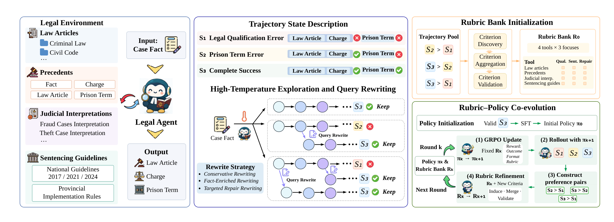

# 专业知识工作 RSI：值得关注的工作

仅选取本领域最新、与 RSI 关联最紧密的 3 篇工作；编号与「领域内发展状况.md」索引表一致。研究问题与核心方法为英文摘要的中文概括，不对实验数值作任何推断；方法架构图取自 arXiv 官方 HTML 版中的论文原图。

## 1. LegalEvolver: Agentic Legal Judgment Prediction via Rubric-Guided Self-Evolution（2026）

- **研究问题**：随着大语言模型智能体发展，它们被越来越多地应用到法律领域。
- **核心方法**：提出 LegalEvolver 查询优化框架，专门生成对法律判决预测检索具有信息量的查询，并以评分量规引导自进化。
- **RSI 价值**：改进对象：上下文、提示与记忆结构；反馈闭环：未明确；多轮迭代：是；分类 L2；定位：直接 RSI（候选）。
- **值得关注的原因**：2026 年工作，在本领域 48 篇收录论文中 RSI 关联度评分位列前段；其主攻方向为上下文与记忆进化，与「系统自主改进自身并参与下一轮改进」这一核心问题直接相关，但摘要层面尚不足以证明稳定的跨代递归闭环，需回到原文实验部分核实。
- **原文与全文**：[官方论文页](https://arxiv.org/abs/2611.06381) ｜ [arXiv:2611.06381](https://arxiv.org/abs/2611.06381) ｜ [本地 PDF](docs/2026_LegalEvolver_Agentic_Legal_Judgment_Prediction_via.pdf)
- **发表渠道**：arXiv preprint（预印本，未经同行评审）

*图：论文方法 / 框架图（取自 arXiv 官方 HTML 版的原图）。来源：[arXiv 官方 HTML 版原图](https://arxiv.org/html/2611.06381v1/legique-method.png)*

## 2. Parthenon Law: A Self-Evolving Legal-Agent Framework（2026）

- **研究问题**：法律领域智能体有望把文档密集的事务转成可复核的工作成果，但可靠部署仍面临障碍：缺乏对当前最强模型-智能体组合的大规模实证。
- **核心方法**：在 Harvey LAB 上对 12,510 条智能体轨迹做大规模实证研究，发现即便前沿智能体也远不能单次完成事务。
- **RSI 价值**：改进对象：Agent 规划、决策与协作机制；反馈闭环：是；多轮迭代：未明确；分类 L4；定位：直接 RSI（候选）。
- **值得关注的原因**：2026 年工作，在本领域 48 篇收录论文中 RSI 关联度评分位列前段；其主攻方向为Agent 机制进化，与「系统自主改进自身并参与下一轮改进」这一核心问题直接相关，但摘要层面尚不足以证明稳定的跨代递归闭环，需回到原文实验部分核实。
- **原文与全文**：[官方论文页](https://arxiv.org/abs/2606.04602) ｜ [arXiv:2606.04602](https://arxiv.org/abs/2606.04602) ｜ [本地 PDF](docs/2026_Parthenon_Law_A_Self_Evolving_Legal_Agent.pdf)
- **发表渠道**：arXiv preprint（预印本，未经同行评审）

## 3. From Process Models to Composable Agentic Workflows: Combining BPMN, Agents and Enterprise Knowledge（2026）

- **研究问题**：基于大语言模型的智能体能够推理、调用工具并相互协作。
- **核心方法**：提出「递归能力组合」：让智能体执行业务流程，并把流程暴露为可复用的智能体工具（Agentic Tools）。
- **RSI 价值**：改进对象：Agent 规划、决策与协作机制；反馈闭环：未明确；多轮迭代：是；分类 L4；定位：接近 RSI。
- **值得关注的原因**：2026 年工作，在本领域 48 篇收录论文中 RSI 关联度评分位列前段；其主攻方向为Agent 机制进化，与「系统自主改进自身并参与下一轮改进」这一核心问题直接相关，但摘要层面尚不足以证明稳定的跨代递归闭环，需回到原文实验部分核实。
- **原文与全文**：[官方论文页](https://arxiv.org/abs/2611.13196) ｜ [arXiv:2611.13196](https://arxiv.org/abs/2611.13196) ｜ [本地 PDF](docs/2026_From_Process_Models_to_Composable_Agentic_Workflows.pdf)
- **发表渠道**：arXiv preprint（预印本，未经同行评审）
