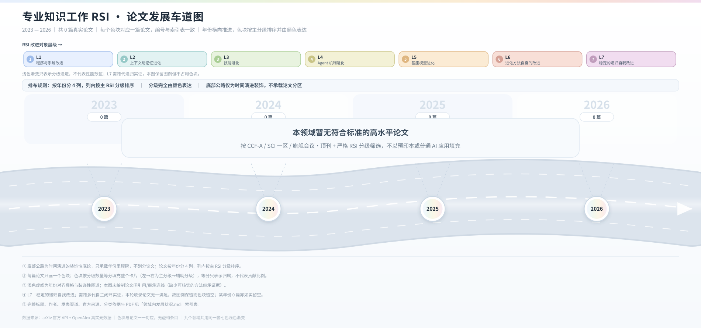

# 专业知识工作 RSI：领域内发展状况

[PNG 预览图](assets/lane_knowledge.png) ｜ 图中每个色块对应一篇真实论文，编号与下表一致 ｜ [七级配色规范](../assets/RSI_七级配色图例.svg)

> **排布规则**：论文按年份分为 4 列，列内按**主 RSI 分级**排序，分级完全由颜色表达；底部公路只是时间演进的装饰性底纹，承载年份里程碑，**不用于划分论文**（避免无语义的上下分区）。多分级论文的色块为**整块等宽填充**（左→右为主分级→辅助分级，两个分级即左右各一半），等分只表示归属，不代表贡献比例。

## 发展脉络

本领域共收录 **48 篇** 2023—2026 年的真实论文，按年份分布为 2023 年 14 篇、2024 年 7 篇、2025 年 10 篇、2026 年 17 篇。其中 39 篇为未经同行评审的预印本，48 篇已下载原文 PDF 存档。

按 RSI 主分级统计，L1（程序与系统改进）14 篇、L2（上下文与记忆进化）13 篇、L3（技能进化）1 篇、L4（Agent 机制进化）12 篇、L5（基座模型进化）4 篇、L6（进化方法自身的改进）4 篇。定位上：直接 RSI 候选 10 篇、接近 RSI 6 篇、相关基础能力 32 篇。

其中 **32 篇**为跨领域 RSI 基础方法（含 32 篇公认代表作），未绑定具体应用场景；表中「定位」列已逐篇标注，这类工作不计入本领域的应用型成果。

**成熟度判断**：本领域严格意义上「系统自主改进自身、并由改进后的系统继续推动下一轮改进」的证据仍然有限；多数工作属于反馈驱动的优化、持续学习或自主技能积累，为 RSI 提供基础能力但尚未构成稳定的递归闭环。本表逐篇区分「直接 RSI / 接近 RSI / 相关基础能力」，未把普通自动优化或一次性人工微调认定为 RSI。

## 论文索引

论文名称链接到可追溯的官方页面；下表一次性给出核实所需的全部字段（作者、改进对象、闭环、多轮迭代、分类依据、PDF）。

| 编号 | 论文名称 | 年份 | 发表渠道 | 作者 | RSI 分级 | 定位 | 改进对象 | 反馈闭环 | 多轮迭代 | 分类依据 | PDF |
|---|---|---|---|---|---|---|---|---|---|---|---|
| P01 | [CRITIC: Large Language Models Can Self-Correct with Tool-Interactive Critiquing](https://arxiv.org/abs/2305.11738) | 2023 | arXiv preprint（预印本，未经同行评审） | Zhibin Gou, Zhihong Shao, Yeyun Gong et al. | L1 | 直接 RSI（候选）；跨领域基础方法 | 程序/系统实现与算法流程 | 是 | 是 | \[跨领域通用工作\] 自我改进线索：self-improv、self-correct、self-improvement；反馈/迭代线索：feedback、progressively；L1 线索：debugg… | [2023\_CRITIC\_Large\_Language\_Models\_Can\_Self\_Correct.pdf](docs/2023_CRITIC_Large_Language_Models_Can_Self_Correct.pdf) |
| P02 | [Reflexion: Language Agents with Verbal Reinforcement Learning](https://arxiv.org/abs/2303.11366) | 2023 | neural information processing systems | Noah Shinn, Federico Cassano, Edward Berman et al. | L2 | 相关基础能力；跨领域基础方法 | 上下文、提示与记忆结构 | 是 | 未明确 | \[跨领域通用工作\] 反馈/迭代线索：feedback、subsequent；L2 线索：episodic memory、memory | [2023\_Reflexion\_Language\_Agents\_with\_Verbal\_Reinforcement.pdf](docs/2023_Reflexion_Language_Agents_with_Verbal_Reinforcement.pdf) |
| P03 | [Generative Agents: Interactive Simulacra of Human Behavior](https://arxiv.org/abs/2304.03442) | 2023 | ACM Symposium on User Interface Software and Technology (UIST) | Joon Sung Park, Joseph C. O'Brien, Carrie J. Cai et al. | L4 | 相关基础能力；跨领域基础方法 | Agent 规划、决策与协作机制 | 未明确 | 是 | \[跨领域通用工作\] 自我改进线索：reflection；L4 线索：agent architecture、planning | [2023\_Generative\_Agents\_Interactive\_Simulacra\_of\_Human.pdf](docs/2023_Generative_Agents_Interactive_Simulacra_of_Human.pdf) |
| P04 | [Language Agent Tree Search Unifies Reasoning Acting and Planning in Language Models](https://arxiv.org/abs/2310.04406) | 2023 | arXiv preprint（预印本，未经同行评审） | Andy Zhou, Kai Yan, Michal Shlapentokh-Rothman et al. | L5 | 相关基础能力；跨领域基础方法 | 模型参数与训练机制 | 是 | 未明确 | \[跨领域通用工作\] 自我改进线索：self-reflect、reflection；反馈/迭代线索：feedback；L5 线索：fine-tuning | [2023\_Language\_Agent\_Tree\_Search\_Unifies\_Reasoning\_Acting.pdf](docs/2023_Language_Agent_Tree_Search_Unifies_Reasoning_Acting.pdf) |
| P05 | [ExpeL: LLM Agents Are Experiential Learners](https://arxiv.org/abs/2308.10144) | 2023 | Proceedings of the AAAI Conference on Artificial Intelligence | Andrew Zhao, Daniel Huang, Quentin Xu et al. | L2 | 相关基础能力；跨领域基础方法 | 上下文、提示与记忆结构 | 未明确 | 未明确 | \[跨领域通用工作\] L2 线索：experience | [2023\_ExpeL\_LLM\_Agents\_Are\_Experiential\_Learners.pdf](docs/2023_ExpeL_LLM_Agents_Are_Experiential_Learners.pdf) |
| P06 | [Tree of Thoughts: Deliberate Problem Solving with Large Language Models](https://arxiv.org/abs/2305.10601) | 2023 | neural information processing systems | Shunyu Yao, Dian Yu, Jeffrey Zhao et al. | L2 | 相关基础能力；跨领域基础方法 | 上下文、提示与记忆结构 | 未明确 | 未明确 | \[跨领域通用工作\] L2 线索：prompt | [2023\_Tree\_of\_Thoughts\_Deliberate\_Problem\_Solving\_with.pdf](docs/2023_Tree_of_Thoughts_Deliberate_Problem_Solving_with.pdf) |
| P07 | [CAMEL: Communicative Agents for "Mind" Exploration of Large Language Model Society](https://arxiv.org/abs/2303.17760) | 2023 | neural information processing systems | Guohao Li, Hasan Abed Al Kader Hammoud, Hani Itani et al. | L4 | 相关基础能力；跨领域基础方法 | Agent 规划、决策与协作机制 | 未明确 | 未明确 | \[跨领域通用工作\] L4 线索：agent system、multi-agent | [2023\_CAMEL\_Communicative\_Agents\_for\_Mind\_Exploration.pdf](docs/2023_CAMEL_Communicative_Agents_for_Mind_Exploration.pdf) |
| P08 | [AutoGen: Enabling Next-Gen LLM Applications via Multi-Agent Conversation](https://arxiv.org/abs/2308.08155) | 2023 | arXiv preprint（预印本，未经同行评审） | Qingyun Wu, Gagan Bansal, Jieyu Zhang et al. | L4 | 相关基础能力；跨领域基础方法 | Agent 规划、决策与协作机制 | 未明确 | 未明确 | \[跨领域通用工作\] L4 线索：multi-agent | [2023\_AutoGen\_Enabling\_Next\_Gen\_LLM\_Applications\_via.pdf](docs/2023_AutoGen_Enabling_Next_Gen_LLM_Applications_via.pdf) |
| P09 | [MetaGPT: Meta Programming for A Multi-Agent Collaborative Framework](https://arxiv.org/abs/2308.00352) | 2023 | arXiv preprint（预印本，未经同行评审） | Sirui Hong, Mingchen Zhuge, Jiaqi Chen et al. | L4 | 相关基础能力；跨领域基础方法 | Agent 规划、决策与协作机制 | 未明确 | 未明确 | \[跨领域通用工作\] L4 线索：agent system、multi-agent | [2023\_MetaGPT\_Meta\_Programming\_for\_A\_Multi\_Agent.pdf](docs/2023_MetaGPT_Meta_Programming_for_A_Multi_Agent.pdf) |
| P10 | [Self-Discovering Interpretable Diffusion Latent Directions for Responsible Text-to-Image Generation](https://arxiv.org/abs/2311.17216) | 2023 | CVPR（作者注明：Accepted to CVPR 2024） | Hang Li, Chengzhi Shen, Philip Torr et al. | L1 | 相关基础能力；跨领域基础方法 | 程序/系统实现与算法流程 | 未明确 | 未明确 | \[跨领域通用工作\] 依据标题与摘要主题词判定 | [2023\_Self\_Discovering\_Interpretable\_Diffusion\_Latent.pdf](docs/2023_Self_Discovering_Interpretable_Diffusion_Latent.pdf) |
| P11 | [EvoPrompt: Connecting LLMs with Evolutionary Algorithms Yields Powerful Prompt Optimizers](https://arxiv.org/abs/2309.08532) | 2023 | arXiv preprint（预印本，未经同行评审） | Qingyan Guo, Rui Wang, Junliang Guo et al. | L2 | 相关基础能力；跨领域基础方法 | 上下文、提示与记忆结构 | 未明确 | 是 | \[跨领域通用工作\] 反馈/迭代线索：iterative；L2 线索：prompt、prompt optimization | [2023\_EvoPrompt\_Connecting\_LLMs\_with\_Evolutionary\_Algorithms.pdf](docs/2023_EvoPrompt_Connecting_LLMs_with_Evolutionary_Algorithms.pdf) |
| P12 | [MemGPT: Towards LLMs as Operating Systems](https://arxiv.org/abs/2310.08560) | 2023 | arXiv preprint（预印本，未经同行评审） | Charles Packer, Sarah Wooders, Kevin Lin et al. | L2 | 相关基础能力；跨领域基础方法 | 上下文、提示与记忆结构 | 未明确 | 未明确 | \[跨领域通用工作\] L2 线索：memory | [2023\_MemGPT\_Towards\_LLMs\_as\_Operating\_Systems.pdf](docs/2023_MemGPT_Towards_LLMs_as_Operating_Systems.pdf) |
| P13 | [AgentTuning: Enabling Generalized Agent Abilities for LLMs](https://arxiv.org/abs/2310.12823) | 2023 | arXiv preprint（预印本，未经同行评审） | Aohan Zeng, Mingdao Liu, Rui Lu et al. | L2 | 相关基础能力；跨领域基础方法 | 上下文、提示与记忆结构 | 未明确 | 未明确 | \[跨领域通用工作\] L2 线索：prompt | [2023\_AgentTuning\_Enabling\_Generalized\_Agent\_Abilities.pdf](docs/2023_AgentTuning_Enabling_Generalized_Agent_Abilities.pdf) |
| P14 | [AgentVerse: Facilitating Multi-Agent Collaboration and Exploring Emergent Behaviors](https://arxiv.org/abs/2308.10848) | 2023 | arXiv preprint（预印本，未经同行评审） | Weize Chen, Yusheng Su, Jingwei Zuo et al. | L4 | 相关基础能力；跨领域基础方法 | Agent 规划、决策与协作机制 | 未明确 | 未明确 | \[跨领域通用工作\] L4 线索：multi-agent | [2023\_AgentVerse\_Facilitating\_Multi\_Agent\_Collaboration.pdf](docs/2023_AgentVerse_Facilitating_Multi_Agent_Collaboration.pdf) |
| P15 | [Evaluating Large Language Models on Business Process Modeling: Framework, Benchmark, and Self-Improvement Analysis](https://arxiv.org/abs/2412.00023) | 2024 | arXiv preprint（预印本，未经同行评审） | Humam Kourani, Alessandro Berti, Daniel Schuster et al. | L1 | 接近 RSI | 程序/系统实现与算法流程 | 未明确 | 未明确 | 自我改进线索：self-improv、self-improvement、self-evaluation | [2024\_Evaluating\_Large\_Language\_Models\_on\_Business\_Process.pdf](docs/2024_Evaluating_Large_Language_Models_on_Business_Process.pdf) |
| P16 | [Agent-as-a-Judge: Evaluate Agents with Agents](https://arxiv.org/abs/2410.10934) | 2024 | arXiv preprint（预印本，未经同行评审） | Mingchen Zhuge, Changsheng Zhao, Dylan Ashley et al. | L1 | 直接 RSI（候选）；跨领域基础方法 | 程序/系统实现与算法流程 | 是 | 未明确 | \[跨领域通用工作\] 自我改进线索：self-improv、self-improvement；反馈/迭代线索：feedback；L1 线索：code generation | [2024\_Agent\_as\_a\_Judge\_Evaluate\_Agents\_with.pdf](docs/2024_Agent_as_a_Judge_Evaluate_Agents_with.pdf) |
| P17 | [Automated Design of Agentic Systems](https://arxiv.org/abs/2408.08435) | 2024 | arXiv preprint（预印本，未经同行评审） | Shengran Hu, Cong Lu, Jeff Clune | L5 | 相关基础能力；跨领域基础方法 | 模型参数与训练机制 | 未明确 | 是 | \[跨领域通用工作\] 自我改进线索：self-reflect、reflection；反馈/迭代线索：iterative、progressively；L5 线索：foundation model | [2024\_Automated\_Design\_of\_Agentic\_Systems.pdf](docs/2024_Automated_Design_of_Agentic_Systems.pdf) |
| P18 | [Automating the Enterprise with Foundation Models](https://arxiv.org/abs/2405.03710) | 2024 | arXiv preprint（预印本，未经同行评审） | Michael Wornow, Avanika Narayan, Krista Opsahl-Ong et al. | L5 | 接近 RSI | 模型参数与训练机制 | 未明确 | 未明确 | 自我改进线索：self-improv、self-improvement；L5 线索：foundation model | [2024\_Automating\_the\_Enterprise\_with\_Foundation\_Models.pdf](docs/2024_Automating_the_Enterprise_with_Foundation_Models.pdf) |
| P19 | [Self-Discover: Large Language Models Self-Compose Reasoning Structures](https://arxiv.org/abs/2402.03620) | 2024 | arXiv preprint（预印本，未经同行评审） | Pei Zhou, Jay Pujara, Xiang Ren et al. | L6 | 相关基础能力；跨领域基础方法 | 改进方法/评价与搜索策略 | 未明确 | 未明确 | \[跨领域通用工作\] L6 线索：critic | [2024\_Self\_Discover\_Large\_Language\_Models\_Self\_Compose.pdf](docs/2024_Self_Discover_Large_Language_Models_Self_Compose.pdf) |
| P20 | [MetaGPT: Merging Large Language Models Using Model Exclusive Task Arithmetic](https://arxiv.org/abs/2406.11385) | 2024 | arXiv preprint（预印本，未经同行评审） | Yuyan Zhou, Liang Song, Bingning Wang et al. | L5 | 相关基础能力；跨领域基础方法 | 模型参数与训练机制 | 未明确 | 未明确 | \[跨领域通用工作\] L5 线索：training data | [2024\_MetaGPT\_Merging\_Large\_Language\_Models\_Using\_Model.pdf](docs/2024_MetaGPT_Merging_Large_Language_Models_Using_Model.pdf) |
| P21 | [FairGen: Enhancing Fairness in Text-to-Image Diffusion Models via Self-Discovering Latent Directions](https://arxiv.org/abs/2412.18810) | 2024 | arXiv preprint（预印本，未经同行评审） | Yilei Jiang, Weihong Li, Yiyuan Zhang et al. | L1 | 相关基础能力；跨领域基础方法 | 程序/系统实现与算法流程 | 未明确 | 未明确 | \[跨领域通用工作\] 依据标题与摘要主题词判定 | [2024\_FairGen\_Enhancing\_Fairness\_in\_Text\_to\_Image.pdf](docs/2024_FairGen_Enhancing_Fairness_in_Text_to_Image.pdf) |
| P22 | [Enterprise Deep Research: Steerable Multi-Agent Deep Research for Enterprise Analytics](https://arxiv.org/abs/2510.17797) | 2025 | arXiv preprint（预印本，未经同行评审） | Akshara Prabhakar, Roshan Ram, Zixiang Chen et al. | L4 | 相关基础能力 | Agent 规划、决策与协作机制 | 是 | 未明确 | 自我改进线索：open-ended、reflection；反馈/迭代线索：loop；L4 线索：agent system、multi-agent、planning | [2025\_Enterprise\_Deep\_Research\_Steerable\_Multi\_Agent\_Deep.pdf](docs/2025_Enterprise_Deep_Research_Steerable_Multi_Agent_Deep.pdf) |
| P23 | [Legal Compliance Evaluation of Smart Contracts Generated By Large Language Models](https://arxiv.org/abs/2506.00943) | 2025 | 2025 IEEE International Conference on Blockchain and Cryptocurrency (ICBC), Pisa, Italy, 2025, pp. 1-9 | Chanuka Wijayakoon, Hai Dong, H. M. N. Dilum Bandara et al. | L1 | 接近 RSI | 程序/系统实现与算法流程 | 未明确 | 未明确 | 自我改进线索：self-improv；L1 线索：code generation | [2025\_Legal\_Compliance\_Evaluation\_of\_Smart\_Contracts\_Generated.pdf](docs/2025_Legal_Compliance_Evaluation_of_Smart_Contracts_Generated.pdf) |
| P24 | [Mind2Web 2: Evaluating Agentic Search with Agent-as-a-Judge](https://arxiv.org/abs/2506.21506) | 2025 | arXiv preprint（预印本，未经同行评审） | Boyu Gou, Zanming Huang, Yuting Ning et al. | L1 | 相关基础能力；跨领域基础方法 | 程序/系统实现与算法流程 | 未明确 | 未明确 | \[跨领域通用工作\] 自我改进线索：open-ended | [2025\_Mind2Web\_2\_Evaluating\_Agentic\_Search\_with\_Agent.pdf](docs/2025_Mind2Web_2_Evaluating_Agentic_Search_with_Agent.pdf) |
| P25 | [When AIs Judge AIs: The Rise of Agent-as-a-Judge Evaluation for LLMs](https://arxiv.org/abs/2508.02994) | 2025 | arXiv preprint（预印本，未经同行评审） | Fangyi Yu | L4 | 相关基础能力；跨领域基础方法 | Agent 规划、决策与协作机制 | 未明确 | 未明确 | \[跨领域通用工作\] 自我改进线索：open-ended；L4 线索：multi-agent | [2025\_When\_AIs\_Judge\_AIs\_The\_Rise\_of.pdf](docs/2025_When_AIs_Judge_AIs_The_Rise_of.pdf) |
| P26 | [Mitigating Manipulation and Enhancing Persuasion: A Reflective Multi-Agent Approach for Legal Argument Generation](https://arxiv.org/abs/2506.02992) | 2025 | arXiv preprint（预印本，未经同行评审） | Li Zhang, Kevin D. Ashley | L4 | 相关基础能力 | Agent 规划、决策与协作机制 | 未明确 | 是 | 自我改进线索：iterative refinement、reflection；反馈/迭代线索：iterative；L4 线索：multi-agent | [2025\_Mitigating\_Manipulation\_and\_Enhancing\_Persuasion.pdf](docs/2025_Mitigating_Manipulation_and_Enhancing_Persuasion.pdf) |
| P27 | [EvoFlow: Evolving Diverse Agentic Workflows On The Fly](https://arxiv.org/abs/2502.07373) | 2025 | arXiv preprint（预印本，未经同行评审） | Guibin Zhang, Kaijie Chen, Guancheng Wan et al. | L4 | 相关基础能力；跨领域基础方法 | Agent 规划、决策与协作机制 | 未明确 | 未明确 | \[跨领域通用工作\] L4 线索：agent system、agentic workflow、multi-agent | [2025\_EvoFlow\_Evolving\_Diverse\_Agentic\_Workflows\_On\_The.pdf](docs/2025_EvoFlow_Evolving_Diverse_Agentic_Workflows_On_The.pdf) |
| P28 | [FinResearchBench: A Logic Tree based Agent-as-a-Judge Evaluation Framework for Financial Research Agents](https://arxiv.org/abs/2507.16248) | 2025 | arXiv preprint（预印本，未经同行评审） | Rui Sun, Zuo Bai, Wentao Zhang et al. | L1 | 相关基础能力；跨领域基础方法 | 程序/系统实现与算法流程 | 未明确 | 未明确 | \[跨领域通用工作\] 依据标题与摘要主题词判定 | [2025\_FinResearchBench\_A\_Logic\_Tree\_based\_Agent\_as.pdf](docs/2025_FinResearchBench_A_Logic_Tree_based_Agent_as.pdf) |
| P29 | [Sentient Agent as a Judge: Evaluating Higher-Order Social Cognition in Large Language Models](https://arxiv.org/abs/2505.02847) | 2025 | arXiv preprint（预印本，未经同行评审） | Bang Zhang, Ruotian Ma, Qingxuan Jiang et al. | L1 | 相关基础能力；跨领域基础方法 | 程序/系统实现与算法流程 | 未明确 | 未明确 | \[跨领域通用工作\] 依据标题与摘要主题词判定 | [2025\_Sentient\_Agent\_as\_a\_Judge\_Evaluating\_Higher.pdf](docs/2025_Sentient_Agent_as_a_Judge_Evaluating_Higher.pdf) |
| P30 | [Effects of structure on reasoning in instance-level Self-Discover](https://arxiv.org/abs/2507.03347) | 2025 | arXiv preprint（预印本，未经同行评审） | Sachith Gunasekara, Yasiru Ratnayake | L1 | 相关基础能力；跨领域基础方法 | 程序/系统实现与算法流程 | 未明确 | 未明确 | \[跨领域通用工作\] 依据标题与摘要主题词判定 | [2025\_Effects\_of\_structure\_on\_reasoning\_in\_instance.pdf](docs/2025_Effects_of_structure_on_reasoning_in_instance.pdf) |
| P31 | [Can LLMs Hack Enterprise Networks? Autonomous Assumed Breach Penetration-Testing Active Directory Networks](https://arxiv.org/abs/2502.04227) | 2025 | arXiv preprint（预印本，未经同行评审） | Andreas Happe, Jürgen Cito | L6 | 相关基础能力 | 改进方法/评价与搜索策略 | 未明确 | 未明确 | 自我改进线索：self-correct；L6 线索：critic | [2025\_Can\_LLMs\_Hack\_Enterprise\_Networks\_Autonomous\_Assumed.pdf](docs/2025_Can_LLMs_Hack_Enterprise_Networks_Autonomous_Assumed.pdf) |
| P32 | [MERID: Multimodal Exploration via Recursive Self-Improvement Agents for Major Depression Analysis](https://arxiv.org/abs/2609.36235) | 2026 | arXiv preprint（预印本，未经同行评审） | Lei Liu, Zhaokang Liang, Qingcheng Zeng et al. | L2 | 直接 RSI（候选）；跨领域基础方法 | 上下文、提示与记忆结构 | 是 | 是 | \[跨领域通用工作\] 自我改进线索：self-improv、recursive、self-improvement；反馈/迭代线索：feedback、subsequent、rounds；L2 线索：exper… | [2026\_MERID\_Multimodal\_Exploration\_via\_Recursive\_Self.pdf](docs/2026_MERID_Multimodal_Exploration_via_Recursive_Self.pdf) |
| P33 | [AREX: Towards a Recursively Self-Improving Agent for Deep Research](https://arxiv.org/abs/2607.21461) | 2026 | arXiv preprint（预印本，未经同行评审） | Shuqi Lu, Chaofan Li, Kun Luo et al. | L1 | 直接 RSI（候选）；跨领域基础方法 | 程序/系统实现与算法流程 | 是 | 是 | \[跨领域通用工作\] 自我改进线索：self-improv、recursive、self-improvement；反馈/迭代线索：loop、subsequent | [2026\_AREX\_Towards\_a\_Recursively\_Self\_Improving\_Agent.pdf](docs/2026_AREX_Towards_a_Recursively_Self_Improving_Agent.pdf) |
| P34 | [Continual Harness: Online Adaptation for Self-Improving Foundation Agents](https://arxiv.org/abs/2605.09998) | 2026 | arXiv preprint（预印本，未经同行评审） | Seth Karten, Joel Zhang, Tersoo Upaa et al. | L4 | 直接 RSI（候选）；跨领域基础方法 | Agent 规划、决策与协作机制 | 是 | 是 | \[跨领域通用工作\] 自我改进线索：self-improv、self-improvement；反馈/迭代线索：iterative、iteration、loop；L4 线索：planning、scaffold | [2026\_Continual\_Harness\_Online\_Adaptation\_for\_Self\_Improving.pdf](docs/2026_Continual_Harness_Online_Adaptation_for_Self_Improving.pdf) |
| P35 | [InstAgent: A Recursively Self-Improving Agent Operating System for Heterogeneous Robot Collaboration](https://arxiv.org/abs/2610.23098) | 2026 | arXiv preprint（预印本，未经同行评审） | Haoyang Luo, Junhao Qin, Jingyan Cao et al. | L2 | 直接 RSI（候选）；跨领域基础方法 | 上下文、提示与记忆结构 | 是 | 是 | \[跨领域通用工作\] 自我改进线索：self-improv、recursive；反馈/迭代线索：feedback；L2 线索：experience、memory | [2026\_InstAgent\_A\_Recursively\_Self\_Improving\_Agent\_Operating.pdf](docs/2026_InstAgent_A_Recursively_Self_Improving_Agent_Operating.pdf) |
| P36 | [Self-discovering RL in the Era of Experience: Is Learning History an Asset or a Burden?](https://arxiv.org/abs/2609.35897) | 2026 | arXiv preprint（预印本，未经同行评审） | Haomin Luo | L2 | 直接 RSI（候选）；跨领域基础方法 | 上下文、提示与记忆结构 | 未明确 | 是 | \[跨领域通用工作\] 自我改进线索：self-improv、self-evolv、recursive；反馈/迭代线索：cumulative、rounds；L2 线索：experience | [2026\_Self\_discovering\_RL\_in\_the\_Era\_of.pdf](docs/2026_Self_discovering_RL_in_the_Era_of.pdf) |
| P37 | [LegalEvolver: Agentic Legal Judgment Prediction via Rubric-Guided Self-Evolution](https://arxiv.org/abs/2611.06381) | 2026 | arXiv preprint（预印本，未经同行评审） | Xinyu Yang, Jiejun Tan, Chenlong Deng et al. | L2 | 直接 RSI（候选） | 上下文、提示与记忆结构 | 未明确 | 是 | 自我改进线索：self-evolution；反馈/迭代线索：iterative、multi-round；L2 线索：experience、retrieval | [2026\_LegalEvolver\_Agentic\_Legal\_Judgment\_Prediction\_via.pdf](docs/2026_LegalEvolver_Agentic_Legal_Judgment_Prediction_via.pdf) |
| P38 | [Parthenon Law: A Self-Evolving Legal-Agent Framework](https://arxiv.org/abs/2606.04602) | 2026 | arXiv preprint（预印本，未经同行评审） | Hejia Geng, Leo Liu | L4 | 直接 RSI（候选） | Agent 规划、决策与协作机制 | 是 | 未明确 | 自我改进线索：self-evolv；反馈/迭代线索：loop；L4 线索：agent architecture | [2026\_Parthenon\_Law\_A\_Self\_Evolving\_Legal\_Agent.pdf](docs/2026_Parthenon_Law_A_Self_Evolving_Legal_Agent.pdf) |
| P39 | [From Process Models to Composable Agentic Workflows: Combining BPMN, Agents and Enterprise Knowledge](https://arxiv.org/abs/2611.13196) | 2026 | arXiv preprint（预印本，未经同行评审） | Christian Fillies, Jan Fillies, Frauke Weichhardt et al. | L4 | 接近 RSI | Agent 规划、决策与协作机制 | 未明确 | 是 | 自我改进线索：recursive；L4 线索：agent system、agentic workflow、multi-agent | [2026\_From\_Process\_Models\_to\_Composable\_Agentic\_Workflows.pdf](docs/2026_From_Process_Models_to_Composable_Agentic_Workflows.pdf) |
| P40 | [Unleashing the Potential of Large Language Models: A Blueprint for Real-Time, Enterprise-Ready Deployments](https://arxiv.org/abs/2608.00419) | 2026 | Computer, vol. 59, no. 4, pp. 195-199, April 2026 | Muhammad Faizan Raza, Shuo, Yang et al. | L2 | 接近 RSI | 上下文、提示与记忆结构 | 是 | 是 | 自我改进线索：continual learning、feedback loop；反馈/迭代线索：feedback、loop、continual；L2 线索：retrieval、retrieval-augm… | [2026\_Unleashing\_the\_Potential\_of\_Large\_Language\_Models.pdf](docs/2026_Unleashing_the_Potential_of_Large_Language_Models.pdf) |
| P41 | [Conversational Query Engine for Mixed-Modality Heterogeneous Enterprise Data Sources](https://arxiv.org/abs/2606.28370) | 2026 | arXiv preprint（预印本，未经同行评审） | Darshita Rathore, Vineet Kumar, Vaibhav Singal et al. | L2 | 接近 RSI | 上下文、提示与记忆结构 | 未明确 | 是 | 自我改进线索：self-correct、recursive；L2 线索：retrieval | [2026\_Conversational\_Query\_Engine\_for\_Mixed\_Modality\_Heterogeneous.pdf](docs/2026_Conversational_Query_Engine_for_Mixed_Modality_Heterogeneous.pdf) |
| P42 | [Adaptive Workflow Intelligence: A Cognitive Architecture for Context-Driven Enterprise Automation](https://arxiv.org/abs/2610.08793) | 2026 | arXiv preprint（预印本，未经同行评审） | Sreedevi Pandiyath Viswambaran | L6 | 相关基础能力 | 改进方法/评价与搜索策略 | 是 | 未明确 | 自我改进线索：reflection；反馈/迭代线索：feedback、loop；L6 线索：reflection mechanism | [2026\_Adaptive\_Workflow\_Intelligence\_A\_Cognitive\_Architecture.pdf](docs/2026_Adaptive_Workflow_Intelligence_A_Cognitive_Architecture.pdf) |
| P43 | [Legal-DC: Benchmarking Retrieval-Augmented Generation for Legal Documents](https://arxiv.org/abs/2603.11772) | 2026 | arXiv preprint（预印本，未经同行评审） | Yaocong Li, Qiang Lan, Leihan Zhang et al. | L2 | 相关基础能力 | 上下文、提示与记忆结构 | 未明确 | 未明确 | 自我改进线索：self-reflect、reflection；L2 线索：retrieval、retrieval-augmented | [2026\_Legal\_DC\_Benchmarking\_Retrieval\_Augmented\_Generation.pdf](docs/2026_Legal_DC_Benchmarking_Retrieval_Augmented_Generation.pdf) |
| P44 | [LATS-RCA: Language Agent Tree Search for Root Cause Analysis in Microservices](https://arxiv.org/abs/2605.03505) | 2026 | arXiv preprint（预印本，未经同行评审） | Alexander Naakka, Yuqing Wang, Mika V Mäntylä | L1 | 相关基础能力；跨领域基础方法 | 程序/系统实现与算法流程 | 未明确 | 是 | \[跨领域通用工作\] 自我改进线索：reflection；反馈/迭代线索：iterative | [2026\_LATS\_RCA\_Language\_Agent\_Tree\_Search\_for.pdf](docs/2026_LATS_RCA_Language_Agent_Tree_Search_for.pdf) |
| P45 | [Partner-Aware Hierarchical Skill Discovery for Robust Human-AI Collaboration](https://arxiv.org/abs/2605.24352) | 2026 | arXiv preprint（预印本，未经同行评审） | Adnan Ahmad, Bahareh Nakisa, Mohammad Naim Rastgoo | L3 | 相关基础能力 | 可复用技能/工具库 | 未明确 | 未明确 | 自我改进线索：skill discovery；L3 线索：skill、skill discovery | [2026\_Partner\_Aware\_Hierarchical\_Skill\_Discovery\_for\_Robust.pdf](docs/2026_Partner_Aware_Hierarchical_Skill_Discovery_for_Robust.pdf) |
| P46 | [Eureka: Intelligent Feature Engineering for Enterprise AI Cloud Resource Demand Prediction](https://arxiv.org/abs/2605.25297) | 2026 | Database Systems for Advanced Applications (DASFAA 2026), Lecture Notes in Computer Science, vol. 16540, pp. 528-540, Springer | Hangxuan Li, Renjun Jia, Xuezhang Wu et al. | L1 | 直接 RSI（候选） | 程序/系统实现与算法流程 | 未明确 | 是 | 自我改进线索：self-evolv；反馈/迭代线索：iterative；L1 线索：code generation | [2026\_Eureka\_Intelligent\_Feature\_Engineering\_for\_Enterprise.pdf](docs/2026_Eureka_Intelligent_Feature_Engineering_for_Enterprise.pdf) |
| P47 | [LRAS: Advanced Legal Reasoning with Agentic Search](https://arxiv.org/abs/2601.07296) | 2026 | arXiv preprint（预印本，未经同行评审） | Yujin Zhou, Chuxue Cao, Jinluan Yang et al. | L1 | 相关基础能力 | 程序/系统实现与算法流程 | 是 | 未明确 | 自我改进线索：closed-loop；反馈/迭代线索：loop | [2026\_LRAS\_Advanced\_Legal\_Reasoning\_with\_Agentic\_Search.pdf](docs/2026_LRAS_Advanced_Legal_Reasoning_with_Agentic_Search.pdf) |
| P48 | [RF-Agent: Automated Reward Function Design via Language Agent Tree Search](https://arxiv.org/abs/2602.23876) | 2026 | arXiv preprint（预印本，未经同行评审） | Ning Gao, Xiuhui Zhang, Xingyu Jiang et al. | L6 | 相关基础能力；跨领域基础方法 | 改进方法/评价与搜索策略 | 是 | 是 | \[跨领域通用工作\] 反馈/迭代线索：feedback、iterative；L6 线索：reward design | [2026\_RF\_Agent\_Automated\_Reward\_Function\_Design\_via.pdf](docs/2026_RF_Agent_Automated_Reward_Function_Design_via.pdf) |

> 说明：「直接 RSI（候选）」表示摘要同时出现明确的自我改进措辞与反馈/迭代线索，是否真正构成严格递归闭环仍需回到原文实验部分核实；「相关基础能力」不计入 RSI 成果。第 7 级（稳定的递归自我改进）需跨多代自主闭环的实证，本轮收录论文无一满足，故一律未标注。

## 目前的主要技术路线及发展趋势

- **L1 程序与系统改进**（14 篇，代表：P01、P10、P15、P16、P21、P23）：围绕程序与系统改进展开，相关工作主要体现为对该层改进对象的自主修改与反馈验证。
- **L2 上下文与记忆进化**（13 篇，代表：P02、P05、P06、P11、P12、P13）：围绕上下文与记忆进化展开，相关工作主要体现为对该层改进对象的自主修改与反馈验证。
- **L3 技能进化**（1 篇，代表：P45）：围绕技能进化展开，相关工作主要体现为对该层改进对象的自主修改与反馈验证。
- **L4 Agent 机制进化**（12 篇，代表：P03、P07、P08、P09、P14、P22）：围绕Agent 机制进化展开，相关工作主要体现为对该层改进对象的自主修改与反馈验证。
- **L5 基座模型进化**（4 篇，代表：P04、P17、P18、P20）：围绕基座模型进化展开，相关工作主要体现为对该层改进对象的自主修改与反馈验证。
- **L6 进化方法自身的改进**（4 篇，代表：P19、P31、P42、P48）：围绕进化方法自身的改进展开，相关工作主要体现为对该层改进对象的自主修改与反馈验证。
- **时间趋势**：收录论文从 2023 年的 14 篇到 2026 年的 17 篇，研究重心由一次性反馈修正逐步转向经验积累、技能库复用与改进方法本身的优化。
- **分级趋势**：主分级分布为 L1 14 篇、L2 13 篇、L3 1 篇、L4 12 篇、L5 4 篇、L6 4 篇；分级按「改进对象 + 短语级证据」判定并按词表规模归一化，避免泛词导致 L1 虚高。

## 尚未解决的关键问题

1. **闭环判定缺乏统一证据标准**：多数工作报告若干轮迭代后的性能提升，但很少验证「改进后的系统是否更擅长产生下一代改进」，这恰是 RSI 的核心判据。
2. **第 7 级证据空缺**：本领域收录论文中没有一篇提供跨多代、自主、可持续提升的递归闭环实验，因此未做任何 L7 归类。
3. **领域特有约束**：专业知识工作的效果缺少客观、即时的评价指标，反馈闭环高度依赖人工判断。
4. **评价与复现**：不同工作使用各自的任务集与指标，且预印本占比偏高，改进效果的可比性与同行评审状态需要持续跟踪。
5. **改进对象的边界**：Agent 组件优化、基座模型再训练与真正的递归自我改进常被混称，需要按「改进对象 + 改进后的系统是否参与下一轮」两层标准分别判定。
